--------------------------------------------------------------------------------

# Inputs & Outputs

src: ./inputs/
dst: ./outputs/

|    |    dist |    area |
|---:|--------:|--------:|
|  0 | 0       | 0.00049 |
|  1 | 0.06028 | 0.00015 |
|  2 | 0.06868 | 0.00011 |
|  3 | 0.07318 | 9e-05   |
|  4 | 0.08108 | 7.9e-05 |
|  5 | 0.14154 | 0.00049 |

--------------------------------------------------------------------------------

# bernoulli__Group_33__1.csv

## raw data

|   test_section |   volume |   time |   static_head |   total_head |
|---------------:|---------:|-------:|--------------:|-------------:|
|              1 |      700 |     10 |           170 |          167 |
|              2 |      700 |     10 |           160 |          168 |
|              3 |      700 |     10 |           149 |          168 |
|              4 |      700 |     10 |           137 |          169 |
|              5 |      700 |     10 |           121 |          168 |
|              6 |      700 |     10 |           135 |          155 |

## SI units data

|   test_section |    dist |    area |   flow_rate |   velocity |   pressure_head |   velocity_head |   calculated_total_head |   measured_total_head |
|---------------:|--------:|--------:|------------:|-----------:|----------------:|----------------:|------------------------:|----------------------:|
|              1 | 0       | 0.00049 |       7e-05 |   0.142857 |           0.17  |      0.00104017 |                0.17104  |                 0.167 |
|              2 | 0.06028 | 0.00015 |       7e-05 |   0.466667 |           0.16  |      0.0110998  |                0.1711   |                 0.168 |
|              3 | 0.06868 | 0.00011 |       7e-05 |   0.636364 |           0.149 |      0.0206401  |                0.16964  |                 0.168 |
|              4 | 0.07318 | 9e-05   |       7e-05 |   0.777778 |           0.137 |      0.0308327  |                0.167833 |                 0.169 |
|              5 | 0.08108 | 7.9e-05 |       7e-05 |   0.886076 |           0.121 |      0.0400168  |                0.161017 |                 0.168 |
|              6 | 0.14154 | 0.00049 |       7e-05 |   0.142857 |           0.135 |      0.00104017 |                0.13604  |                 0.155 |

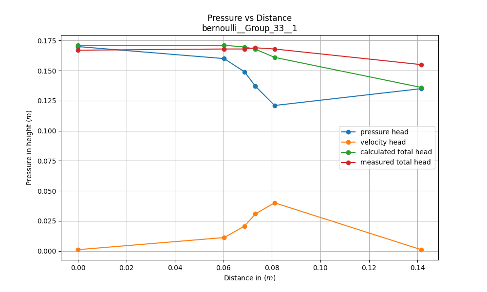

--------------------------------------------------------------------------------

# bernoulli__Group_33__2.csv

## raw data

|   test_section |   volume |   time |   static_head |   total_head |
|---------------:|---------:|-------:|--------------:|-------------:|
|              1 |      960 |     10 |           185 |          185 |
|              2 |      960 |     10 |           166 |          185 |
|              3 |      960 |     10 |           150 |          185 |
|              4 |      960 |     10 |           130 |          185 |
|              5 |      960 |     10 |            96 |          185 |
|              6 |      960 |     10 |           130 |          155 |

## SI units data

|   test_section |    dist |    area |   flow_rate |   velocity |   pressure_head |   velocity_head |   calculated_total_head |   measured_total_head |
|---------------:|--------:|--------:|------------:|-----------:|----------------:|----------------:|------------------------:|----------------------:|
|              1 | 0       | 0.00049 |     9.6e-05 |   0.195918 |           0.185 |      0.00195637 |                0.186956 |                 0.185 |
|              2 | 0.06028 | 0.00015 |     9.6e-05 |   0.64     |           0.166 |      0.0208767  |                0.186877 |                 0.185 |
|              3 | 0.06868 | 0.00011 |     9.6e-05 |   0.872727 |           0.15  |      0.0388202  |                0.18882  |                 0.185 |
|              4 | 0.07318 | 9e-05   |     9.6e-05 |   1.06667  |           0.13  |      0.0579907  |                0.187991 |                 0.185 |
|              5 | 0.08108 | 7.9e-05 |     9.6e-05 |   1.21519  |           0.096 |      0.0752643  |                0.171264 |                 0.185 |
|              6 | 0.14154 | 0.00049 |     9.6e-05 |   0.195918 |           0.13  |      0.00195637 |                0.131956 |                 0.155 |

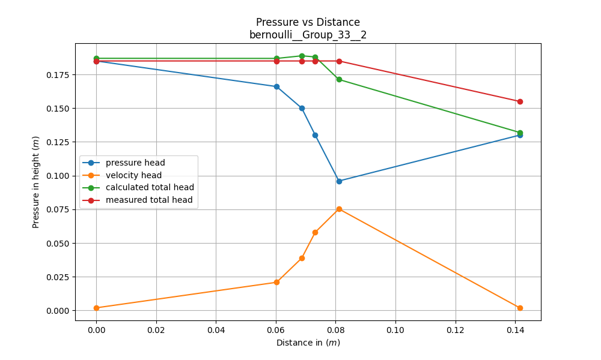

--------------------------------------------------------------------------------

# bernoulli__Group_33__3.csv

## raw data

|   test_section |   volume |   time |   static_head |   total_head |
|---------------:|---------:|-------:|--------------:|-------------:|
|              1 |     1250 |     10 |           219 |          218 |
|              2 |     1250 |     10 |           185 |          219 |
|              3 |     1250 |     10 |           150 |          220 |
|              4 |     1250 |     10 |           112 |          220 |
|              5 |     1250 |     10 |            47 |          220 |
|              6 |     1250 |     10 |           127 |          165 |

## SI units data

|   test_section |    dist |    area |   flow_rate |   velocity |   pressure_head |   velocity_head |   calculated_total_head |   measured_total_head |
|---------------:|--------:|--------:|------------:|-----------:|----------------:|----------------:|------------------------:|----------------------:|
|              1 | 0       | 0.00049 |    0.000125 |   0.255102 |           0.219 |      0.00331687 |                0.222317 |                 0.218 |
|              2 | 0.06028 | 0.00015 |    0.000125 |   0.833333 |           0.185 |      0.0353947  |                0.220395 |                 0.219 |
|              3 | 0.06868 | 0.00011 |    0.000125 |   1.13636  |           0.15  |      0.0658166  |                0.215817 |                 0.22  |
|              4 | 0.07318 | 9e-05   |    0.000125 |   1.38889  |           0.112 |      0.0983187  |                0.210319 |                 0.22  |
|              5 | 0.08108 | 7.9e-05 |    0.000125 |   1.58228  |           0.047 |      0.127605   |                0.174605 |                 0.22  |
|              6 | 0.14154 | 0.00049 |    0.000125 |   0.255102 |           0.127 |      0.00331687 |                0.130317 |                 0.165 |

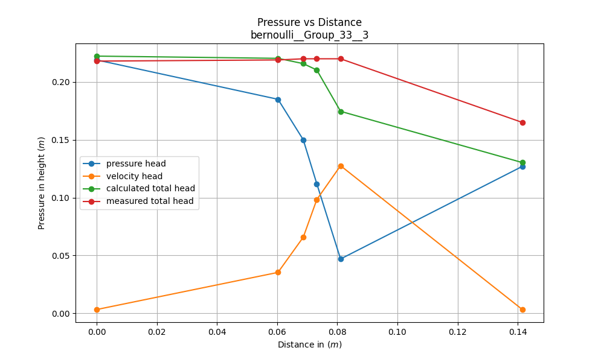

--------------------------------------------------------------------------------

# bernoulli__Group_34__1.csv

## raw data

|   test_section |   volume |   time |   static_head |   total_head |
|---------------:|---------:|-------:|--------------:|-------------:|
|              1 |      820 |     10 |           160 |          166 |
|              2 |      820 |     10 |           145 |          160 |
|              3 |      820 |     10 |           130 |          160 |
|              4 |      820 |     10 |           115 |          158 |
|              5 |      820 |     10 |            92 |          158 |
|              6 |      820 |     10 |           116 |          135 |

## SI units data

|   test_section |    dist |    area |   flow_rate |   velocity |   pressure_head |   velocity_head |   calculated_total_head |   measured_total_head |
|---------------:|--------:|--------:|------------:|-----------:|----------------:|----------------:|------------------------:|----------------------:|
|              1 | 0       | 0.00049 |     8.2e-05 |   0.167347 |           0.16  |      0.00142737 |                0.161427 |                 0.166 |
|              2 | 0.06028 | 0.00015 |     8.2e-05 |   0.546667 |           0.145 |      0.0152316  |                0.160232 |                 0.16  |
|              3 | 0.06868 | 0.00011 |     8.2e-05 |   0.745455 |           0.13  |      0.0283233  |                0.158323 |                 0.16  |
|              4 | 0.07318 | 9e-05   |     8.2e-05 |   0.911111 |           0.115 |      0.0423101  |                0.15731  |                 0.158 |
|              5 | 0.08108 | 7.9e-05 |     8.2e-05 |   1.03797  |           0.092 |      0.0549129  |                0.146913 |                 0.158 |
|              6 | 0.14154 | 0.00049 |     8.2e-05 |   0.167347 |           0.116 |      0.00142737 |                0.117427 |                 0.135 |

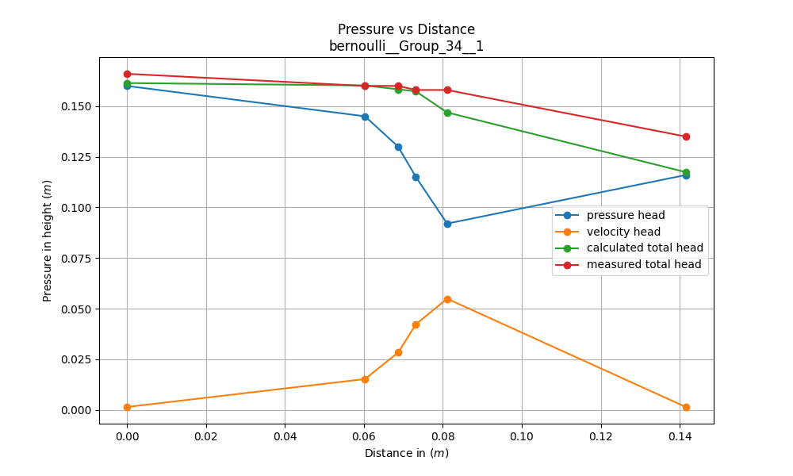

--------------------------------------------------------------------------------

# bernoulli__Group_34__2.csv

## raw data

|   test_section |   volume |   time |   static_head |   total_head |
|---------------:|---------:|-------:|--------------:|-------------:|
|              1 |     1060 |     10 |           175 |          175 |
|              2 |     1060 |     10 |           154 |          175 |
|              3 |     1060 |     10 |           131 |          175 |
|              4 |     1060 |     10 |           110 |          175 |
|              5 |     1060 |     10 |            78 |          175 |
|              6 |     1060 |     10 |           114 |          135 |

## SI units data

|   test_section |    dist |    area |   flow_rate |   velocity |   pressure_head |   velocity_head |   calculated_total_head |   measured_total_head |
|---------------:|--------:|--------:|------------:|-----------:|----------------:|----------------:|------------------------:|----------------------:|
|              1 | 0       | 0.00049 |    0.000106 |   0.216327 |           0.175 |      0.00238518 |                0.177385 |                 0.175 |
|              2 | 0.06028 | 0.00015 |    0.000106 |   0.706667 |           0.154 |      0.0254525  |                0.179452 |                 0.175 |
|              3 | 0.06868 | 0.00011 |    0.000106 |   0.963636 |           0.131 |      0.047329   |                0.178329 |                 0.175 |
|              4 | 0.07318 | 9e-05   |    0.000106 |   1.17778  |           0.11  |      0.0707014  |                0.180701 |                 0.175 |
|              5 | 0.08108 | 7.9e-05 |    0.000106 |   1.34177  |           0.078 |      0.0917611  |                0.169761 |                 0.175 |
|              6 | 0.14154 | 0.00049 |    0.000106 |   0.216327 |           0.114 |      0.00238518 |                0.116385 |                 0.135 |

--------------------------------------------------------------------------------

# bernoulli__Group_34__3.csv

## raw data

|   test_section |   volume |   time |   static_head |   total_head |
|---------------:|---------:|-------:|--------------:|-------------:|
|              1 |     1370 |     10 |           208 |          205 |
|              2 |     1370 |     10 |           170 |          206 |
|              3 |     1370 |     10 |           132 |          206 |
|              4 |     1370 |     10 |           100 |          206 |
|              5 |     1370 |     10 |            45 |          205 |
|              6 |     1370 |     10 |           110 |          130 |

## SI units data

|   test_section |    dist |    area |   flow_rate |   velocity |   pressure_head |   velocity_head |   calculated_total_head |   measured_total_head |
|---------------:|--------:|--------:|------------:|-----------:|----------------:|----------------:|------------------------:|----------------------:|
|              1 | 0       | 0.00049 |    0.000137 |   0.279592 |           0.208 |      0.00398428 |                0.211984 |                 0.205 |
|              2 | 0.06028 | 0.00015 |    0.000137 |   0.913333 |           0.17  |      0.0425167  |                0.212517 |                 0.206 |
|              3 | 0.06868 | 0.00011 |    0.000137 |   1.24545  |           0.132 |      0.07906    |                0.21106  |                 0.206 |
|              4 | 0.07318 | 9e-05   |    0.000137 |   1.52222  |           0.1   |      0.118102   |                0.218102 |                 0.206 |
|              5 | 0.08108 | 7.9e-05 |    0.000137 |   1.73418  |           0.045 |      0.153281   |                0.198281 |                 0.205 |
|              6 | 0.14154 | 0.00049 |    0.000137 |   0.279592 |           0.11  |      0.00398428 |                0.113984 |                 0.13  |

--------------------------------------------------------------------------------

# bernoulli__Group_35__1.csv

## raw data

|   test_section |   volume |   time |   static_head |   total_head |
|---------------:|---------:|-------:|--------------:|-------------:|
|              1 |      640 |     10 |           180 |          172 |
|              2 |      640 |     10 |           168 |          173 |
|              3 |      640 |     10 |           150 |          173 |
|              4 |      640 |     10 |           145 |          172 |
|              5 |      640 |     10 |           121 |          172 |
|              6 |      640 |     10 |           150 |          163 |

## SI units data

|   test_section |    dist |    area |   flow_rate |   velocity |   pressure_head |   velocity_head |   calculated_total_head |   measured_total_head |
|---------------:|--------:|--------:|------------:|-----------:|----------------:|----------------:|------------------------:|----------------------:|
|              1 | 0       | 0.00049 |     6.4e-05 |   0.130612 |           0.18  |     0.000869498 |                0.180869 |                 0.172 |
|              2 | 0.06028 | 0.00015 |     6.4e-05 |   0.426667 |           0.168 |     0.00927851  |                0.177279 |                 0.173 |
|              3 | 0.06868 | 0.00011 |     6.4e-05 |   0.581818 |           0.15  |     0.0172534   |                0.167253 |                 0.173 |
|              4 | 0.07318 | 9e-05   |     6.4e-05 |   0.711111 |           0.145 |     0.0257736   |                0.170774 |                 0.172 |
|              5 | 0.08108 | 7.9e-05 |     6.4e-05 |   0.810127 |           0.121 |     0.0334508   |                0.154451 |                 0.172 |
|              6 | 0.14154 | 0.00049 |     6.4e-05 |   0.130612 |           0.15  |     0.000869498 |                0.150869 |                 0.163 |

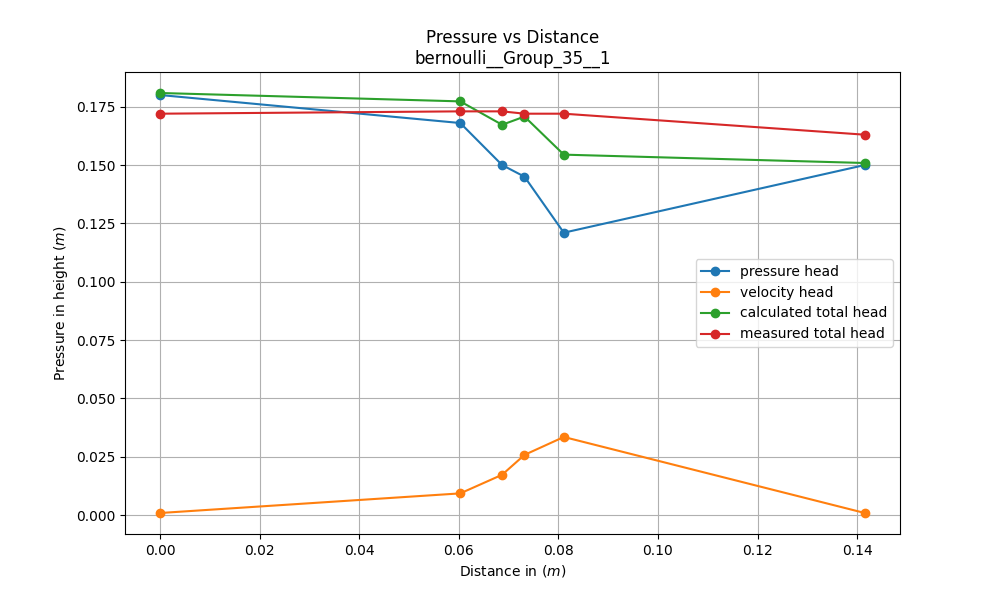

--------------------------------------------------------------------------------

# bernoulli__Group_35__2.csv

## raw data

|   test_section |   volume |   time |   static_head |   total_head |
|---------------:|---------:|-------:|--------------:|-------------:|
|              1 |     1180 |     10 |           210 |          215 |
|              2 |     1180 |     10 |           185 |          217 |
|              3 |     1180 |     10 |           155 |          217 |
|              4 |     1180 |     10 |           120 |          218 |
|              5 |     1180 |     10 |            83 |          215 |
|              6 |     1180 |     10 |           130 |          160 |

## SI units data

|   test_section |    dist |    area |   flow_rate |   velocity |   pressure_head |   velocity_head |   calculated_total_head |   measured_total_head |
|---------------:|--------:|--------:|------------:|-----------:|----------------:|----------------:|------------------------:|----------------------:|
|              1 | 0       | 0.00049 |    0.000118 |   0.240816 |           0.21  |      0.00295579 |                0.212956 |                 0.215 |
|              2 | 0.06028 | 0.00015 |    0.000118 |   0.786667 |           0.185 |      0.0315415  |                0.216542 |                 0.217 |
|              3 | 0.06868 | 0.00011 |    0.000118 |   1.07273  |           0.155 |      0.0586516  |                0.213652 |                 0.217 |
|              4 | 0.07318 | 9e-05   |    0.000118 |   1.31111  |           0.12  |      0.0876153  |                0.207615 |                 0.218 |
|              5 | 0.08108 | 7.9e-05 |    0.000118 |   1.49367  |           0.083 |      0.113713   |                0.196713 |                 0.215 |
|              6 | 0.14154 | 0.00049 |    0.000118 |   0.240816 |           0.13  |      0.00295579 |                0.132956 |                 0.16  |

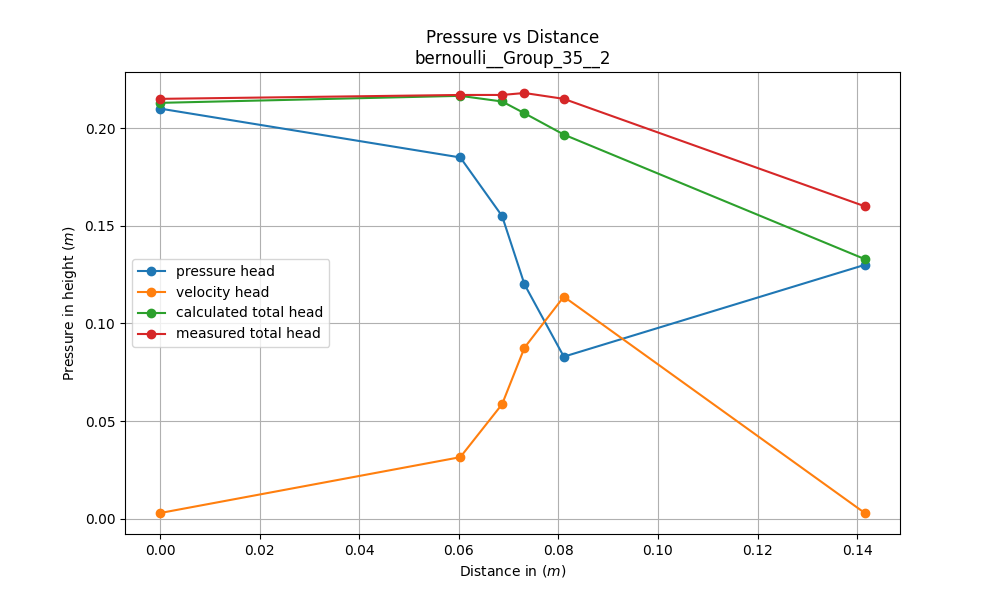

--------------------------------------------------------------------------------

# bernoulli__Group_35__3.csv

## raw data

|   test_section |   volume |   time |   static_head |   total_head |
|---------------:|---------:|-------:|--------------:|-------------:|
|              1 |     1530 |     10 |           262 |          260 |
|              2 |     1530 |     10 |           215 |          261 |
|              3 |     1530 |     10 |           165 |          260 |
|              4 |     1530 |     10 |           117 |          260 |
|              5 |     1530 |     10 |            55 |          255 |
|              6 |     1530 |     10 |           132 |          162 |

## SI units data

|   test_section |    dist |    area |   flow_rate |   velocity |   pressure_head |   velocity_head |   calculated_total_head |   measured_total_head |
|---------------:|--------:|--------:|------------:|-----------:|----------------:|----------------:|------------------------:|----------------------:|
|              1 | 0       | 0.00049 |    0.000153 |   0.312245 |           0.262 |      0.00496926 |                0.266969 |                 0.26  |
|              2 | 0.06028 | 0.00015 |    0.000153 |   1.02     |           0.215 |      0.0530275  |                0.268028 |                 0.261 |
|              3 | 0.06868 | 0.00011 |    0.000153 |   1.39091  |           0.165 |      0.0986049  |                0.263605 |                 0.26  |
|              4 | 0.07318 | 9e-05   |    0.000153 |   1.7      |           0.117 |      0.147299   |                0.264299 |                 0.26  |
|              5 | 0.08108 | 7.9e-05 |    0.000153 |   1.93671  |           0.055 |      0.191174   |                0.246174 |                 0.255 |
|              6 | 0.14154 | 0.00049 |    0.000153 |   0.312245 |           0.132 |      0.00496926 |                0.136969 |                 0.162 |

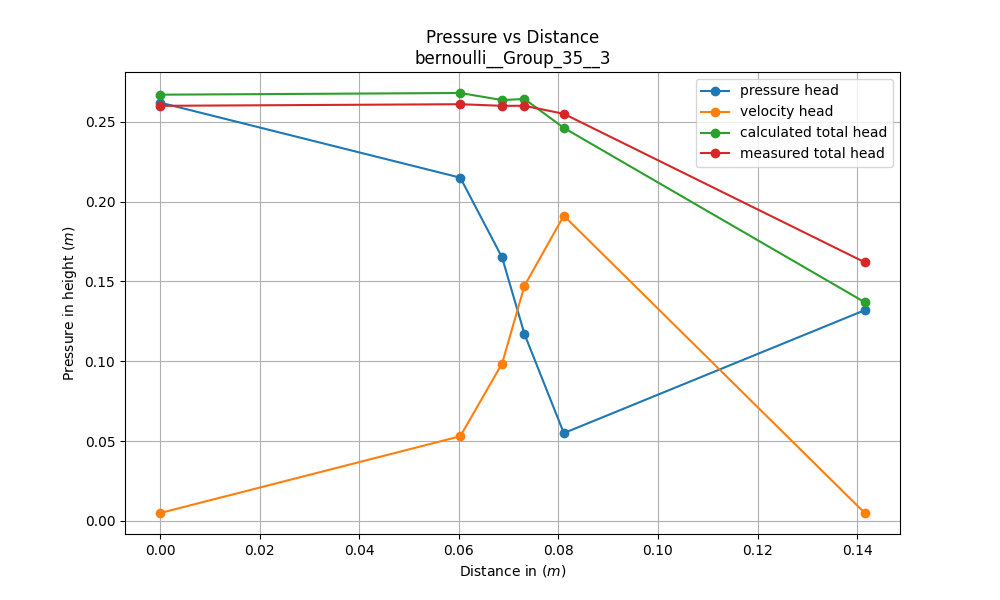

--------------------------------------------------------------------------------

# bernoulli__Group_36__1.csv

## raw data

|   test_section |   volume |   time |   static_head |   total_head |
|---------------:|---------:|-------:|--------------:|-------------:|
|              1 |     1340 |     10 |           230 |          230 |
|              2 |     1340 |     10 |           190 |          230 |
|              3 |     1340 |     10 |           150 |          230 |
|              4 |     1340 |     10 |           120 |          230 |
|              5 |     1340 |     10 |            65 |          230 |
|              6 |     1340 |     10 |           120 |          165 |

## SI units data

|   test_section |    dist |    area |   flow_rate |   velocity |   pressure_head |   velocity_head |   calculated_total_head |   measured_total_head |
|---------------:|--------:|--------:|------------:|-----------:|----------------:|----------------:|------------------------:|----------------------:|
|              1 | 0       | 0.00049 |    0.000134 |   0.273469 |           0.23  |       0.0038117 |                0.233812 |                 0.23  |
|              2 | 0.06028 | 0.00015 |    0.000134 |   0.893333 |           0.19  |       0.040675  |                0.230675 |                 0.23  |
|              3 | 0.06868 | 0.00011 |    0.000134 |   1.21818  |           0.15  |       0.0756354 |                0.225635 |                 0.23  |
|              4 | 0.07318 | 9e-05   |    0.000134 |   1.48889  |           0.12  |       0.112986  |                0.232986 |                 0.23  |
|              5 | 0.08108 | 7.9e-05 |    0.000134 |   1.6962   |           0.065 |       0.146641  |                0.211641 |                 0.23  |
|              6 | 0.14154 | 0.00049 |    0.000134 |   0.273469 |           0.12  |       0.0038117 |                0.123812 |                 0.165 |

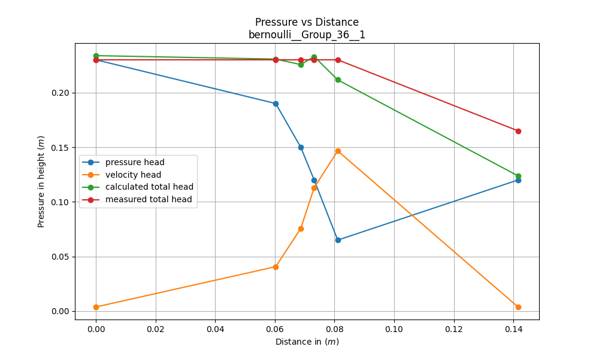

--------------------------------------------------------------------------------

# bernoulli__Group_36__2.csv

## raw data

|   test_section |   volume |   time |   static_head |   total_head |
|---------------:|---------:|-------:|--------------:|-------------:|
|              1 |      780 |     10 |           185 |          185 |
|              2 |      780 |     10 |           170 |          185 |
|              3 |      780 |     10 |           155 |          185 |
|              4 |      780 |     10 |           140 |          185 |
|              5 |      780 |     10 |           120 |          185 |
|              6 |      780 |     10 |           135 |          165 |

## SI units data

|   test_section |    dist |    area |   flow_rate |   velocity |   pressure_head |   velocity_head |   calculated_total_head |   measured_total_head |
|---------------:|--------:|--------:|------------:|-----------:|----------------:|----------------:|------------------------:|----------------------:|
|              1 | 0       | 0.00049 |     7.8e-05 |   0.159184 |           0.185 |      0.00129151 |                0.186292 |                 0.185 |
|              2 | 0.06028 | 0.00015 |     7.8e-05 |   0.52     |           0.17  |      0.0137819  |                0.183782 |                 0.185 |
|              3 | 0.06868 | 0.00011 |     7.8e-05 |   0.709091 |           0.155 |      0.0256274  |                0.180627 |                 0.185 |
|              4 | 0.07318 | 9e-05   |     7.8e-05 |   0.866667 |           0.14  |      0.0382829  |                0.178283 |                 0.185 |
|              5 | 0.08108 | 7.9e-05 |     7.8e-05 |   0.987342 |           0.12  |      0.0496862  |                0.169686 |                 0.185 |
|              6 | 0.14154 | 0.00049 |     7.8e-05 |   0.159184 |           0.135 |      0.00129151 |                0.136292 |                 0.165 |

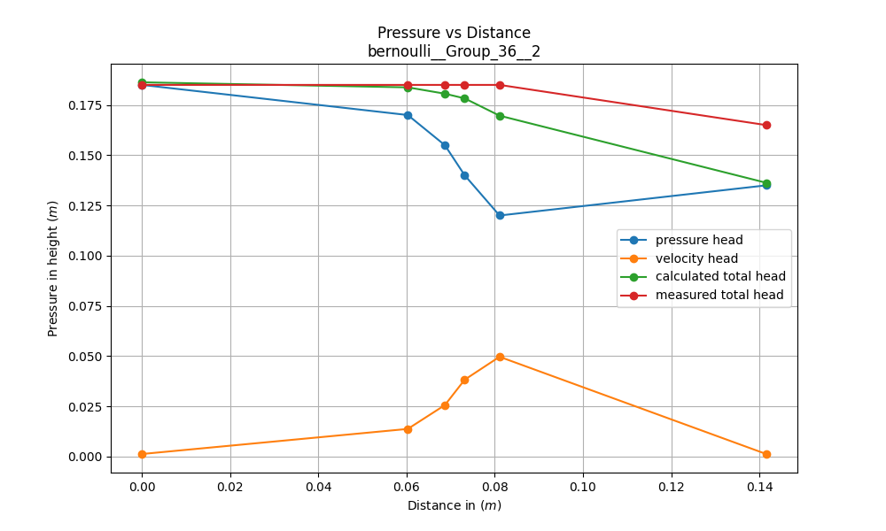

--------------------------------------------------------------------------------

# bernoulli__Group_36__3.csv

## raw data

|   test_section |   volume |   time |   static_head |   total_head |
|---------------:|---------:|-------:|--------------:|-------------:|
|              1 |      940 |     10 |           190 |          195 |
|              2 |      940 |     10 |           175 |          195 |
|              3 |      940 |     10 |           155 |          195 |
|              4 |      940 |     10 |           135 |          195 |
|              5 |      940 |     10 |           110 |          195 |
|              6 |      940 |     10 |           135 |          165 |

## SI units data

|   test_section |    dist |    area |   flow_rate |   velocity |   pressure_head |   velocity_head |   calculated_total_head |   measured_total_head |
|---------------:|--------:|--------:|------------:|-----------:|----------------:|----------------:|------------------------:|----------------------:|
|              1 | 0       | 0.00049 |     9.4e-05 |   0.191837 |           0.19  |      0.00187571 |                0.191876 |                 0.195 |
|              2 | 0.06028 | 0.00015 |     9.4e-05 |   0.626667 |           0.175 |      0.0200159  |                0.195016 |                 0.195 |
|              3 | 0.06868 | 0.00011 |     9.4e-05 |   0.854545 |           0.155 |      0.0372196  |                0.19222  |                 0.195 |
|              4 | 0.07318 | 9e-05   |     9.4e-05 |   1.04444  |           0.135 |      0.0555996  |                0.1906   |                 0.195 |
|              5 | 0.08108 | 7.9e-05 |     9.4e-05 |   1.18987  |           0.11  |      0.072161   |                0.182161 |                 0.195 |
|              6 | 0.14154 | 0.00049 |     9.4e-05 |   0.191837 |           0.135 |      0.00187571 |                0.136876 |                 0.165 |

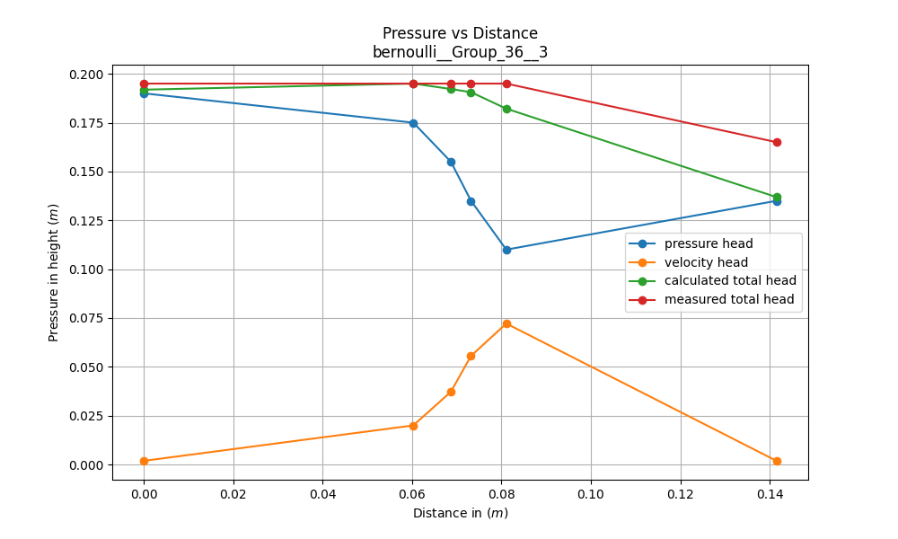

--------------------------------------------------------------------------------

# bernoulli__Group_37__1.csv

## raw data

|   test_section |   volume |   time |   static_head |   total_head |
|---------------:|---------:|-------:|--------------:|-------------:|
|              1 |      460 |  10.02 |           173 |          173 |
|              2 |      460 |  10.02 |           167 |          171 |
|              3 |      460 |  10.02 |           164 |          170 |
|              4 |      460 |  10.02 |           159 |          170 |
|              5 |      460 |  10.02 |           155 |          170 |
|              6 |      460 |  10.02 |           158 |          166 |

## SI units data

|   test_section |    dist |    area |   flow_rate |   velocity |   pressure_head |   velocity_head |   calculated_total_head |   measured_total_head |
|---------------:|--------:|--------:|------------:|-----------:|----------------:|----------------:|------------------------:|----------------------:|
|              1 | 0       | 0.00049 | 4.59082e-05 |  0.0936902 |           0.173 |     0.000447393 |                0.173447 |                 0.173 |
|              2 | 0.06028 | 0.00015 | 4.59082e-05 |  0.306055  |           0.167 |     0.00477418  |                0.171774 |                 0.171 |
|              3 | 0.06868 | 0.00011 | 4.59082e-05 |  0.417347  |           0.164 |     0.00887761  |                0.172878 |                 0.17  |
|              4 | 0.07318 | 9e-05   | 4.59082e-05 |  0.510091  |           0.159 |     0.0132616   |                0.172262 |                 0.17  |
|              5 | 0.08108 | 7.9e-05 | 4.59082e-05 |  0.581116  |           0.155 |     0.0172118   |                0.172212 |                 0.17  |
|              6 | 0.14154 | 0.00049 | 4.59082e-05 |  0.0936902 |           0.158 |     0.000447393 |                0.158447 |                 0.166 |

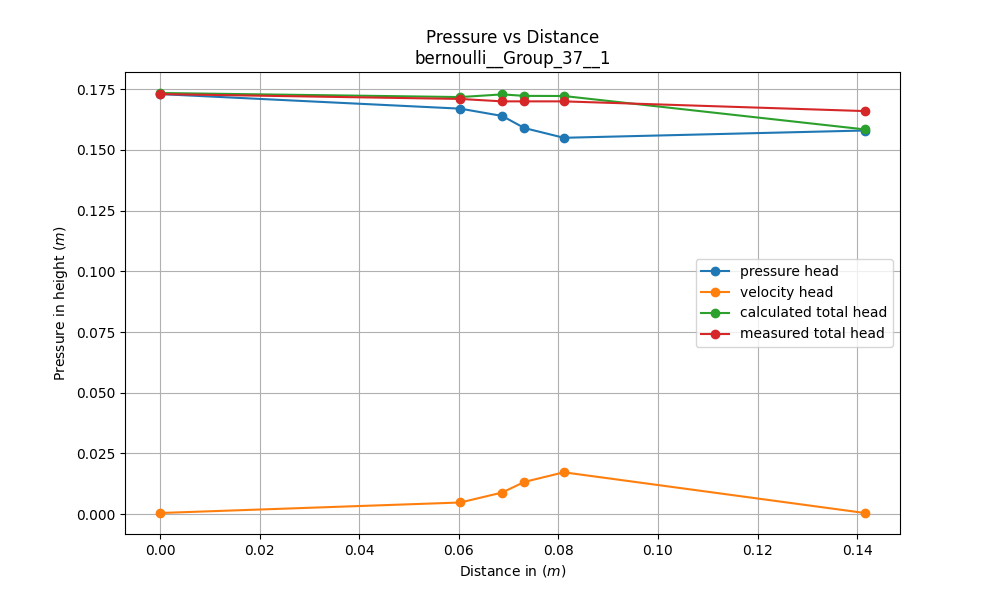

--------------------------------------------------------------------------------

# bernoulli__Group_37__2.csv

## raw data

|   test_section |   volume |   time |   static_head |   total_head |
|---------------:|---------:|-------:|--------------:|-------------:|
|              1 |      750 |  10.64 |           186 |          185 |
|              2 |      750 |  10.64 |           174 |          185 |
|              3 |      750 |  10.64 |           162 |          185 |
|              4 |      750 |  10.64 |           149 |          184 |
|              5 |      750 |  10.64 |           130 |          184 |
|              6 |      750 |  10.64 |           167 |          170 |

## SI units data

|   test_section |    dist |    area |   flow_rate |   velocity |   pressure_head |   velocity_head |   calculated_total_head |   measured_total_head |
|---------------:|--------:|--------:|------------:|-----------:|----------------:|----------------:|------------------------:|----------------------:|
|              1 | 0       | 0.00049 | 7.04887e-05 |   0.143855 |           0.186 |      0.00105475 |                0.187055 |                 0.185 |
|              2 | 0.06028 | 0.00015 | 7.04887e-05 |   0.469925 |           0.174 |      0.0112553  |                0.185255 |                 0.185 |
|              3 | 0.06868 | 0.00011 | 7.04887e-05 |   0.640807 |           0.162 |      0.0209293  |                0.182929 |                 0.185 |
|              4 | 0.07318 | 9e-05   | 7.04887e-05 |   0.783208 |           0.149 |      0.0312648  |                0.180265 |                 0.184 |
|              5 | 0.08108 | 7.9e-05 | 7.04887e-05 |   0.892262 |           0.13  |      0.0405776  |                0.170578 |                 0.184 |
|              6 | 0.14154 | 0.00049 | 7.04887e-05 |   0.143855 |           0.167 |      0.00105475 |                0.168055 |                 0.17  |

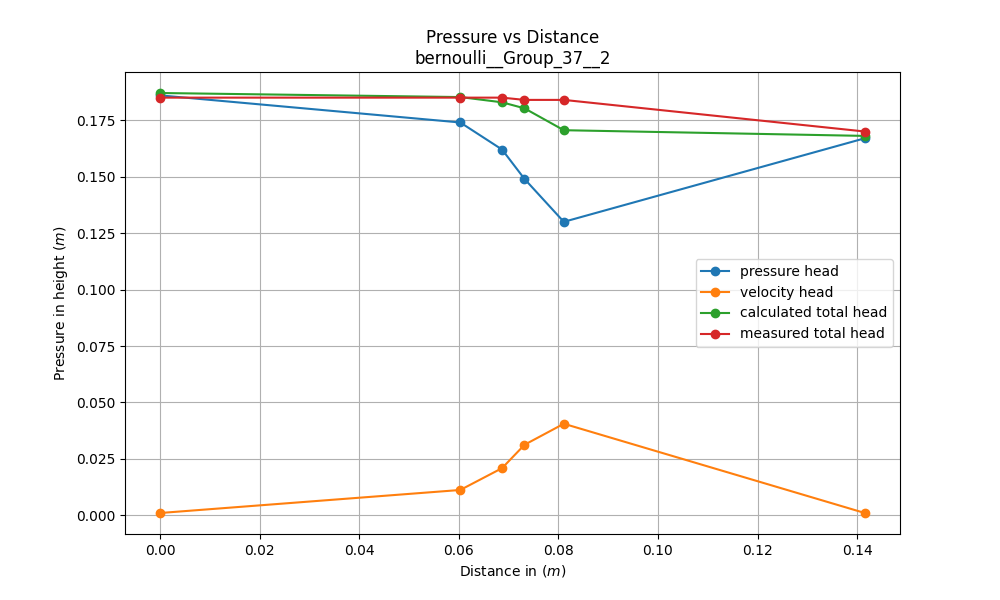

--------------------------------------------------------------------------------

# bernoulli__Group_37__3.csv

## raw data

|   test_section |   volume |   time |   static_head |   total_head |
|---------------:|---------:|-------:|--------------:|-------------:|
|              1 |      740 |  10.34 |           185 |          184 |
|              2 |      740 |  10.34 |           174 |          184 |
|              3 |      740 |  10.34 |           163 |          184 |
|              4 |      740 |  10.34 |           150 |          184 |
|              5 |      740 |  10.34 |           133 |          184 |
|              6 |      740 |  10.34 |           165 |          170 |

## SI units data

|   test_section |    dist |    area |   flow_rate |   velocity |   pressure_head |   velocity_head |   calculated_total_head |   measured_total_head |
|---------------:|--------:|--------:|------------:|-----------:|----------------:|----------------:|------------------------:|----------------------:|
|              1 | 0       | 0.00049 | 7.15667e-05 |   0.146055 |           0.185 |      0.00108725 |                0.186087 |                 0.184 |
|              2 | 0.06028 | 0.00015 | 7.15667e-05 |   0.477112 |           0.174 |      0.0116022  |                0.185602 |                 0.184 |
|              3 | 0.06868 | 0.00011 | 7.15667e-05 |   0.650607 |           0.163 |      0.0215744  |                0.184574 |                 0.184 |
|              4 | 0.07318 | 9e-05   | 7.15667e-05 |   0.795186 |           0.15  |      0.0322284  |                0.182228 |                 0.184 |
|              5 | 0.08108 | 7.9e-05 | 7.15667e-05 |   0.905908 |           0.133 |      0.0418282  |                0.174828 |                 0.184 |
|              6 | 0.14154 | 0.00049 | 7.15667e-05 |   0.146055 |           0.165 |      0.00108725 |                0.166087 |                 0.17  |

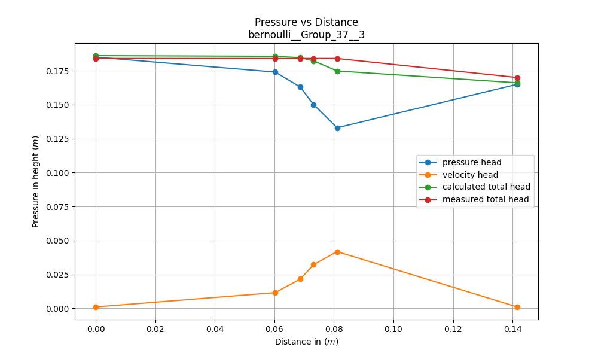

--------------------------------------------------------------------------------

# bernoulli__Group_38__1.csv

## raw data

|   test_section |   volume |   time |   static_head |   total_head |
|---------------:|---------:|-------:|--------------:|-------------:|
|              1 |      645 |     10 |           187 |          185 |
|              2 |      645 |     10 |           177 |          185 |
|              3 |      645 |     10 |           168 |          185 |
|              4 |      645 |     10 |           159 |          185 |
|              5 |      645 |     10 |           146 |          185 |
|              6 |      645 |     10 |           159 |          172 |

## SI units data

|   test_section |    dist |    area |   flow_rate |   velocity |   pressure_head |   velocity_head |   calculated_total_head |   measured_total_head |
|---------------:|--------:|--------:|------------:|-----------:|----------------:|----------------:|------------------------:|----------------------:|
|              1 | 0       | 0.00049 |    6.45e-05 |   0.131633 |           0.187 |     0.000883137 |                0.187883 |                 0.185 |
|              2 | 0.06028 | 0.00015 |    6.45e-05 |   0.43     |           0.177 |     0.00942406  |                0.186424 |                 0.185 |
|              3 | 0.06868 | 0.00011 |    6.45e-05 |   0.586364 |           0.168 |     0.0175241   |                0.185524 |                 0.185 |
|              4 | 0.07318 | 9e-05   |    6.45e-05 |   0.716667 |           0.159 |     0.0261779   |                0.185178 |                 0.185 |
|              5 | 0.08108 | 7.9e-05 |    6.45e-05 |   0.816456 |           0.146 |     0.0339755   |                0.179976 |                 0.185 |
|              6 | 0.14154 | 0.00049 |    6.45e-05 |   0.131633 |           0.159 |     0.000883137 |                0.159883 |                 0.172 |

--------------------------------------------------------------------------------

# bernoulli__Group_38__2.csv

## raw data

|   test_section |   volume |   time |   static_head |   total_head |
|---------------:|---------:|-------:|--------------:|-------------:|
|              1 |      760 |     10 |           194 |          193 |
|              2 |      760 |     10 |           181 |          193 |
|              3 |      760 |     10 |           170 |          193 |
|              4 |      760 |     10 |           154 |          193 |
|              5 |      760 |     10 |           145 |          193 |
|              6 |      760 |     10 |           159 |          175 |

## SI units data

|   test_section |    dist |    area |   flow_rate |   velocity |   pressure_head |   velocity_head |   calculated_total_head |   measured_total_head |
|---------------:|--------:|--------:|------------:|-----------:|----------------:|----------------:|------------------------:|----------------------:|
|              1 | 0       | 0.00049 |     7.6e-05 |   0.155102 |           0.194 |      0.00122613 |                0.195226 |                 0.193 |
|              2 | 0.06028 | 0.00015 |     7.6e-05 |   0.506667 |           0.181 |      0.0130842  |                0.194084 |                 0.193 |
|              3 | 0.06868 | 0.00011 |     7.6e-05 |   0.690909 |           0.17  |      0.02433    |                0.19433  |                 0.193 |
|              4 | 0.07318 | 9e-05   |     7.6e-05 |   0.844444 |           0.154 |      0.0363449  |                0.190345 |                 0.193 |
|              5 | 0.08108 | 7.9e-05 |     7.6e-05 |   0.962025 |           0.145 |      0.0471709  |                0.192171 |                 0.193 |
|              6 | 0.14154 | 0.00049 |     7.6e-05 |   0.155102 |           0.159 |      0.00122613 |                0.160226 |                 0.175 |

--------------------------------------------------------------------------------

# bernoulli__Group_38__3.csv

## raw data

|   test_section |   volume |   time |   static_head |   total_head |
|---------------:|---------:|-------:|--------------:|-------------:|
|              1 |      875 |     10 |           205 |          202 |
|              2 |      875 |     10 |           187 |          202 |
|              3 |      875 |     10 |           172 |          202 |
|              4 |      875 |     10 |           157 |          202 |
|              5 |      875 |     10 |           137 |          201 |
|              6 |      875 |     10 |           159 |          175 |

## SI units data

|   test_section |    dist |    area |   flow_rate |   velocity |   pressure_head |   velocity_head |   calculated_total_head |   measured_total_head |
|---------------:|--------:|--------:|------------:|-----------:|----------------:|----------------:|------------------------:|----------------------:|
|              1 | 0       | 0.00049 |    8.75e-05 |   0.178571 |           0.205 |      0.00162527 |                0.206625 |                 0.202 |
|              2 | 0.06028 | 0.00015 |    8.75e-05 |   0.583333 |           0.187 |      0.0173434  |                0.204343 |                 0.202 |
|              3 | 0.06868 | 0.00011 |    8.75e-05 |   0.795455 |           0.172 |      0.0322501  |                0.20425  |                 0.202 |
|              4 | 0.07318 | 9e-05   |    8.75e-05 |   0.972222 |           0.157 |      0.0481761  |                0.205176 |                 0.202 |
|              5 | 0.08108 | 7.9e-05 |    8.75e-05 |   1.10759  |           0.137 |      0.0625263  |                0.199526 |                 0.201 |
|              6 | 0.14154 | 0.00049 |    8.75e-05 |   0.178571 |           0.159 |      0.00162527 |                0.160625 |                 0.175 |

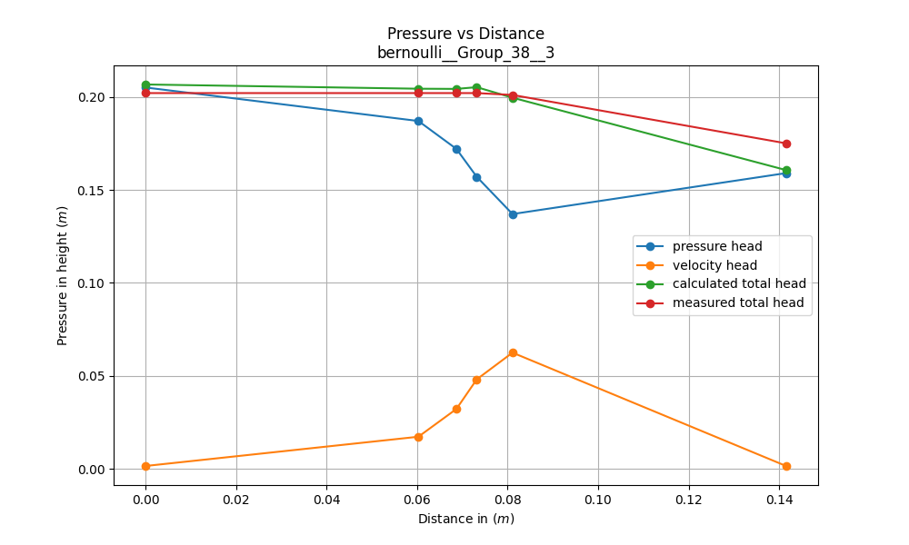

--------------------------------------------------------------------------------

# bernoulli__Group_39__1.csv

## raw data

|   test_section |   volume |   time |   static_head |   total_head |
|---------------:|---------:|-------:|--------------:|-------------:|
|              1 |      805 |  10.08 |           159 |          159 |
|              2 |      805 |  10.08 |           146 |          158 |
|              3 |      805 |  10.08 |           143 |          158 |
|              4 |      805 |  10.08 |           118 |          158 |
|              5 |      805 |  10.08 |            99 |          156 |
|              6 |      805 |  10.08 |           117 |          141 |

## SI units data

|   test_section |    dist |    area |   flow_rate |   velocity |   pressure_head |   velocity_head |   calculated_total_head |   measured_total_head |
|---------------:|--------:|--------:|------------:|-----------:|----------------:|----------------:|------------------------:|----------------------:|
|              1 | 0       | 0.00049 | 7.98611e-05 |   0.162982 |           0.159 |      0.00135388 |                0.160354 |                 0.159 |
|              2 | 0.06028 | 0.00015 | 7.98611e-05 |   0.532407 |           0.146 |      0.0144474  |                0.160447 |                 0.158 |
|              3 | 0.06868 | 0.00011 | 7.98611e-05 |   0.72601  |           0.143 |      0.026865   |                0.169865 |                 0.158 |
|              4 | 0.07318 | 9e-05   | 7.98611e-05 |   0.887346 |           0.118 |      0.0401316  |                0.158132 |                 0.158 |
|              5 | 0.08108 | 7.9e-05 | 7.98611e-05 |   1.0109   |           0.099 |      0.0520856  |                0.151086 |                 0.156 |
|              6 | 0.14154 | 0.00049 | 7.98611e-05 |   0.162982 |           0.117 |      0.00135388 |                0.118354 |                 0.141 |

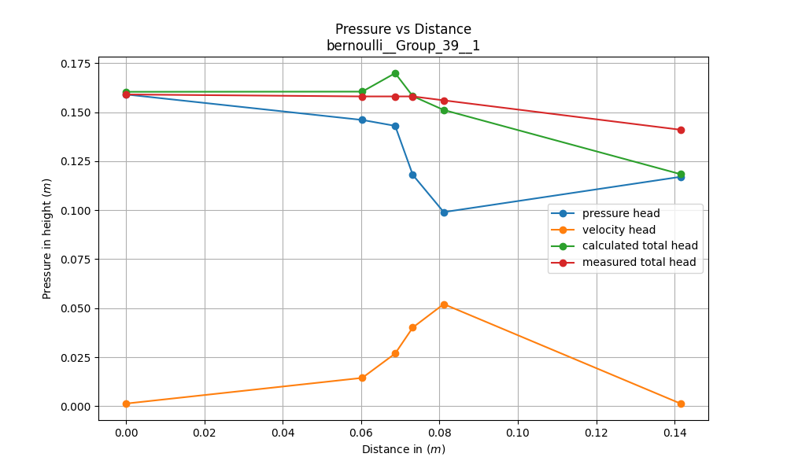

--------------------------------------------------------------------------------

# bernoulli__Group_39__2.csv

## raw data

|   test_section |   volume |   time |   static_head |   total_head |
|---------------:|---------:|-------:|--------------:|-------------:|
|              1 |     1180 |  10.29 |           180 |          181 |
|              2 |     1180 |  10.29 |           156 |          181 |
|              3 |     1180 |  10.29 |           134 |          181 |
|              4 |     1180 |  10.29 |           109 |          180 |
|              5 |     1180 |  10.29 |            71 |          179 |
|              6 |     1180 |  10.29 |           110 |          140 |

## SI units data

|   test_section |    dist |    area |   flow_rate |   velocity |   pressure_head |   velocity_head |   calculated_total_head |   measured_total_head |
|---------------:|--------:|--------:|------------:|-----------:|----------------:|----------------:|------------------------:|----------------------:|
|              1 | 0       | 0.00049 | 0.000114674 |   0.234029 |           0.18  |      0.00279153 |                0.182792 |                 0.181 |
|              2 | 0.06028 | 0.00015 | 0.000114674 |   0.764496 |           0.156 |      0.0297887  |                0.185789 |                 0.181 |
|              3 | 0.06868 | 0.00011 | 0.000114674 |   1.04249  |           0.134 |      0.0553922  |                0.189392 |                 0.181 |
|              4 | 0.07318 | 9e-05   | 0.000114674 |   1.27416  |           0.109 |      0.0827464  |                0.191746 |                 0.18  |
|              5 | 0.08108 | 7.9e-05 | 0.000114674 |   1.45158  |           0.071 |      0.107394   |                0.178394 |                 0.179 |
|              6 | 0.14154 | 0.00049 | 0.000114674 |   0.234029 |           0.11  |      0.00279153 |                0.112792 |                 0.14  |

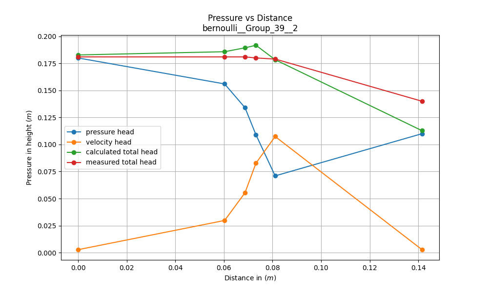

--------------------------------------------------------------------------------

# bernoulli__Group_39__3.csv

## raw data

|   test_section |   volume |   time |   static_head |   total_head |
|---------------:|---------:|-------:|--------------:|-------------:|
|              1 |     1295 |  10.05 |           217 |          220 |
|              2 |     1295 |  10.05 |           180 |          220 |
|              3 |     1295 |  10.05 |           142 |          219 |
|              4 |     1295 |  10.05 |           101 |          217 |
|              5 |     1295 |  10.05 |            47 |          214 |
|              6 |     1295 |  10.05 |           121 |          144 |

## SI units data

|   test_section |    dist |    area |   flow_rate |   velocity |   pressure_head |   velocity_head |   calculated_total_head |   measured_total_head |
|---------------:|--------:|--------:|------------:|-----------:|----------------:|----------------:|------------------------:|----------------------:|
|              1 | 0       | 0.00049 | 0.000128856 |   0.262971 |           0.217 |      0.00352465 |                0.220525 |                 0.22  |
|              2 | 0.06028 | 0.00015 | 0.000128856 |   0.859038 |           0.18  |      0.037612   |                0.217612 |                 0.22  |
|              3 | 0.06868 | 0.00011 | 0.000128856 |   1.17142  |           0.142 |      0.0699396  |                0.21194  |                 0.219 |
|              4 | 0.07318 | 9e-05   | 0.000128856 |   1.43173  |           0.101 |      0.104478   |                0.205478 |                 0.217 |
|              5 | 0.08108 | 7.9e-05 | 0.000128856 |   1.63109  |           0.047 |      0.135598   |                0.182598 |                 0.214 |
|              6 | 0.14154 | 0.00049 | 0.000128856 |   0.262971 |           0.121 |      0.00352465 |                0.124525 |                 0.144 |

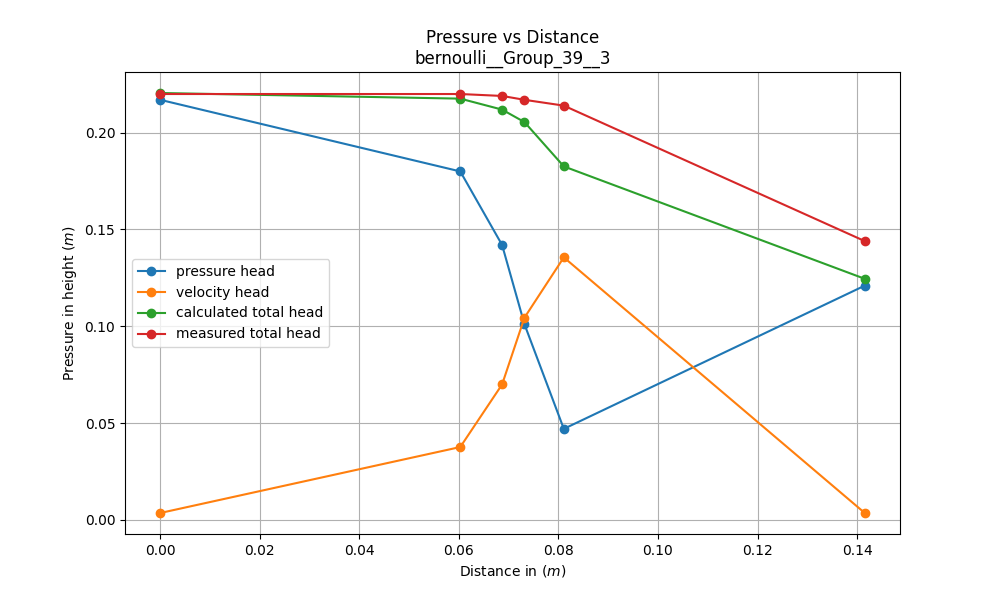

--------------------------------------------------------------------------------

# bernoulli__Group_40__1.csv

## raw data

|   test_section |   volume |   time |   static_head |   total_head |
|---------------:|---------:|-------:|--------------:|-------------:|
|              1 |      720 |     10 |           164 |          164 |
|              2 |      720 |     10 |           153 |          164 |
|              3 |      720 |     10 |           142 |          163 |
|              4 |      720 |     10 |           131 |          163 |
|              5 |      720 |     10 |           115 |          162 |
|              6 |      720 |     10 |           130 |          147 |

## SI units data

|   test_section |    dist |    area |   flow_rate |   velocity |   pressure_head |   velocity_head |   calculated_total_head |   measured_total_head |
|---------------:|--------:|--------:|------------:|-----------:|----------------:|----------------:|------------------------:|----------------------:|
|              1 | 0       | 0.00049 |     7.2e-05 |   0.146939 |           0.164 |      0.00110046 |                0.1651   |                 0.164 |
|              2 | 0.06028 | 0.00015 |     7.2e-05 |   0.48     |           0.153 |      0.0117431  |                0.164743 |                 0.164 |
|              3 | 0.06868 | 0.00011 |     7.2e-05 |   0.654545 |           0.142 |      0.0218364  |                0.163836 |                 0.163 |
|              4 | 0.07318 | 9e-05   |     7.2e-05 |   0.8      |           0.131 |      0.0326198  |                0.16362  |                 0.163 |
|              5 | 0.08108 | 7.9e-05 |     7.2e-05 |   0.911392 |           0.115 |      0.0423362  |                0.157336 |                 0.162 |
|              6 | 0.14154 | 0.00049 |     7.2e-05 |   0.146939 |           0.13  |      0.00110046 |                0.1311   |                 0.147 |

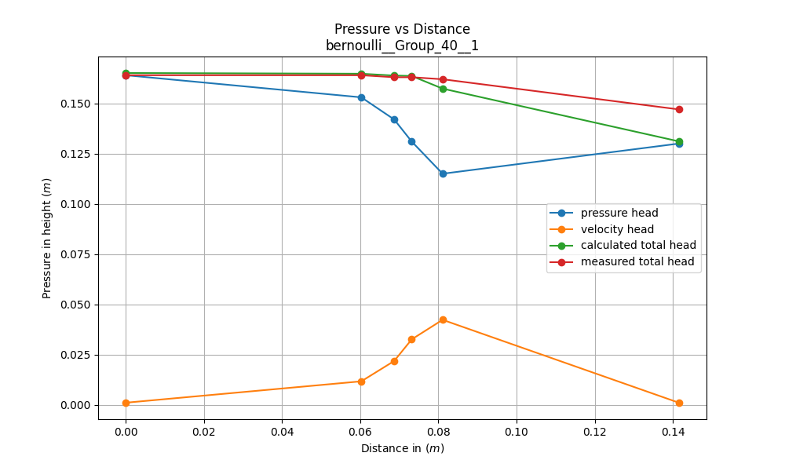

--------------------------------------------------------------------------------

# bernoulli__Group_40__2.csv

## raw data

|   test_section |   volume |   time |   static_head |   total_head |
|---------------:|---------:|-------:|--------------:|-------------:|
|              1 |      740 |     10 |           164 |          164 |
|              2 |      740 |     10 |           153 |          163 |
|              3 |      740 |     10 |           142 |          163 |
|              4 |      740 |     10 |           132 |          162 |
|              5 |      740 |     10 |           115 |          162 |
|              6 |      740 |     10 |           131 |          148 |

## SI units data

|   test_section |    dist |    area |   flow_rate |   velocity |   pressure_head |   velocity_head |   calculated_total_head |   measured_total_head |
|---------------:|--------:|--------:|------------:|-----------:|----------------:|----------------:|------------------------:|----------------------:|
|              1 | 0       | 0.00049 |     7.4e-05 |   0.15102  |           0.164 |      0.00116244 |                0.165162 |                 0.164 |
|              2 | 0.06028 | 0.00015 |     7.4e-05 |   0.493333 |           0.153 |      0.0124046  |                0.165405 |                 0.163 |
|              3 | 0.06868 | 0.00011 |     7.4e-05 |   0.672727 |           0.142 |      0.0230664  |                0.165066 |                 0.163 |
|              4 | 0.07318 | 9e-05   |     7.4e-05 |   0.822222 |           0.132 |      0.0344572  |                0.166457 |                 0.162 |
|              5 | 0.08108 | 7.9e-05 |     7.4e-05 |   0.936709 |           0.115 |      0.0447209  |                0.159721 |                 0.162 |
|              6 | 0.14154 | 0.00049 |     7.4e-05 |   0.15102  |           0.131 |      0.00116244 |                0.132162 |                 0.148 |

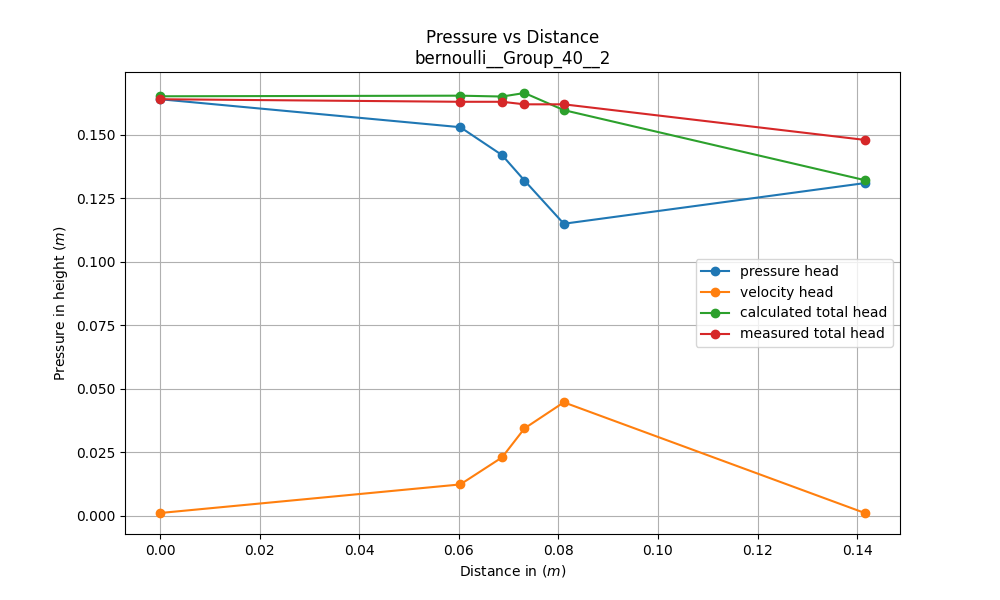

--------------------------------------------------------------------------------

# bernoulli__Group_40__3.csv

## raw data

|   test_section |   volume |   time |   static_head |   total_head |
|---------------:|---------:|-------:|--------------:|-------------:|
|              1 |     1240 |     10 |           231 |          232 |
|              2 |     1240 |     10 |           196 |          230 |
|              3 |     1240 |     10 |           161 |          230 |
|              4 |     1240 |     10 |           127 |          229 |
|              5 |     1240 |     10 |            76 |          226 |
|              6 |     1240 |     10 |           141 |          165 |

## SI units data

|   test_section |    dist |    area |   flow_rate |   velocity |   pressure_head |   velocity_head |   calculated_total_head |   measured_total_head |
|---------------:|--------:|--------:|------------:|-----------:|----------------:|----------------:|------------------------:|----------------------:|
|              1 | 0       | 0.00049 |    0.000124 |   0.253061 |           0.231 |      0.00326402 |                0.234264 |                 0.232 |
|              2 | 0.06028 | 0.00015 |    0.000124 |   0.826667 |           0.196 |      0.0348307  |                0.230831 |                 0.23  |
|              3 | 0.06868 | 0.00011 |    0.000124 |   1.12727  |           0.161 |      0.0647678  |                0.225768 |                 0.23  |
|              4 | 0.07318 | 9e-05   |    0.000124 |   1.37778  |           0.127 |      0.0967519  |                0.223752 |                 0.229 |
|              5 | 0.08108 | 7.9e-05 |    0.000124 |   1.56962  |           0.076 |      0.125571   |                0.201571 |                 0.226 |
|              6 | 0.14154 | 0.00049 |    0.000124 |   0.253061 |           0.141 |      0.00326402 |                0.144264 |                 0.165 |

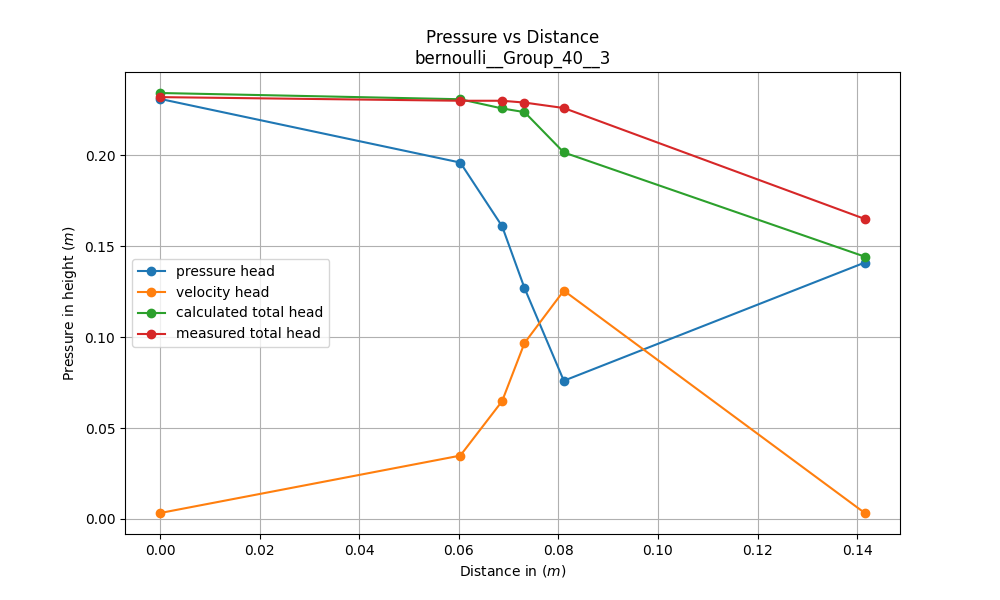

--------------------------------------------------------------------------------

# bernoulli__Group_41__1.csv

## raw data

|   test_section |   volume |   time |   static_head |   total_head |
|---------------:|---------:|-------:|--------------:|-------------:|
|              1 |     1210 |     10 |           210 |          217 |
|              2 |     1210 |     10 |           185 |          216 |
|              3 |     1210 |     10 |           165 |          216 |
|              4 |     1210 |     10 |           138 |          216 |
|              5 |     1210 |     10 |            87 |          198 |
|              6 |     1210 |     10 |           133 |          168 |

## SI units data

|   test_section |    dist |    area |   flow_rate |   velocity |   pressure_head |   velocity_head |   calculated_total_head |   measured_total_head |
|---------------:|--------:|--------:|------------:|-----------:|----------------:|----------------:|------------------------:|----------------------:|
|              1 | 0       | 0.00049 |    0.000121 |   0.246939 |           0.21  |      0.00310799 |                0.213108 |                 0.217 |
|              2 | 0.06028 | 0.00015 |    0.000121 |   0.806667 |           0.185 |      0.0331657  |                0.218166 |                 0.216 |
|              3 | 0.06868 | 0.00011 |    0.000121 |   1.1      |           0.165 |      0.0616718  |                0.226672 |                 0.216 |
|              4 | 0.07318 | 9e-05   |    0.000121 |   1.34444  |           0.138 |      0.092127   |                0.230127 |                 0.216 |
|              5 | 0.08108 | 7.9e-05 |    0.000121 |   1.53165  |           0.087 |      0.119569   |                0.206569 |                 0.198 |
|              6 | 0.14154 | 0.00049 |    0.000121 |   0.246939 |           0.133 |      0.00310799 |                0.136108 |                 0.168 |

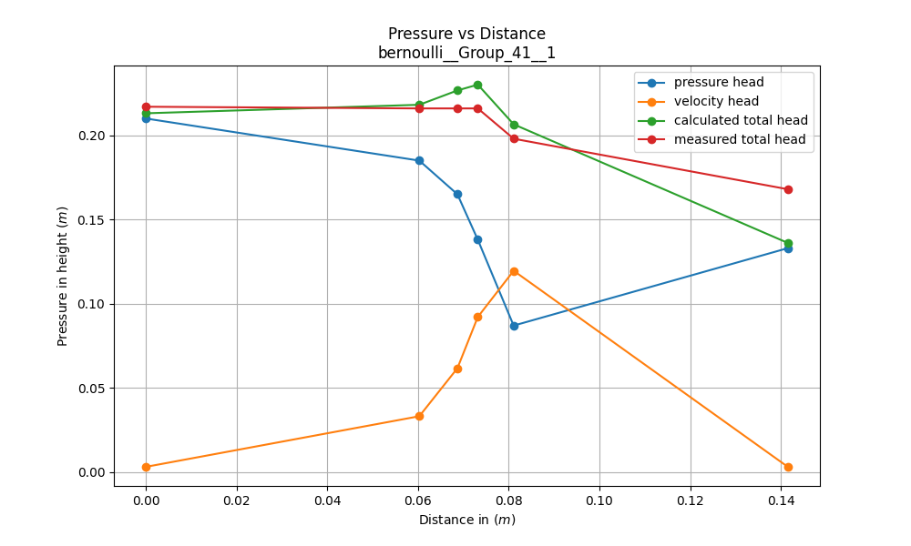

--------------------------------------------------------------------------------

# bernoulli__Group_41__2.csv

## raw data

|   test_section |   volume |   time |   static_head |   total_head |
|---------------:|---------:|-------:|--------------:|-------------:|
|              1 |      770 |     10 |           185 |          194 |
|              2 |      770 |     10 |           175 |          194 |
|              3 |      770 |     10 |           166 |          194 |
|              4 |      770 |     10 |           153 |          194 |
|              5 |      770 |     10 |           110 |          175 |
|              6 |      770 |     10 |           142 |          158 |

## SI units data

|   test_section |    dist |    area |   flow_rate |   velocity |   pressure_head |   velocity_head |   calculated_total_head |   measured_total_head |
|---------------:|--------:|--------:|------------:|-----------:|----------------:|----------------:|------------------------:|----------------------:|
|              1 | 0       | 0.00049 |     7.7e-05 |   0.157143 |           0.185 |      0.00125861 |                0.186259 |                 0.194 |
|              2 | 0.06028 | 0.00015 |     7.7e-05 |   0.513333 |           0.175 |      0.0134307  |                0.188431 |                 0.194 |
|              3 | 0.06868 | 0.00011 |     7.7e-05 |   0.7      |           0.166 |      0.0249745  |                0.190975 |                 0.194 |
|              4 | 0.07318 | 9e-05   |     7.7e-05 |   0.855556 |           0.153 |      0.0373076  |                0.190308 |                 0.194 |
|              5 | 0.08108 | 7.9e-05 |     7.7e-05 |   0.974684 |           0.11  |      0.0484204  |                0.15842  |                 0.175 |
|              6 | 0.14154 | 0.00049 |     7.7e-05 |   0.157143 |           0.142 |      0.00125861 |                0.143259 |                 0.158 |

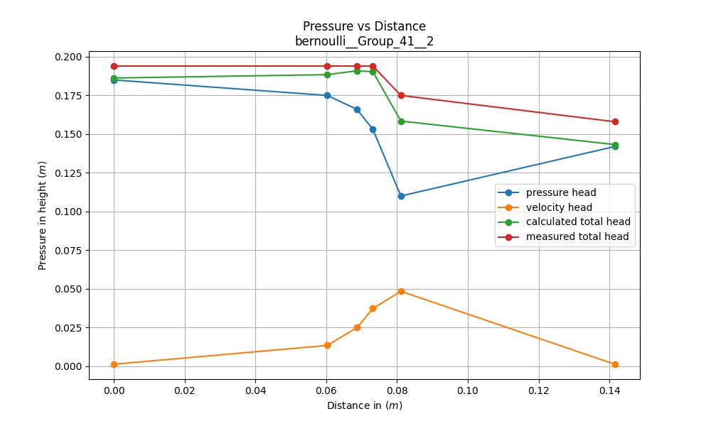

--------------------------------------------------------------------------------

# bernoulli__Group_41__3.csv

## raw data

|   test_section |   volume |   time |   static_head |   total_head |
|---------------:|---------:|-------:|--------------:|-------------:|
|              1 |      986 |     10 |           195 |          200 |
|              2 |      986 |     10 |           180 |          200 |
|              3 |      986 |     10 |           162 |          200 |
|              4 |      986 |     10 |           140 |          200 |
|              5 |      986 |     10 |            98 |          178 |
|              6 |      986 |     10 |           119 |          165 |

## SI units data

|   test_section |    dist |    area |   flow_rate |   velocity |   pressure_head |   velocity_head |   calculated_total_head |   measured_total_head |
|---------------:|--------:|--------:|------------:|-----------:|----------------:|----------------:|------------------------:|----------------------:|
|              1 | 0       | 0.00049 |    9.86e-05 |   0.201224 |           0.195 |      0.00206378 |                0.197064 |                 0.2   |
|              2 | 0.06028 | 0.00015 |    9.86e-05 |   0.657333 |           0.18  |      0.0220228  |                0.202023 |                 0.2   |
|              3 | 0.06868 | 0.00011 |    9.86e-05 |   0.896364 |           0.162 |      0.0409515  |                0.202951 |                 0.2   |
|              4 | 0.07318 | 9e-05   |    9.86e-05 |   1.09556  |           0.14  |      0.0611744  |                0.201174 |                 0.2   |
|              5 | 0.08108 | 7.9e-05 |    9.86e-05 |   1.2481   |           0.098 |      0.0793964  |                0.177396 |                 0.178 |
|              6 | 0.14154 | 0.00049 |    9.86e-05 |   0.201224 |           0.119 |      0.00206378 |                0.121064 |                 0.165 |

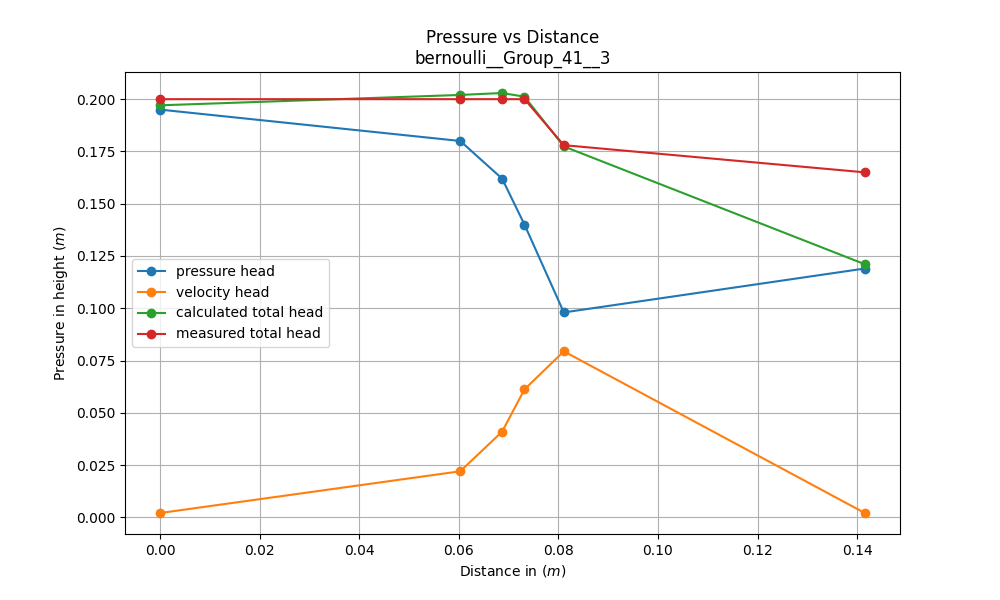

--------------------------------------------------------------------------------

# bernoulli__Group_42__1.csv

## raw data

|   test_section |   volume |   time |   static_head |   total_head |
|---------------:|---------:|-------:|--------------:|-------------:|
|              1 |      875 |     10 |           205 |          202 |
|              2 |      875 |     10 |           187 |          202 |
|              3 |      875 |     10 |           172 |          202 |
|              4 |      875 |     10 |           157 |          202 |
|              5 |      875 |     10 |           137 |          201 |
|              6 |      875 |     10 |           159 |          175 |

## SI units data

|   test_section |    dist |    area |   flow_rate |   velocity |   pressure_head |   velocity_head |   calculated_total_head |   measured_total_head |
|---------------:|--------:|--------:|------------:|-----------:|----------------:|----------------:|------------------------:|----------------------:|
|              1 | 0       | 0.00049 |    8.75e-05 |   0.178571 |           0.205 |      0.00162527 |                0.206625 |                 0.202 |
|              2 | 0.06028 | 0.00015 |    8.75e-05 |   0.583333 |           0.187 |      0.0173434  |                0.204343 |                 0.202 |
|              3 | 0.06868 | 0.00011 |    8.75e-05 |   0.795455 |           0.172 |      0.0322501  |                0.20425  |                 0.202 |
|              4 | 0.07318 | 9e-05   |    8.75e-05 |   0.972222 |           0.157 |      0.0481761  |                0.205176 |                 0.202 |
|              5 | 0.08108 | 7.9e-05 |    8.75e-05 |   1.10759  |           0.137 |      0.0625263  |                0.199526 |                 0.201 |
|              6 | 0.14154 | 0.00049 |    8.75e-05 |   0.178571 |           0.159 |      0.00162527 |                0.160625 |                 0.175 |

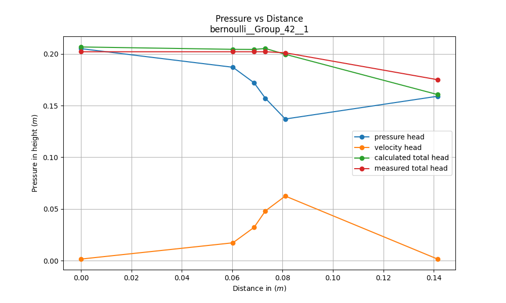

--------------------------------------------------------------------------------

# bernoulli__Group_42__2.csv

## raw data

|   test_section |   volume |   time |   static_head |   total_head |
|---------------:|---------:|-------:|--------------:|-------------:|
|              1 |      640 |     10 |           187 |          185 |
|              2 |      640 |     10 |           177 |          185 |
|              3 |      640 |     10 |           168 |          185 |
|              4 |      640 |     10 |           159 |          185 |
|              5 |      640 |     10 |           146 |          185 |
|              6 |      640 |     10 |           159 |          172 |

## SI units data

|   test_section |    dist |    area |   flow_rate |   velocity |   pressure_head |   velocity_head |   calculated_total_head |   measured_total_head |
|---------------:|--------:|--------:|------------:|-----------:|----------------:|----------------:|------------------------:|----------------------:|
|              1 | 0       | 0.00049 |     6.4e-05 |   0.130612 |           0.187 |     0.000869498 |                0.187869 |                 0.185 |
|              2 | 0.06028 | 0.00015 |     6.4e-05 |   0.426667 |           0.177 |     0.00927851  |                0.186279 |                 0.185 |
|              3 | 0.06868 | 0.00011 |     6.4e-05 |   0.581818 |           0.168 |     0.0172534   |                0.185253 |                 0.185 |
|              4 | 0.07318 | 9e-05   |     6.4e-05 |   0.711111 |           0.159 |     0.0257736   |                0.184774 |                 0.185 |
|              5 | 0.08108 | 7.9e-05 |     6.4e-05 |   0.810127 |           0.146 |     0.0334508   |                0.179451 |                 0.185 |
|              6 | 0.14154 | 0.00049 |     6.4e-05 |   0.130612 |           0.159 |     0.000869498 |                0.159869 |                 0.172 |

--------------------------------------------------------------------------------

# bernoulli__Group_42__3.csv

## raw data

|   test_section |   volume |   time |   static_head |   total_head |
|---------------:|---------:|-------:|--------------:|-------------:|
|              1 |      760 |     10 |           194 |          192 |
|              2 |      760 |     10 |           181 |          192 |
|              3 |      760 |     10 |           170 |          192 |
|              4 |      760 |     10 |           154 |          192 |
|              5 |      760 |     10 |           145 |          192 |
|              6 |      760 |     10 |           159 |          175 |

## SI units data

|   test_section |    dist |    area |   flow_rate |   velocity |   pressure_head |   velocity_head |   calculated_total_head |   measured_total_head |
|---------------:|--------:|--------:|------------:|-----------:|----------------:|----------------:|------------------------:|----------------------:|
|              1 | 0       | 0.00049 |     7.6e-05 |   0.155102 |           0.194 |      0.00122613 |                0.195226 |                 0.192 |
|              2 | 0.06028 | 0.00015 |     7.6e-05 |   0.506667 |           0.181 |      0.0130842  |                0.194084 |                 0.192 |
|              3 | 0.06868 | 0.00011 |     7.6e-05 |   0.690909 |           0.17  |      0.02433    |                0.19433  |                 0.192 |
|              4 | 0.07318 | 9e-05   |     7.6e-05 |   0.844444 |           0.154 |      0.0363449  |                0.190345 |                 0.192 |
|              5 | 0.08108 | 7.9e-05 |     7.6e-05 |   0.962025 |           0.145 |      0.0471709  |                0.192171 |                 0.192 |
|              6 | 0.14154 | 0.00049 |     7.6e-05 |   0.155102 |           0.159 |      0.00122613 |                0.160226 |                 0.175 |

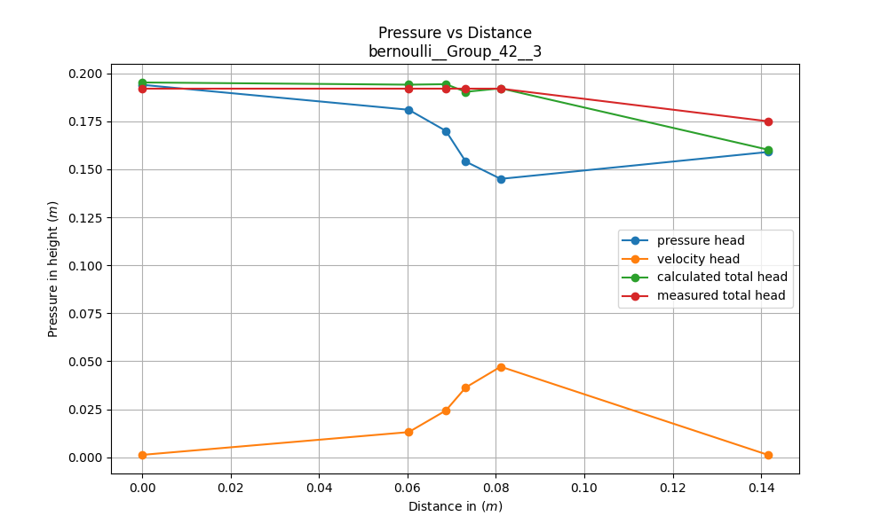

--------------------------------------------------------------------------------

# bernoulli__Group_43__1.csv

## raw data

|   test_section |   volume |   time |   static_head |   total_head |
|---------------:|---------:|-------:|--------------:|-------------:|
|              1 |      800 |     10 |           205 |          202 |
|              2 |      800 |     10 |           190 |          202 |
|              3 |      800 |     10 |           175 |          202 |
|              4 |      800 |     10 |           158 |          202 |
|              5 |      800 |     10 |           141 |          201 |
|              6 |      800 |     10 |           160 |          177 |

## SI units data

|   test_section |    dist |    area |   flow_rate |   velocity |   pressure_head |   velocity_head |   calculated_total_head |   measured_total_head |
|---------------:|--------:|--------:|------------:|-----------:|----------------:|----------------:|------------------------:|----------------------:|
|              1 | 0       | 0.00049 |       8e-05 |   0.163265 |           0.205 |      0.00135859 |                0.206359 |                 0.202 |
|              2 | 0.06028 | 0.00015 |       8e-05 |   0.533333 |           0.19  |      0.0144977  |                0.204498 |                 0.202 |
|              3 | 0.06868 | 0.00011 |       8e-05 |   0.727273 |           0.175 |      0.0269585  |                0.201958 |                 0.202 |
|              4 | 0.07318 | 9e-05   |       8e-05 |   0.888889 |           0.158 |      0.0402713  |                0.198271 |                 0.202 |
|              5 | 0.08108 | 7.9e-05 |       8e-05 |   1.01266  |           0.141 |      0.0522669  |                0.193267 |                 0.201 |
|              6 | 0.14154 | 0.00049 |       8e-05 |   0.163265 |           0.16  |      0.00135859 |                0.161359 |                 0.177 |

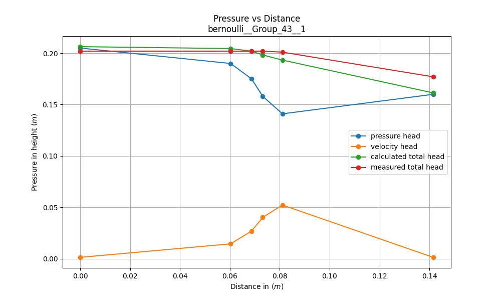

--------------------------------------------------------------------------------

# bernoulli__Group_43__2.csv

## raw data

|   test_section |   volume |   time |   static_head |   total_head |
|---------------:|---------:|-------:|--------------:|-------------:|
|              1 |     1020 |     10 |           220 |          218 |
|              2 |     1020 |     10 |           197 |          220 |
|              3 |     1020 |     10 |           174 |          220 |
|              4 |     1020 |     10 |           148 |          220 |
|              5 |     1020 |     10 |           115 |          218 |
|              6 |     1020 |     10 |           155 |          178 |

## SI units data

|   test_section |    dist |    area |   flow_rate |   velocity |   pressure_head |   velocity_head |   calculated_total_head |   measured_total_head |
|---------------:|--------:|--------:|------------:|-----------:|----------------:|----------------:|------------------------:|----------------------:|
|              1 | 0       | 0.00049 |    0.000102 |   0.208163 |           0.22  |      0.00220856 |                0.222209 |                 0.218 |
|              2 | 0.06028 | 0.00015 |    0.000102 |   0.68     |           0.197 |      0.0235678  |                0.220568 |                 0.22  |
|              3 | 0.06868 | 0.00011 |    0.000102 |   0.927273 |           0.174 |      0.0438244  |                0.217824 |                 0.22  |
|              4 | 0.07318 | 9e-05   |    0.000102 |   1.13333  |           0.148 |      0.0654661  |                0.213466 |                 0.22  |
|              5 | 0.08108 | 7.9e-05 |    0.000102 |   1.29114  |           0.115 |      0.0849664  |                0.199966 |                 0.218 |
|              6 | 0.14154 | 0.00049 |    0.000102 |   0.208163 |           0.155 |      0.00220856 |                0.157209 |                 0.178 |

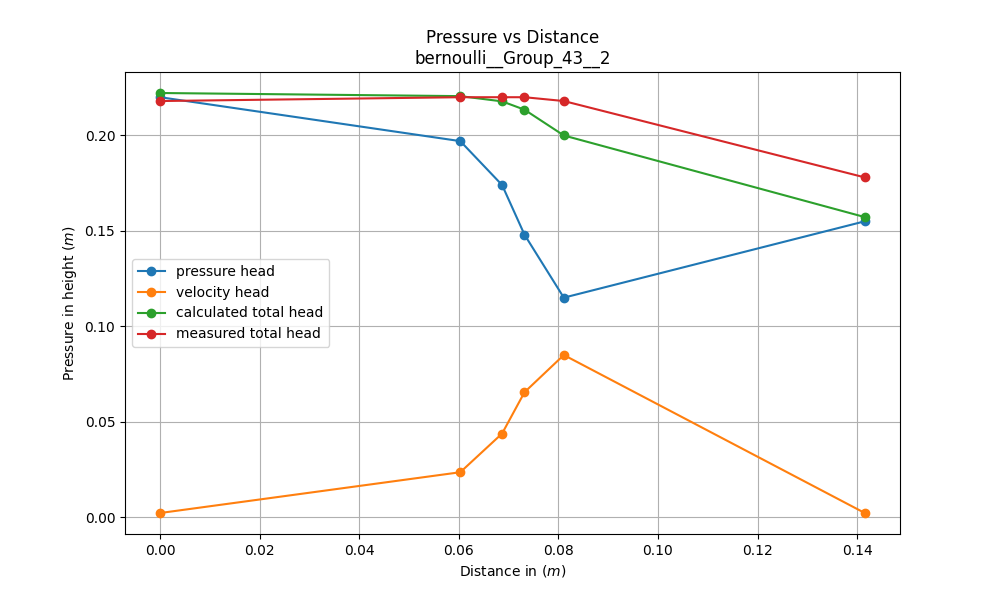

--------------------------------------------------------------------------------

# bernoulli__Group_43__3.csv

## raw data

|   test_section |   volume |   time |   static_head |   total_head |
|---------------:|---------:|-------:|--------------:|-------------:|
|              1 |     1120 |     10 |           230 |          230 |
|              2 |     1120 |     10 |           203 |          230 |
|              3 |     1120 |     10 |           174 |          230 |
|              4 |     1120 |     10 |           144 |          230 |
|              5 |     1120 |     10 |           103 |          227 |
|              6 |     1120 |     10 |           155 |          175 |

## SI units data

|   test_section |    dist |    area |   flow_rate |   velocity |   pressure_head |   velocity_head |   calculated_total_head |   measured_total_head |
|---------------:|--------:|--------:|------------:|-----------:|----------------:|----------------:|------------------------:|----------------------:|
|              1 | 0       | 0.00049 |    0.000112 |   0.228571 |           0.23  |      0.00266284 |                0.232663 |                 0.23  |
|              2 | 0.06028 | 0.00015 |    0.000112 |   0.746667 |           0.203 |      0.0284154  |                0.231415 |                 0.23  |
|              3 | 0.06868 | 0.00011 |    0.000112 |   1.01818  |           0.174 |      0.0528386  |                0.226839 |                 0.23  |
|              4 | 0.07318 | 9e-05   |    0.000112 |   1.24444  |           0.144 |      0.0789318  |                0.222932 |                 0.23  |
|              5 | 0.08108 | 7.9e-05 |    0.000112 |   1.41772  |           0.103 |      0.102443   |                0.205443 |                 0.227 |
|              6 | 0.14154 | 0.00049 |    0.000112 |   0.228571 |           0.155 |      0.00266284 |                0.157663 |                 0.175 |

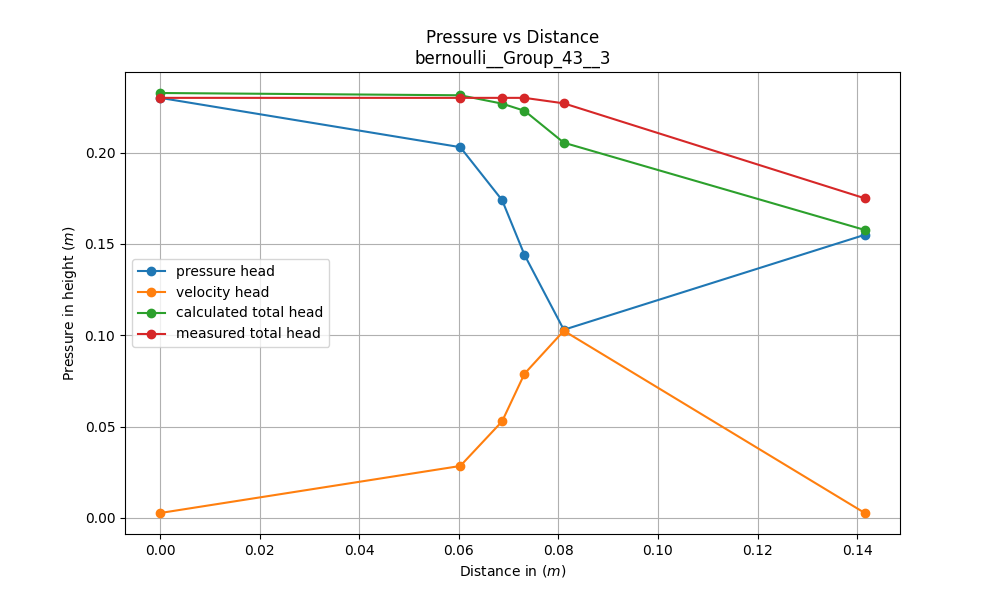

--------------------------------------------------------------------------------

# bernoulli__Group_44__1.csv

## raw data

|   test_section |   volume |   time |   static_head |   total_head |
|---------------:|---------:|-------:|--------------:|-------------:|
|              1 |      645 |     10 |           187 |          185 |
|              2 |      645 |     10 |           177 |          185 |
|              3 |      645 |     10 |           168 |          185 |
|              4 |      645 |     10 |           159 |          185 |
|              5 |      645 |     10 |           146 |          185 |
|              6 |      645 |     10 |           159 |          172 |

## SI units data

|   test_section |    dist |    area |   flow_rate |   velocity |   pressure_head |   velocity_head |   calculated_total_head |   measured_total_head |
|---------------:|--------:|--------:|------------:|-----------:|----------------:|----------------:|------------------------:|----------------------:|
|              1 | 0       | 0.00049 |    6.45e-05 |   0.131633 |           0.187 |     0.000883137 |                0.187883 |                 0.185 |
|              2 | 0.06028 | 0.00015 |    6.45e-05 |   0.43     |           0.177 |     0.00942406  |                0.186424 |                 0.185 |
|              3 | 0.06868 | 0.00011 |    6.45e-05 |   0.586364 |           0.168 |     0.0175241   |                0.185524 |                 0.185 |
|              4 | 0.07318 | 9e-05   |    6.45e-05 |   0.716667 |           0.159 |     0.0261779   |                0.185178 |                 0.185 |
|              5 | 0.08108 | 7.9e-05 |    6.45e-05 |   0.816456 |           0.146 |     0.0339755   |                0.179976 |                 0.185 |
|              6 | 0.14154 | 0.00049 |    6.45e-05 |   0.131633 |           0.159 |     0.000883137 |                0.159883 |                 0.172 |

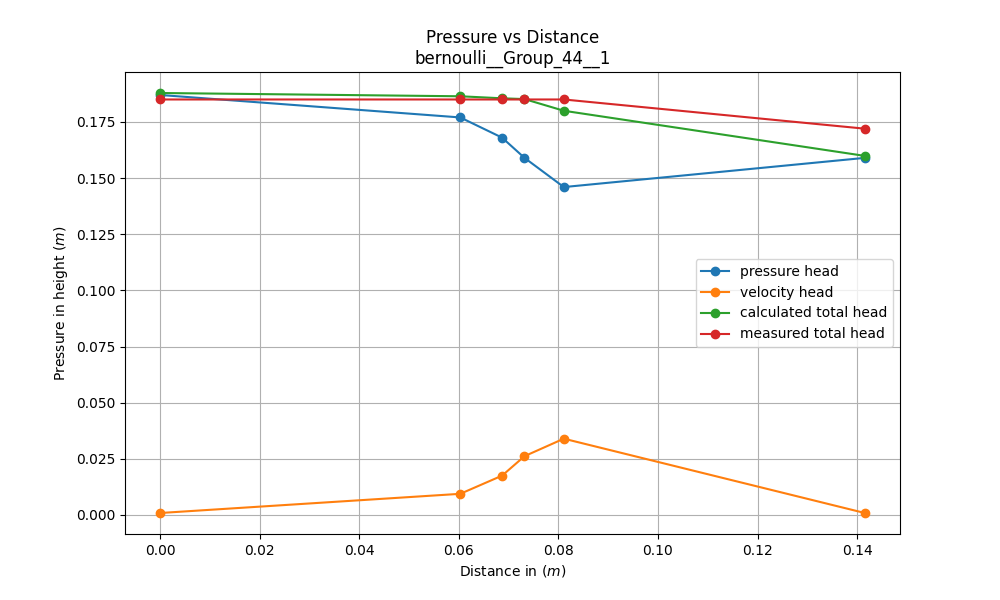

--------------------------------------------------------------------------------

# bernoulli__Group_44__2.csv

## raw data

|   test_section |   volume |   time |   static_head |   total_head |
|---------------:|---------:|-------:|--------------:|-------------:|
|              1 |      760 |     10 |           194 |          193 |
|              2 |      760 |     10 |           181 |          193 |
|              3 |      760 |     10 |           170 |          193 |
|              4 |      760 |     10 |           159 |          193 |
|              5 |      760 |     10 |           145 |          193 |
|              6 |      760 |     10 |           159 |          175 |

## SI units data

|   test_section |    dist |    area |   flow_rate |   velocity |   pressure_head |   velocity_head |   calculated_total_head |   measured_total_head |
|---------------:|--------:|--------:|------------:|-----------:|----------------:|----------------:|------------------------:|----------------------:|
|              1 | 0       | 0.00049 |     7.6e-05 |   0.155102 |           0.194 |      0.00122613 |                0.195226 |                 0.193 |
|              2 | 0.06028 | 0.00015 |     7.6e-05 |   0.506667 |           0.181 |      0.0130842  |                0.194084 |                 0.193 |
|              3 | 0.06868 | 0.00011 |     7.6e-05 |   0.690909 |           0.17  |      0.02433    |                0.19433  |                 0.193 |
|              4 | 0.07318 | 9e-05   |     7.6e-05 |   0.844444 |           0.159 |      0.0363449  |                0.195345 |                 0.193 |
|              5 | 0.08108 | 7.9e-05 |     7.6e-05 |   0.962025 |           0.145 |      0.0471709  |                0.192171 |                 0.193 |
|              6 | 0.14154 | 0.00049 |     7.6e-05 |   0.155102 |           0.159 |      0.00122613 |                0.160226 |                 0.175 |

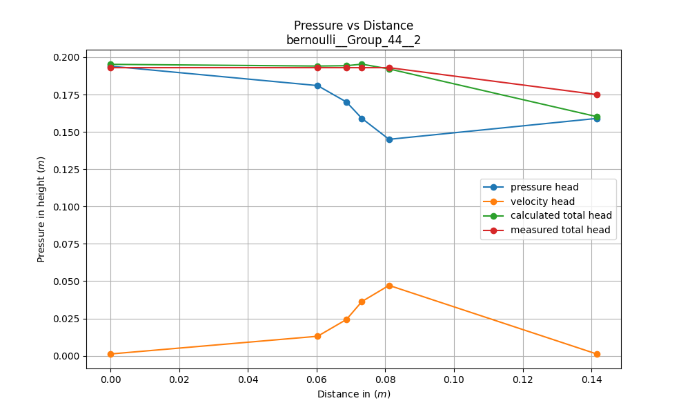

--------------------------------------------------------------------------------

# bernoulli__Group_44__3.csv

## raw data

|   test_section |   volume |   time |   static_head |   total_head |
|---------------:|---------:|-------:|--------------:|-------------:|
|              1 |      875 |     10 |           205 |          202 |
|              2 |      875 |     10 |           187 |          202 |
|              3 |      875 |     10 |           172 |          202 |
|              4 |      875 |     10 |           157 |          202 |
|              5 |      875 |     10 |           137 |          201 |
|              6 |      875 |     10 |           159 |          175 |

## SI units data

|   test_section |    dist |    area |   flow_rate |   velocity |   pressure_head |   velocity_head |   calculated_total_head |   measured_total_head |
|---------------:|--------:|--------:|------------:|-----------:|----------------:|----------------:|------------------------:|----------------------:|
|              1 | 0       | 0.00049 |    8.75e-05 |   0.178571 |           0.205 |      0.00162527 |                0.206625 |                 0.202 |
|              2 | 0.06028 | 0.00015 |    8.75e-05 |   0.583333 |           0.187 |      0.0173434  |                0.204343 |                 0.202 |
|              3 | 0.06868 | 0.00011 |    8.75e-05 |   0.795455 |           0.172 |      0.0322501  |                0.20425  |                 0.202 |
|              4 | 0.07318 | 9e-05   |    8.75e-05 |   0.972222 |           0.157 |      0.0481761  |                0.205176 |                 0.202 |
|              5 | 0.08108 | 7.9e-05 |    8.75e-05 |   1.10759  |           0.137 |      0.0625263  |                0.199526 |                 0.201 |
|              6 | 0.14154 | 0.00049 |    8.75e-05 |   0.178571 |           0.159 |      0.00162527 |                0.160625 |                 0.175 |

--------------------------------------------------------------------------------

# bernoulli__Group_45__1.csv

## raw data

|   test_section |   volume |   time |   static_head |   total_head |
|---------------:|---------:|-------:|--------------:|-------------:|
|              1 |      800 |     10 |           205 |          201 |
|              2 |      800 |     10 |           170 |          205 |
|              3 |      800 |     10 |           155 |          205 |
|              4 |      800 |     10 |           120 |          205 |
|              5 |      800 |     10 |            50 |          205 |
|              6 |      800 |     10 |           160 |          175 |

## SI units data

|   test_section |    dist |    area |   flow_rate |   velocity |   pressure_head |   velocity_head |   calculated_total_head |   measured_total_head |
|---------------:|--------:|--------:|------------:|-----------:|----------------:|----------------:|------------------------:|----------------------:|
|              1 | 0       | 0.00049 |       8e-05 |   0.163265 |           0.205 |      0.00135859 |                0.206359 |                 0.201 |
|              2 | 0.06028 | 0.00015 |       8e-05 |   0.533333 |           0.17  |      0.0144977  |                0.184498 |                 0.205 |
|              3 | 0.06868 | 0.00011 |       8e-05 |   0.727273 |           0.155 |      0.0269585  |                0.181958 |                 0.205 |
|              4 | 0.07318 | 9e-05   |       8e-05 |   0.888889 |           0.12  |      0.0402713  |                0.160271 |                 0.205 |
|              5 | 0.08108 | 7.9e-05 |       8e-05 |   1.01266  |           0.05  |      0.0522669  |                0.102267 |                 0.205 |
|              6 | 0.14154 | 0.00049 |       8e-05 |   0.163265 |           0.16  |      0.00135859 |                0.161359 |                 0.175 |

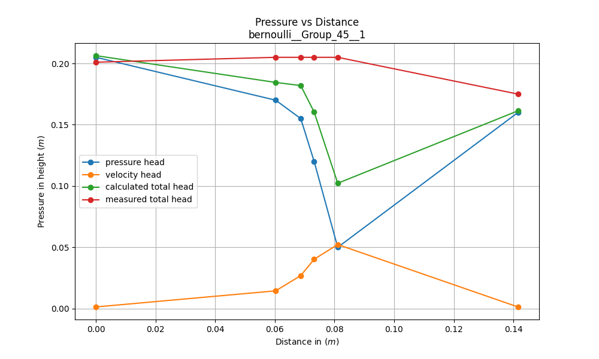

--------------------------------------------------------------------------------

# bernoulli__Group_45__2.csv

## raw data

|   test_section |   volume |   time |   static_head |   total_head |
|---------------:|---------:|-------:|--------------:|-------------:|
|              1 |     1210 |     10 |           240 |          240 |
|              2 |     1210 |     10 |           205 |          240 |
|              3 |     1210 |     10 |           175 |          240 |
|              4 |     1210 |     10 |           145 |          240 |
|              5 |     1210 |     10 |           115 |          240 |
|              6 |     1210 |     10 |           175 |          175 |

## SI units data

|   test_section |    dist |    area |   flow_rate |   velocity |   pressure_head |   velocity_head |   calculated_total_head |   measured_total_head |
|---------------:|--------:|--------:|------------:|-----------:|----------------:|----------------:|------------------------:|----------------------:|
|              1 | 0       | 0.00049 |    0.000121 |   0.246939 |           0.24  |      0.00310799 |                0.243108 |                 0.24  |
|              2 | 0.06028 | 0.00015 |    0.000121 |   0.806667 |           0.205 |      0.0331657  |                0.238166 |                 0.24  |
|              3 | 0.06868 | 0.00011 |    0.000121 |   1.1      |           0.175 |      0.0616718  |                0.236672 |                 0.24  |
|              4 | 0.07318 | 9e-05   |    0.000121 |   1.34444  |           0.145 |      0.092127   |                0.237127 |                 0.24  |
|              5 | 0.08108 | 7.9e-05 |    0.000121 |   1.53165  |           0.115 |      0.119569   |                0.234569 |                 0.24  |
|              6 | 0.14154 | 0.00049 |    0.000121 |   0.246939 |           0.175 |      0.00310799 |                0.178108 |                 0.175 |

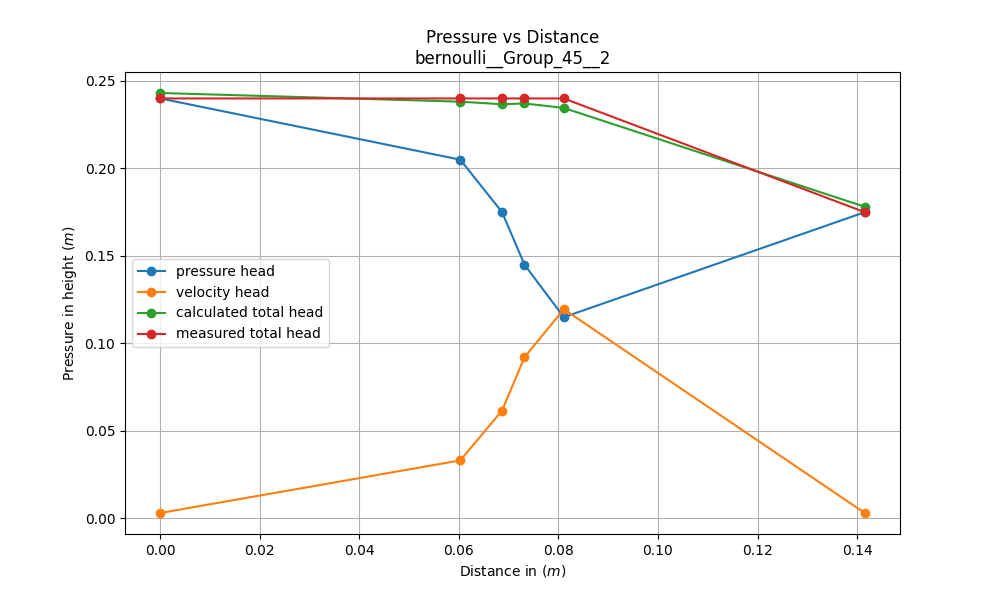

--------------------------------------------------------------------------------

# bernoulli__Group_45__3.csv

## raw data

|   test_section |   volume |   time |   static_head |   total_head |
|---------------:|---------:|-------:|--------------:|-------------:|
|              1 |     1550 |     10 |           270 |          270 |
|              2 |     1550 |     10 |           205 |          275 |
|              3 |     1550 |     10 |           175 |          275 |
|              4 |     1550 |     10 |            75 |          270 |
|              5 |     1550 |     10 |            50 |          270 |
|              6 |     1550 |     10 |           160 |          175 |

## SI units data

|   test_section |    dist |    area |   flow_rate |   velocity |   pressure_head |   velocity_head |   calculated_total_head |   measured_total_head |
|---------------:|--------:|--------:|------------:|-----------:|----------------:|----------------:|------------------------:|----------------------:|
|              1 | 0       | 0.00049 |    0.000155 |   0.316327 |           0.27  |      0.00510002 |                0.2751   |                 0.27  |
|              2 | 0.06028 | 0.00015 |    0.000155 |   1.03333  |           0.205 |      0.0544229  |                0.259423 |                 0.275 |
|              3 | 0.06868 | 0.00011 |    0.000155 |   1.40909  |           0.175 |      0.1012     |                0.2762   |                 0.275 |
|              4 | 0.07318 | 9e-05   |    0.000155 |   1.72222  |           0.075 |      0.151175   |                0.226175 |                 0.27  |
|              5 | 0.08108 | 7.9e-05 |    0.000155 |   1.96203  |           0.05  |      0.196205   |                0.246205 |                 0.27  |
|              6 | 0.14154 | 0.00049 |    0.000155 |   0.316327 |           0.16  |      0.00510002 |                0.1651   |                 0.175 |

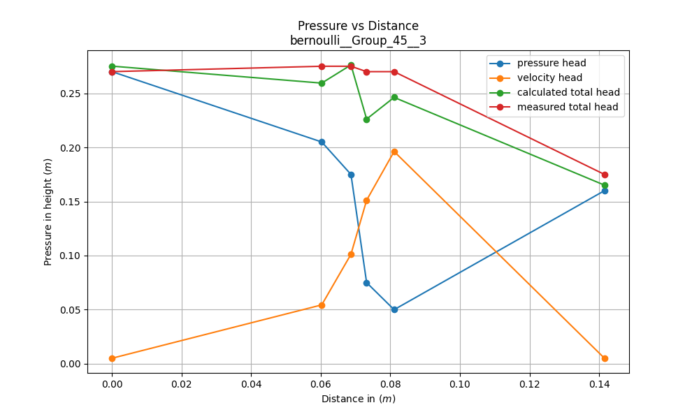

--------------------------------------------------------------------------------

# bernoulli__Group_46__1.csv

## raw data

|   test_section |   volume |   time |   static_head |   total_head |
|---------------:|---------:|-------:|--------------:|-------------:|
|              1 |     1490 |     10 |           255 |          260 |
|              2 |     1490 |     10 |           207 |          258 |
|              3 |     1490 |     10 |           160 |          258 |
|              4 |     1490 |     10 |           107 |          256 |
|              5 |     1490 |     10 |            34 |          255 |
|              6 |     1490 |     10 |           140 |          165 |

## SI units data

|   test_section |    dist |    area |   flow_rate |   velocity |   pressure_head |   velocity_head |   calculated_total_head |   measured_total_head |
|---------------:|--------:|--------:|------------:|-----------:|----------------:|----------------:|------------------------:|----------------------:|
|              1 | 0       | 0.00049 |    0.000149 |   0.304082 |           0.255 |      0.00471283 |                0.259713 |                 0.26  |
|              2 | 0.06028 | 0.00015 |    0.000149 |   0.993333 |           0.207 |      0.0502911  |                0.257291 |                 0.258 |
|              3 | 0.06868 | 0.00011 |    0.000149 |   1.35455  |           0.16  |      0.0935165  |                0.253516 |                 0.258 |
|              4 | 0.07318 | 9e-05   |    0.000149 |   1.65556  |           0.107 |      0.139697   |                0.246697 |                 0.256 |
|              5 | 0.08108 | 7.9e-05 |    0.000149 |   1.88608  |           0.034 |      0.181309   |                0.215309 |                 0.255 |
|              6 | 0.14154 | 0.00049 |    0.000149 |   0.304082 |           0.14  |      0.00471283 |                0.144713 |                 0.165 |

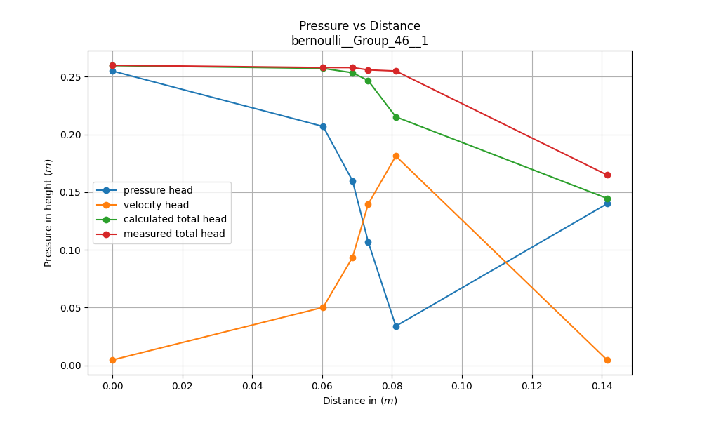

--------------------------------------------------------------------------------

# bernoulli__Group_46__2.csv

## raw data

|   test_section |   volume |   time |   static_head |   total_head |
|---------------:|---------:|-------:|--------------:|-------------:|
|              1 |      830 |     10 |           191 |          192 |
|              2 |      830 |     10 |           174 |          190 |
|              3 |      830 |     10 |           157 |          190 |
|              4 |      830 |     10 |           140 |          189 |
|              5 |      830 |     10 |           115 |          189 |
|              6 |      830 |     10 |           160 |          161 |

## SI units data

|   test_section |    dist |    area |   flow_rate |   velocity |   pressure_head |   velocity_head |   calculated_total_head |   measured_total_head |
|---------------:|--------:|--------:|------------:|-----------:|----------------:|----------------:|------------------------:|----------------------:|
|              1 | 0       | 0.00049 |     8.3e-05 |   0.169388 |           0.191 |       0.0014624 |                0.192462 |                 0.192 |
|              2 | 0.06028 | 0.00015 |     8.3e-05 |   0.553333 |           0.174 |       0.0156054 |                0.189605 |                 0.19  |
|              3 | 0.06868 | 0.00011 |     8.3e-05 |   0.754545 |           0.157 |       0.0290183 |                0.186018 |                 0.19  |
|              4 | 0.07318 | 9e-05   |     8.3e-05 |   0.922222 |           0.14  |       0.0433483 |                0.183348 |                 0.189 |
|              5 | 0.08108 | 7.9e-05 |     8.3e-05 |   1.05063  |           0.115 |       0.0562604 |                0.17126  |                 0.189 |
|              6 | 0.14154 | 0.00049 |     8.3e-05 |   0.169388 |           0.16  |       0.0014624 |                0.161462 |                 0.161 |

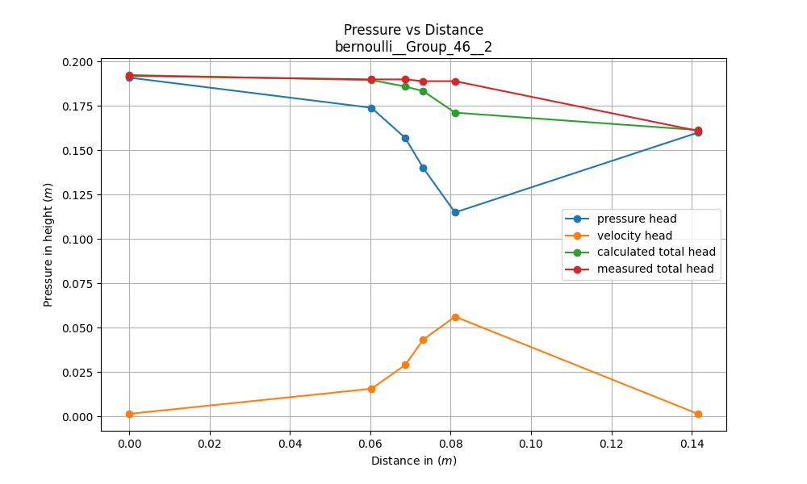

--------------------------------------------------------------------------------

# bernoulli__Group_46__3.csv

## raw data

|   test_section |   volume |   time |   static_head |   total_head |
|---------------:|---------:|-------:|--------------:|-------------:|
|              1 |     1190 |     10 |           198 |          225 |
|              2 |     1190 |     10 |           177 |          225 |
|              3 |     1190 |     10 |           153 |          225 |
|              4 |     1190 |     10 |           128 |          224 |
|              5 |     1190 |     10 |           100 |          223 |
|              6 |     1190 |     10 |           144 |          158 |

## SI units data

|   test_section |    dist |    area |   flow_rate |   velocity |   pressure_head |   velocity_head |   calculated_total_head |   measured_total_head |
|---------------:|--------:|--------:|------------:|-----------:|----------------:|----------------:|------------------------:|----------------------:|
|              1 | 0       | 0.00049 |    0.000119 |   0.242857 |           0.198 |       0.0030061 |                0.201006 |                 0.225 |
|              2 | 0.06028 | 0.00015 |    0.000119 |   0.793333 |           0.177 |       0.0320784 |                0.209078 |                 0.225 |
|              3 | 0.06868 | 0.00011 |    0.000119 |   1.08182  |           0.153 |       0.0596499 |                0.21265  |                 0.225 |
|              4 | 0.07318 | 9e-05   |    0.000119 |   1.32222  |           0.128 |       0.0891066 |                0.217107 |                 0.224 |
|              5 | 0.08108 | 7.9e-05 |    0.000119 |   1.50633  |           0.1   |       0.115649  |                0.215649 |                 0.223 |
|              6 | 0.14154 | 0.00049 |    0.000119 |   0.242857 |           0.144 |       0.0030061 |                0.147006 |                 0.158 |

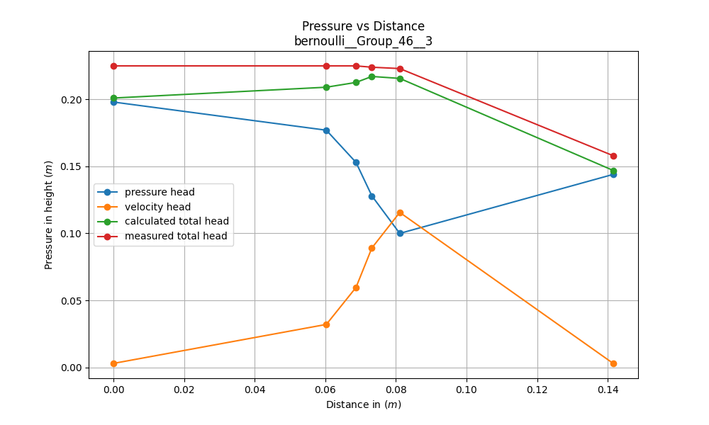

--------------------------------------------------------------------------------

# bernoulli__Group_47__1.csv

## raw data

|   test_section |   volume |   time |   static_head |   total_head |
|---------------:|---------:|-------:|--------------:|-------------:|
|              1 |      720 |     10 |           179 |          177 |
|              2 |      720 |     10 |           167 |          177 |
|              3 |      720 |     10 |           156 |          177 |
|              4 |      720 |     10 |           144 |          177 |
|              5 |      720 |     10 |           129 |          176 |
|              6 |      720 |     10 |           187 |          160 |

## SI units data

|   test_section |    dist |    area |   flow_rate |   velocity |   pressure_head |   velocity_head |   calculated_total_head |   measured_total_head |
|---------------:|--------:|--------:|------------:|-----------:|----------------:|----------------:|------------------------:|----------------------:|
|              1 | 0       | 0.00049 |     7.2e-05 |   0.146939 |           0.179 |      0.00110046 |                0.1801   |                 0.177 |
|              2 | 0.06028 | 0.00015 |     7.2e-05 |   0.48     |           0.167 |      0.0117431  |                0.178743 |                 0.177 |
|              3 | 0.06868 | 0.00011 |     7.2e-05 |   0.654545 |           0.156 |      0.0218364  |                0.177836 |                 0.177 |
|              4 | 0.07318 | 9e-05   |     7.2e-05 |   0.8      |           0.144 |      0.0326198  |                0.17662  |                 0.177 |
|              5 | 0.08108 | 7.9e-05 |     7.2e-05 |   0.911392 |           0.129 |      0.0423362  |                0.171336 |                 0.176 |
|              6 | 0.14154 | 0.00049 |     7.2e-05 |   0.146939 |           0.187 |      0.00110046 |                0.1881   |                 0.16  |

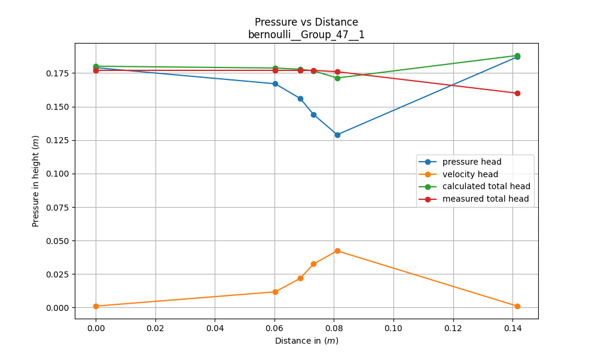

--------------------------------------------------------------------------------

# bernoulli__Group_47__2.csv

## raw data

|   test_section |   volume |   time |   static_head |   total_head |
|---------------:|---------:|-------:|--------------:|-------------:|
|              1 |      760 |     10 |           184 |          183 |
|              2 |      760 |     10 |           172 |          183 |
|              3 |      760 |     10 |           163 |          183 |
|              4 |      760 |     10 |           150 |          180 |
|              5 |      760 |     10 |           135 |          180 |
|              6 |      760 |     10 |           149 |          166 |

## SI units data

|   test_section |    dist |    area |   flow_rate |   velocity |   pressure_head |   velocity_head |   calculated_total_head |   measured_total_head |
|---------------:|--------:|--------:|------------:|-----------:|----------------:|----------------:|------------------------:|----------------------:|
|              1 | 0       | 0.00049 |     7.6e-05 |   0.155102 |           0.184 |      0.00122613 |                0.185226 |                 0.183 |
|              2 | 0.06028 | 0.00015 |     7.6e-05 |   0.506667 |           0.172 |      0.0130842  |                0.185084 |                 0.183 |
|              3 | 0.06868 | 0.00011 |     7.6e-05 |   0.690909 |           0.163 |      0.02433    |                0.18733  |                 0.183 |
|              4 | 0.07318 | 9e-05   |     7.6e-05 |   0.844444 |           0.15  |      0.0363449  |                0.186345 |                 0.18  |
|              5 | 0.08108 | 7.9e-05 |     7.6e-05 |   0.962025 |           0.135 |      0.0471709  |                0.182171 |                 0.18  |
|              6 | 0.14154 | 0.00049 |     7.6e-05 |   0.155102 |           0.149 |      0.00122613 |                0.150226 |                 0.166 |

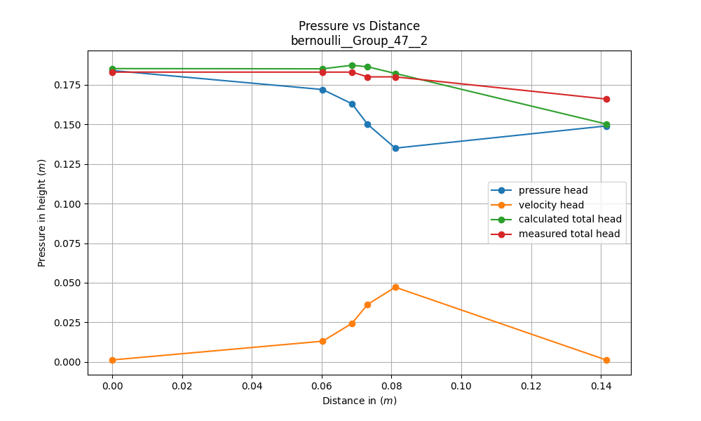

--------------------------------------------------------------------------------

# bernoulli__Group_47__3.csv

## raw data

|   test_section |   volume |   time |   static_head |   total_head |
|---------------:|---------:|-------:|--------------:|-------------:|
|              1 |      980 |     10 |           200 |          200 |
|              2 |      980 |     10 |           181 |          198 |
|              3 |      980 |     10 |           164 |          198 |
|              4 |      980 |     10 |           149 |          195 |
|              5 |      980 |     10 |           124 |          194 |
|              6 |      980 |     10 |           150 |          161 |

## SI units data

|   test_section |    dist |    area |   flow_rate |   velocity |   pressure_head |   velocity_head |   calculated_total_head |   measured_total_head |
|---------------:|--------:|--------:|------------:|-----------:|----------------:|----------------:|------------------------:|----------------------:|
|              1 | 0       | 0.00049 |     9.8e-05 |   0.2      |           0.2   |      0.00203874 |                0.202039 |                 0.2   |
|              2 | 0.06028 | 0.00015 |     9.8e-05 |   0.653333 |           0.181 |      0.0217556  |                0.202756 |                 0.198 |
|              3 | 0.06868 | 0.00011 |     9.8e-05 |   0.890909 |           0.164 |      0.0404546  |                0.204455 |                 0.198 |
|              4 | 0.07318 | 9e-05   |     9.8e-05 |   1.08889  |           0.149 |      0.0604322  |                0.209432 |                 0.195 |
|              5 | 0.08108 | 7.9e-05 |     9.8e-05 |   1.24051  |           0.124 |      0.078433   |                0.202433 |                 0.194 |
|              6 | 0.14154 | 0.00049 |     9.8e-05 |   0.2      |           0.15  |      0.00203874 |                0.152039 |                 0.161 |

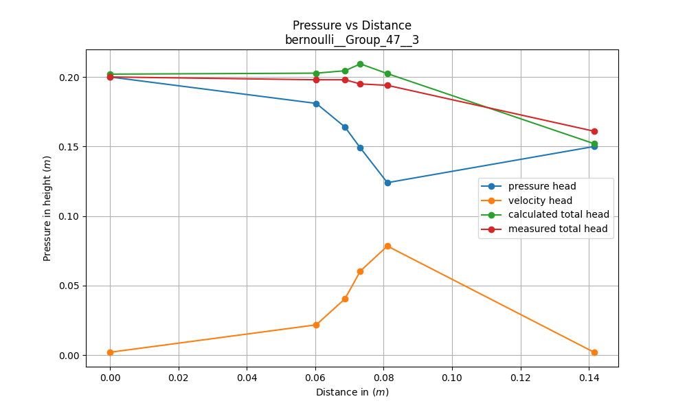

--------------------------------------------------------------------------------

# bernoulli__Group_48__1.csv

## raw data

|   test_section |   volume |   time |   static_head |   total_head |
|---------------:|---------:|-------:|--------------:|-------------:|
|              1 |      800 |     10 |           200 |          199 |
|              2 |      800 |     10 |           186 |          198 |
|              3 |      800 |     10 |           172 |          198 |
|              4 |      800 |     10 |           156 |          198 |
|              5 |      800 |     10 |           136 |          198 |
|              6 |      800 |     10 |           160 |          175 |

## SI units data

|   test_section |    dist |    area |   flow_rate |   velocity |   pressure_head |   velocity_head |   calculated_total_head |   measured_total_head |
|---------------:|--------:|--------:|------------:|-----------:|----------------:|----------------:|------------------------:|----------------------:|
|              1 | 0       | 0.00049 |       8e-05 |   0.163265 |           0.2   |      0.00135859 |                0.201359 |                 0.199 |
|              2 | 0.06028 | 0.00015 |       8e-05 |   0.533333 |           0.186 |      0.0144977  |                0.200498 |                 0.198 |
|              3 | 0.06868 | 0.00011 |       8e-05 |   0.727273 |           0.172 |      0.0269585  |                0.198958 |                 0.198 |
|              4 | 0.07318 | 9e-05   |       8e-05 |   0.888889 |           0.156 |      0.0402713  |                0.196271 |                 0.198 |
|              5 | 0.08108 | 7.9e-05 |       8e-05 |   1.01266  |           0.136 |      0.0522669  |                0.188267 |                 0.198 |
|              6 | 0.14154 | 0.00049 |       8e-05 |   0.163265 |           0.16  |      0.00135859 |                0.161359 |                 0.175 |

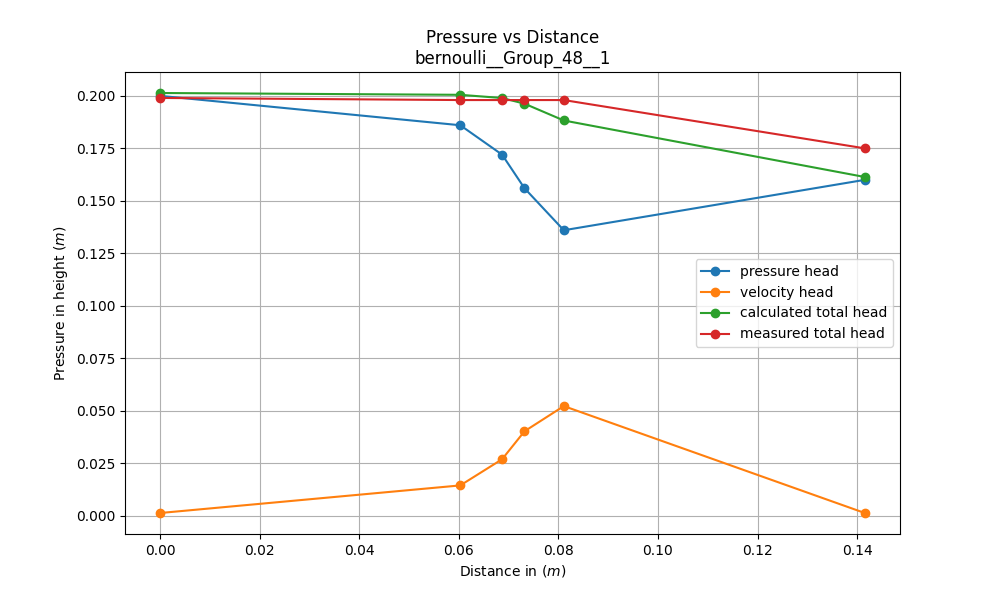

--------------------------------------------------------------------------------

# bernoulli__Group_48__2.csv

## raw data

|   test_section |   volume |   time |   static_head |   total_head |
|---------------:|---------:|-------:|--------------:|-------------:|
|              1 |      960 |     10 |           206 |          205 |
|              2 |      960 |     10 |           189 |          205 |
|              3 |      960 |     10 |           172 |          205 |
|              4 |      960 |     10 |           153 |          205 |
|              5 |      960 |     10 |           130 |          204 |
|              6 |      960 |     10 |           160 |          175 |

## SI units data

|   test_section |    dist |    area |   flow_rate |   velocity |   pressure_head |   velocity_head |   calculated_total_head |   measured_total_head |
|---------------:|--------:|--------:|------------:|-----------:|----------------:|----------------:|------------------------:|----------------------:|
|              1 | 0       | 0.00049 |     9.6e-05 |   0.195918 |           0.206 |      0.00195637 |                0.207956 |                 0.205 |
|              2 | 0.06028 | 0.00015 |     9.6e-05 |   0.64     |           0.189 |      0.0208767  |                0.209877 |                 0.205 |
|              3 | 0.06868 | 0.00011 |     9.6e-05 |   0.872727 |           0.172 |      0.0388202  |                0.21082  |                 0.205 |
|              4 | 0.07318 | 9e-05   |     9.6e-05 |   1.06667  |           0.153 |      0.0579907  |                0.210991 |                 0.205 |
|              5 | 0.08108 | 7.9e-05 |     9.6e-05 |   1.21519  |           0.13  |      0.0752643  |                0.205264 |                 0.204 |
|              6 | 0.14154 | 0.00049 |     9.6e-05 |   0.195918 |           0.16  |      0.00195637 |                0.161956 |                 0.175 |

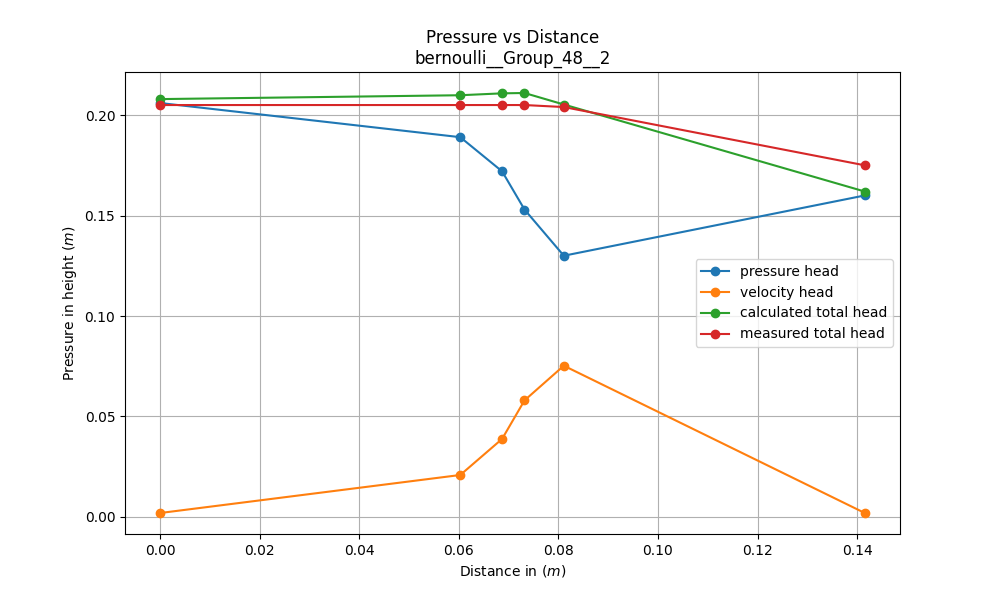

--------------------------------------------------------------------------------

# bernoulli__Group_48__3.csv

## raw data

|   test_section |   volume |   time |   static_head |   total_head |
|---------------:|---------:|-------:|--------------:|-------------:|
|              1 |      970 |     10 |           217 |          219 |
|              2 |      970 |     10 |           174 |          219 |
|              3 |      970 |     10 |           172 |          219 |
|              4 |      970 |     10 |           147 |          219 |
|              5 |      970 |     10 |           114 |          219 |
|              6 |      970 |     10 |           158 |          176 |

## SI units data

|   test_section |    dist |    area |   flow_rate |   velocity |   pressure_head |   velocity_head |   calculated_total_head |   measured_total_head |
|---------------:|--------:|--------:|------------:|-----------:|----------------:|----------------:|------------------------:|----------------------:|
|              1 | 0       | 0.00049 |     9.7e-05 |   0.197959 |           0.217 |      0.00199734 |                0.218997 |                 0.219 |
|              2 | 0.06028 | 0.00015 |     9.7e-05 |   0.646667 |           0.174 |      0.0213139  |                0.195314 |                 0.219 |
|              3 | 0.06868 | 0.00011 |     9.7e-05 |   0.881818 |           0.172 |      0.0396332  |                0.211633 |                 0.219 |
|              4 | 0.07318 | 9e-05   |     9.7e-05 |   1.07778  |           0.147 |      0.0592051  |                0.206205 |                 0.219 |
|              5 | 0.08108 | 7.9e-05 |     9.7e-05 |   1.22785  |           0.114 |      0.0768405  |                0.190841 |                 0.219 |
|              6 | 0.14154 | 0.00049 |     9.7e-05 |   0.197959 |           0.158 |      0.00199734 |                0.159997 |                 0.176 |

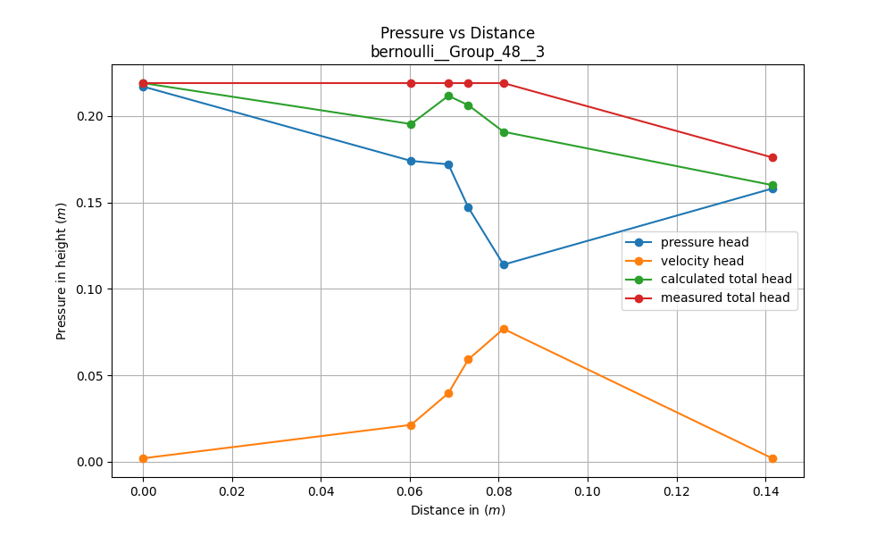

--------------------------------------------------------------------------------

# bernoulli__Group_49__1.csv

## raw data

|   test_section |   volume |   time |   static_head |   total_head |
|---------------:|---------:|-------:|--------------:|-------------:|
|              1 |      820 |     10 |           160 |          160 |
|              2 |      820 |     10 |           145 |          160 |
|              3 |      820 |     10 |           130 |          160 |
|              4 |      820 |     10 |           115 |          158 |
|              5 |      820 |     10 |            92 |          158 |
|              6 |      820 |     10 |           116 |          135 |

## SI units data

|   test_section |    dist |    area |   flow_rate |   velocity |   pressure_head |   velocity_head |   calculated_total_head |   measured_total_head |
|---------------:|--------:|--------:|------------:|-----------:|----------------:|----------------:|------------------------:|----------------------:|
|              1 | 0       | 0.00049 |     8.2e-05 |   0.167347 |           0.16  |      0.00142737 |                0.161427 |                 0.16  |
|              2 | 0.06028 | 0.00015 |     8.2e-05 |   0.546667 |           0.145 |      0.0152316  |                0.160232 |                 0.16  |
|              3 | 0.06868 | 0.00011 |     8.2e-05 |   0.745455 |           0.13  |      0.0283233  |                0.158323 |                 0.16  |
|              4 | 0.07318 | 9e-05   |     8.2e-05 |   0.911111 |           0.115 |      0.0423101  |                0.15731  |                 0.158 |
|              5 | 0.08108 | 7.9e-05 |     8.2e-05 |   1.03797  |           0.092 |      0.0549129  |                0.146913 |                 0.158 |
|              6 | 0.14154 | 0.00049 |     8.2e-05 |   0.167347 |           0.116 |      0.00142737 |                0.117427 |                 0.135 |

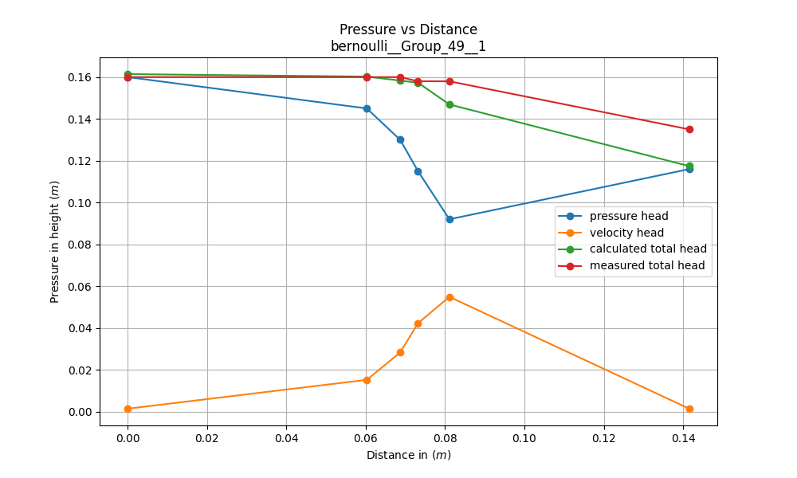

--------------------------------------------------------------------------------

# bernoulli__Group_49__2.csv

## raw data

|   test_section |   volume |   time |   static_head |   total_head |
|---------------:|---------:|-------:|--------------:|-------------:|
|              1 |     1060 |     10 |           175 |          175 |
|              2 |     1060 |     10 |           154 |          175 |
|              3 |     1060 |     10 |           130 |          175 |
|              4 |     1060 |     10 |           110 |          175 |
|              5 |     1060 |     10 |            78 |          175 |
|              6 |     1060 |     10 |           114 |          135 |

## SI units data

|   test_section |    dist |    area |   flow_rate |   velocity |   pressure_head |   velocity_head |   calculated_total_head |   measured_total_head |
|---------------:|--------:|--------:|------------:|-----------:|----------------:|----------------:|------------------------:|----------------------:|
|              1 | 0       | 0.00049 |    0.000106 |   0.216327 |           0.175 |      0.00238518 |                0.177385 |                 0.175 |
|              2 | 0.06028 | 0.00015 |    0.000106 |   0.706667 |           0.154 |      0.0254525  |                0.179452 |                 0.175 |
|              3 | 0.06868 | 0.00011 |    0.000106 |   0.963636 |           0.13  |      0.047329   |                0.177329 |                 0.175 |
|              4 | 0.07318 | 9e-05   |    0.000106 |   1.17778  |           0.11  |      0.0707014  |                0.180701 |                 0.175 |
|              5 | 0.08108 | 7.9e-05 |    0.000106 |   1.34177  |           0.078 |      0.0917611  |                0.169761 |                 0.175 |
|              6 | 0.14154 | 0.00049 |    0.000106 |   0.216327 |           0.114 |      0.00238518 |                0.116385 |                 0.135 |

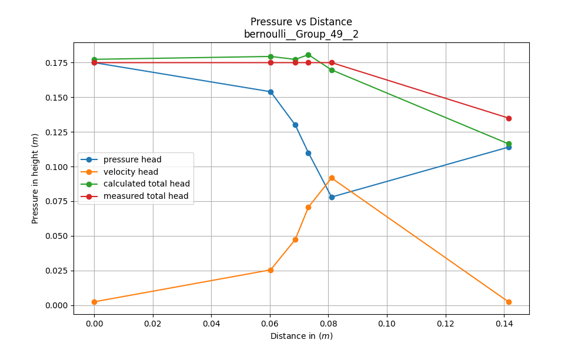

--------------------------------------------------------------------------------

# bernoulli__Group_49__3.csv

## raw data

|   test_section |   volume |   time |   static_head |   total_head |
|---------------:|---------:|-------:|--------------:|-------------:|
|              1 |     1370 |     10 |           208 |          205 |
|              2 |     1370 |     10 |           170 |          206 |
|              3 |     1370 |     10 |           130 |          206 |
|              4 |     1370 |     10 |           100 |          206 |
|              5 |     1370 |     10 |            45 |          205 |
|              6 |     1370 |     10 |           110 |          130 |

## SI units data

|   test_section |    dist |    area |   flow_rate |   velocity |   pressure_head |   velocity_head |   calculated_total_head |   measured_total_head |
|---------------:|--------:|--------:|------------:|-----------:|----------------:|----------------:|------------------------:|----------------------:|
|              1 | 0       | 0.00049 |    0.000137 |   0.279592 |           0.208 |      0.00398428 |                0.211984 |                 0.205 |
|              2 | 0.06028 | 0.00015 |    0.000137 |   0.913333 |           0.17  |      0.0425167  |                0.212517 |                 0.206 |
|              3 | 0.06868 | 0.00011 |    0.000137 |   1.24545  |           0.13  |      0.07906    |                0.20906  |                 0.206 |
|              4 | 0.07318 | 9e-05   |    0.000137 |   1.52222  |           0.1   |      0.118102   |                0.218102 |                 0.206 |
|              5 | 0.08108 | 7.9e-05 |    0.000137 |   1.73418  |           0.045 |      0.153281   |                0.198281 |                 0.205 |
|              6 | 0.14154 | 0.00049 |    0.000137 |   0.279592 |           0.11  |      0.00398428 |                0.113984 |                 0.13  |

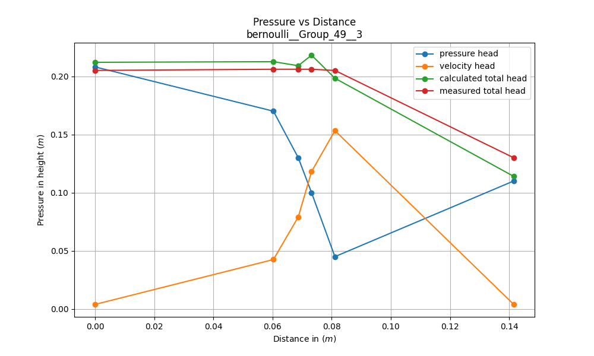

--------------------------------------------------------------------------------

# bernoulli__Group_50__1.csv

## raw data

|   test_section |   volume |   time |   static_head |   total_head |
|---------------:|---------:|-------:|--------------:|-------------:|
|              1 |      720 |     10 |           180 |          180 |
|              2 |      720 |     10 |           169 |          177 |
|              3 |      720 |     10 |           160 |          170 |
|              4 |      720 |     10 |           148 |          177 |
|              5 |      720 |     10 |           135 |          177 |
|              6 |      720 |     10 |           150 |          170 |

## SI units data

|   test_section |    dist |    area |   flow_rate |   velocity |   pressure_head |   velocity_head |   calculated_total_head |   measured_total_head |
|---------------:|--------:|--------:|------------:|-----------:|----------------:|----------------:|------------------------:|----------------------:|
|              1 | 0       | 0.00049 |     7.2e-05 |   0.146939 |           0.18  |      0.00110046 |                0.1811   |                 0.18  |
|              2 | 0.06028 | 0.00015 |     7.2e-05 |   0.48     |           0.169 |      0.0117431  |                0.180743 |                 0.177 |
|              3 | 0.06868 | 0.00011 |     7.2e-05 |   0.654545 |           0.16  |      0.0218364  |                0.181836 |                 0.17  |
|              4 | 0.07318 | 9e-05   |     7.2e-05 |   0.8      |           0.148 |      0.0326198  |                0.18062  |                 0.177 |
|              5 | 0.08108 | 7.9e-05 |     7.2e-05 |   0.911392 |           0.135 |      0.0423362  |                0.177336 |                 0.177 |
|              6 | 0.14154 | 0.00049 |     7.2e-05 |   0.146939 |           0.15  |      0.00110046 |                0.1511   |                 0.17  |

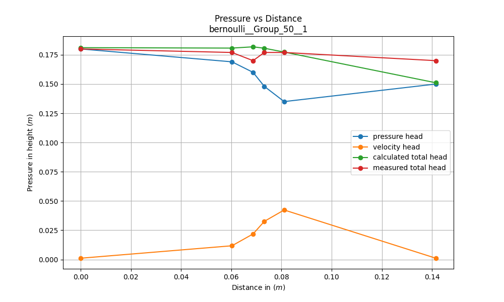

--------------------------------------------------------------------------------

# bernoulli__Group_50__2.csv

## raw data

|   test_section |   volume |   time |   static_head |   total_head |
|---------------:|---------:|-------:|--------------:|-------------:|
|              1 |     1280 |     10 |           250 |          255 |
|              2 |     1280 |     10 |           205 |          253 |
|              3 |     1280 |     10 |           160 |          253 |
|              4 |     1280 |     10 |           111 |          251 |
|              5 |     1280 |     10 |            50 |          248 |
|              6 |     1280 |     10 |           138 |          160 |

## SI units data

|   test_section |    dist |    area |   flow_rate |   velocity |   pressure_head |   velocity_head |   calculated_total_head |   measured_total_head |
|---------------:|--------:|--------:|------------:|-----------:|----------------:|----------------:|------------------------:|----------------------:|
|              1 | 0       | 0.00049 |    0.000128 |   0.261224 |           0.25  |      0.00347799 |                0.253478 |                 0.255 |
|              2 | 0.06028 | 0.00015 |    0.000128 |   0.853333 |           0.205 |      0.0371141  |                0.242114 |                 0.253 |
|              3 | 0.06868 | 0.00011 |    0.000128 |   1.16364  |           0.16  |      0.0690137  |                0.229014 |                 0.253 |
|              4 | 0.07318 | 9e-05   |    0.000128 |   1.42222  |           0.111 |      0.103095   |                0.214095 |                 0.251 |
|              5 | 0.08108 | 7.9e-05 |    0.000128 |   1.62025  |           0.05  |      0.133803   |                0.183803 |                 0.248 |
|              6 | 0.14154 | 0.00049 |    0.000128 |   0.261224 |           0.138 |      0.00347799 |                0.141478 |                 0.16  |

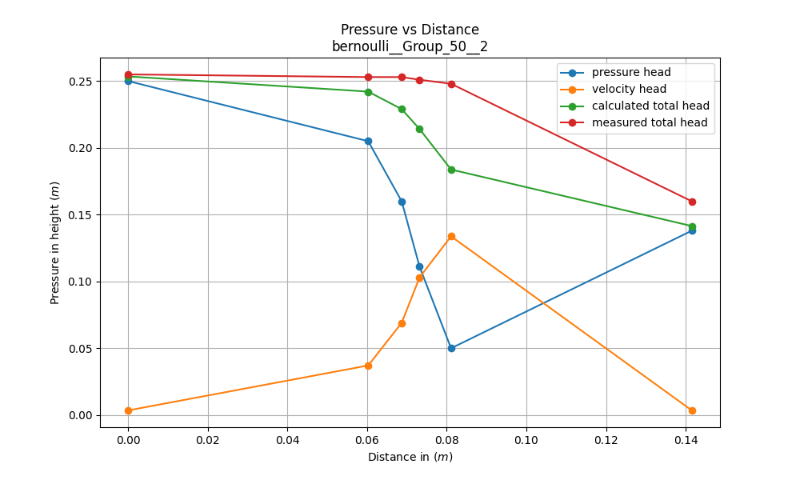

--------------------------------------------------------------------------------

# bernoulli__Group_50__3.csv

## raw data

|   test_section |   volume |   time |   static_head |   total_head |
|---------------:|---------:|-------:|--------------:|-------------:|
|              1 |      920 |     10 |           212 |          214 |
|              2 |      920 |     10 |           190 |          214 |
|              3 |      920 |     10 |           168 |          214 |
|              4 |      920 |     10 |           146 |          209 |
|              5 |      920 |     10 |           115 |          213 |
|              6 |      920 |     10 |           153 |          175 |

## SI units data

|   test_section |    dist |    area |   flow_rate |   velocity |   pressure_head |   velocity_head |   calculated_total_head |   measured_total_head |
|---------------:|--------:|--------:|------------:|-----------:|----------------:|----------------:|------------------------:|----------------------:|
|              1 | 0       | 0.00049 |     9.2e-05 |   0.187755 |           0.212 |      0.00179674 |                0.213797 |                 0.214 |
|              2 | 0.06028 | 0.00015 |     9.2e-05 |   0.613333 |           0.19  |      0.0191732  |                0.209173 |                 0.214 |
|              3 | 0.06868 | 0.00011 |     9.2e-05 |   0.836364 |           0.168 |      0.0356526  |                0.203653 |                 0.214 |
|              4 | 0.07318 | 9e-05   |     9.2e-05 |   1.02222  |           0.146 |      0.0532588  |                0.199259 |                 0.209 |
|              5 | 0.08108 | 7.9e-05 |     9.2e-05 |   1.16456  |           0.115 |      0.069123   |                0.184123 |                 0.213 |
|              6 | 0.14154 | 0.00049 |     9.2e-05 |   0.187755 |           0.153 |      0.00179674 |                0.154797 |                 0.175 |

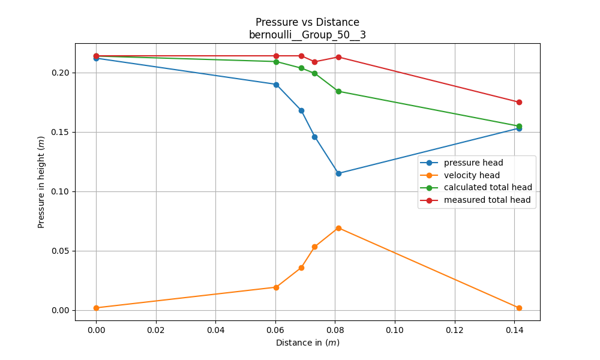

--------------------------------------------------------------------------------

# bernoulli__Group_51__1.csv

## raw data

|   test_section |   volume |   time |   static_head |   total_head |
|---------------:|---------:|-------:|--------------:|-------------:|
|              1 |      780 |  10.24 |           185 |          185 |
|              2 |      780 |  10.24 |           173 |          185 |
|              3 |      780 |  10.24 |           160 |          185 |
|              4 |      780 |  10.24 |           141 |          185 |
|              5 |      780 |  10.24 |           126 |          184 |
|              6 |      780 |  10.24 |           144 |          165 |

## SI units data

|   test_section |    dist |    area |   flow_rate |   velocity |   pressure_head |   velocity_head |   calculated_total_head |   measured_total_head |
|---------------:|--------:|--------:|------------:|-----------:|----------------:|----------------:|------------------------:|----------------------:|
|              1 | 0       | 0.00049 | 7.61719e-05 |   0.155453 |           0.185 |      0.00123168 |                0.186232 |                 0.185 |
|              2 | 0.06028 | 0.00015 | 7.61719e-05 |   0.507812 |           0.173 |      0.0131434  |                0.186143 |                 0.185 |
|              3 | 0.06868 | 0.00011 | 7.61719e-05 |   0.692472 |           0.16  |      0.0244402  |                0.18444  |                 0.185 |
|              4 | 0.07318 | 9e-05   | 7.61719e-05 |   0.846354 |           0.141 |      0.0365094  |                0.177509 |                 0.185 |
|              5 | 0.08108 | 7.9e-05 | 7.61719e-05 |   0.964201 |           0.126 |      0.0473845  |                0.173384 |                 0.184 |
|              6 | 0.14154 | 0.00049 | 7.61719e-05 |   0.155453 |           0.144 |      0.00123168 |                0.145232 |                 0.165 |

--------------------------------------------------------------------------------

# bernoulli__Group_51__2.csv

## raw data

|   test_section |   volume |   time |   static_head |   total_head |
|---------------:|---------:|-------:|--------------:|-------------:|
|              1 |     1150 |  10.37 |           215 |          215 |
|              2 |     1150 |  10.37 |           190 |          215 |
|              3 |     1150 |  10.37 |           162 |          215 |
|              4 |     1150 |  10.37 |           135 |          214 |
|              5 |     1150 |  10.37 |            96 |          215 |
|              6 |     1150 |  10.37 |           132 |          170 |

## SI units data

|   test_section |    dist |    area |   flow_rate |   velocity |   pressure_head |   velocity_head |   calculated_total_head |   measured_total_head |
|---------------:|--------:|--------:|------------:|-----------:|----------------:|----------------:|------------------------:|----------------------:|
|              1 | 0       | 0.00049 | 0.000110897 |   0.22632  |           0.215 |      0.00261064 |                0.217611 |                 0.215 |
|              2 | 0.06028 | 0.00015 | 0.000110897 |   0.739312 |           0.19  |      0.0278584  |                0.217858 |                 0.215 |
|              3 | 0.06868 | 0.00011 | 0.000110897 |   1.00815  |           0.162 |      0.0518029  |                0.213803 |                 0.215 |
|              4 | 0.07318 | 9e-05   | 0.000110897 |   1.23219  |           0.135 |      0.0773845  |                0.212385 |                 0.214 |
|              5 | 0.08108 | 7.9e-05 | 0.000110897 |   1.40376  |           0.096 |      0.100435   |                0.196435 |                 0.215 |
|              6 | 0.14154 | 0.00049 | 0.000110897 |   0.22632  |           0.132 |      0.00261064 |                0.134611 |                 0.17  |

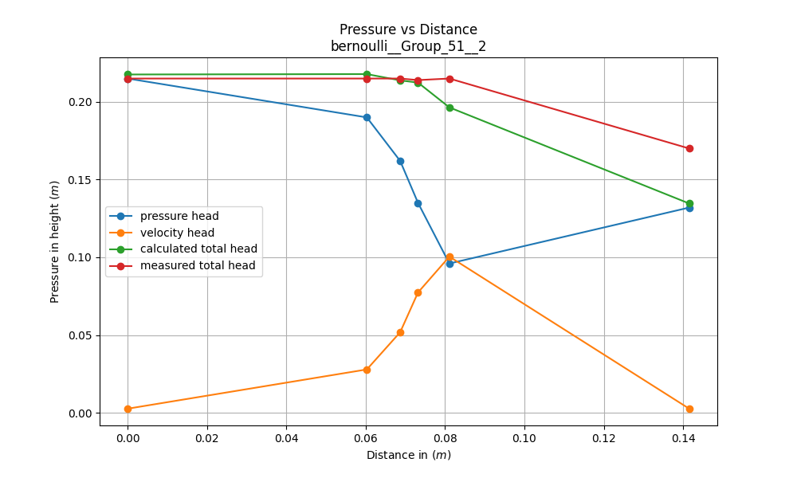

--------------------------------------------------------------------------------

# bernoulli__Group_51__3.csv

## raw data

|   test_section |   volume |   time |   static_head |   total_head |
|---------------:|---------:|-------:|--------------:|-------------:|
|              1 |     1600 |  10.11 |           272 |          275 |
|              2 |     1600 |  10.11 |           216 |          275 |
|              3 |     1600 |  10.11 |           160 |          274 |
|              4 |     1600 |  10.11 |           101 |          273 |
|              5 |     1600 |  10.11 |            24 |          270 |
|              6 |     1600 |  10.11 |           113 |          165 |

## SI units data

|   test_section |    dist |    area |   flow_rate |   velocity |   pressure_head |   velocity_head |   calculated_total_head |   measured_total_head |
|---------------:|--------:|--------:|------------:|-----------:|----------------:|----------------:|------------------------:|----------------------:|
|              1 | 0       | 0.00049 | 0.000158259 |   0.322978 |           0.272 |      0.00531675 |                0.277317 |                 0.275 |
|              2 | 0.06028 | 0.00015 | 0.000158259 |   1.05506  |           0.216 |      0.0567357  |                0.272736 |                 0.275 |
|              3 | 0.06868 | 0.00011 | 0.000158259 |   1.43872  |           0.16  |      0.1055     |                0.2655   |                 0.274 |
|              4 | 0.07318 | 9e-05   | 0.000158259 |   1.75843  |           0.101 |      0.157599   |                0.258599 |                 0.273 |
|              5 | 0.08108 | 7.9e-05 | 0.000158259 |   2.00328  |           0.024 |      0.204543   |                0.228543 |                 0.27  |
|              6 | 0.14154 | 0.00049 | 0.000158259 |   0.322978 |           0.113 |      0.00531675 |                0.118317 |                 0.165 |

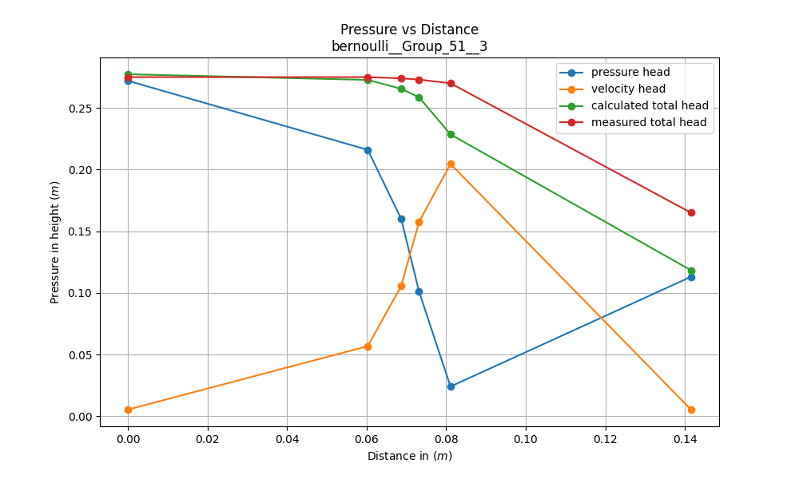

--------------------------------------------------------------------------------

# bernoulli__Group_52__1.csv

## raw data

|   test_section |   volume |   time |   static_head |   total_head |
|---------------:|---------:|-------:|--------------:|-------------:|
|              1 |      929 |   10.3 |           188 |          185 |
|              2 |      929 |   10.3 |           170 |          185 |
|              3 |      929 |   10.3 |           152 |          185 |
|              4 |      929 |   10.3 |           133 |          185 |
|              5 |      929 |   10.3 |           108 |          185 |
|              6 |      929 |   10.3 |           130 |          155 |

## SI units data

|   test_section |    dist |    area |   flow_rate |   velocity |   pressure_head |   velocity_head |   calculated_total_head |   measured_total_head |
|---------------:|--------:|--------:|------------:|-----------:|----------------:|----------------:|------------------------:|----------------------:|
|              1 | 0       | 0.00049 | 9.01942e-05 |   0.18407  |           0.188 |      0.00172689 |                0.189727 |                 0.185 |
|              2 | 0.06028 | 0.00015 | 9.01942e-05 |   0.601294 |           0.17  |      0.0184279  |                0.188428 |                 0.185 |
|              3 | 0.06868 | 0.00011 | 9.01942e-05 |   0.819947 |           0.152 |      0.0342667  |                0.186267 |                 0.185 |
|              4 | 0.07318 | 9e-05   | 9.01942e-05 |   1.00216  |           0.133 |      0.0511886  |                0.184189 |                 0.185 |
|              5 | 0.08108 | 7.9e-05 | 9.01942e-05 |   1.1417   |           0.108 |      0.066436   |                0.174436 |                 0.185 |
|              6 | 0.14154 | 0.00049 | 9.01942e-05 |   0.18407  |           0.13  |      0.00172689 |                0.131727 |                 0.155 |

--------------------------------------------------------------------------------

# bernoulli__Group_52__2.csv

## raw data

|   test_section |   volume |   time |   static_head |   total_head |
|---------------:|---------:|-------:|--------------:|-------------:|
|              1 |     1125 |   10.1 |           203 |          202 |
|              2 |     1125 |   10.1 |           177 |          202 |
|              3 |     1125 |   10.1 |           152 |          202 |
|              4 |     1125 |   10.1 |           126 |          202 |
|              5 |     1125 |   10.1 |            89 |          200 |
|              6 |     1125 |   10.1 |           120 |          154 |

## SI units data

|   test_section |    dist |    area |   flow_rate |   velocity |   pressure_head |   velocity_head |   calculated_total_head |   measured_total_head |
|---------------:|--------:|--------:|------------:|-----------:|----------------:|----------------:|------------------------:|----------------------:|
|              1 | 0       | 0.00049 | 0.000111386 |   0.227319 |           0.203 |      0.00263373 |                0.205634 |                 0.202 |
|              2 | 0.06028 | 0.00015 | 0.000111386 |   0.742574 |           0.177 |      0.0281048  |                0.205105 |                 0.202 |
|              3 | 0.06868 | 0.00011 | 0.000111386 |   1.0126   |           0.152 |      0.052261   |                0.204261 |                 0.202 |
|              4 | 0.07318 | 9e-05   | 0.000111386 |   1.23762  |           0.126 |      0.0780689  |                0.204069 |                 0.202 |
|              5 | 0.08108 | 7.9e-05 | 0.000111386 |   1.40995  |           0.089 |      0.101323   |                0.190323 |                 0.2   |
|              6 | 0.14154 | 0.00049 | 0.000111386 |   0.227319 |           0.12  |      0.00263373 |                0.122634 |                 0.154 |

--------------------------------------------------------------------------------

# bernoulli__Group_52__3.csv

## raw data

|   test_section |   volume |   time |   static_head |   total_head |
|---------------:|---------:|-------:|--------------:|-------------:|
|              1 |     1619 |  10.38 |           256 |          258 |
|              2 |     1619 |  10.38 |           204 |          257 |
|              3 |     1619 |  10.38 |           152 |          258 |
|              4 |     1619 |  10.38 |            97 |          257 |
|              5 |     1619 |  10.38 |            24 |          255 |
|              6 |     1619 |  10.38 |            96 |          153 |

## SI units data

|   test_section |    dist |    area |   flow_rate |   velocity |   pressure_head |   velocity_head |   calculated_total_head |   measured_total_head |
|---------------:|--------:|--------:|------------:|-----------:|----------------:|----------------:|------------------------:|----------------------:|
|              1 | 0       | 0.00049 | 0.000155973 |   0.318312 |           0.256 |      0.00516426 |                0.261164 |                 0.258 |
|              2 | 0.06028 | 0.00015 | 0.000155973 |   1.03982  |           0.204 |      0.0551084  |                0.259108 |                 0.257 |
|              3 | 0.06868 | 0.00011 | 0.000155973 |   1.41794  |           0.152 |      0.102474   |                0.254474 |                 0.258 |
|              4 | 0.07318 | 9e-05   | 0.000155973 |   1.73303  |           0.097 |      0.153079   |                0.250079 |                 0.257 |
|              5 | 0.08108 | 7.9e-05 | 0.000155973 |   1.97434  |           0.024 |      0.198676   |                0.222676 |                 0.255 |
|              6 | 0.14154 | 0.00049 | 0.000155973 |   0.318312 |           0.096 |      0.00516426 |                0.101164 |                 0.153 |

--------------------------------------------------------------------------------

# bernoulli__Group_53__1.csv

## raw data

|   test_section |   volume |   time |   static_head |   total_head |
|---------------:|---------:|-------:|--------------:|-------------:|
|              1 |      780 |     10 |           180 |          175 |
|              2 |      780 |     10 |           165 |          175 |
|              3 |      780 |     10 |           155 |          175 |
|              4 |      780 |     10 |           140 |          175 |
|              5 |      780 |     10 |           120 |          175 |
|              6 |      780 |     10 |           135 |          155 |

## SI units data

|   test_section |    dist |    area |   flow_rate |   velocity |   pressure_head |   velocity_head |   calculated_total_head |   measured_total_head |
|---------------:|--------:|--------:|------------:|-----------:|----------------:|----------------:|------------------------:|----------------------:|
|              1 | 0       | 0.00049 |     7.8e-05 |   0.159184 |           0.18  |      0.00129151 |                0.181292 |                 0.175 |
|              2 | 0.06028 | 0.00015 |     7.8e-05 |   0.52     |           0.165 |      0.0137819  |                0.178782 |                 0.175 |
|              3 | 0.06868 | 0.00011 |     7.8e-05 |   0.709091 |           0.155 |      0.0256274  |                0.180627 |                 0.175 |
|              4 | 0.07318 | 9e-05   |     7.8e-05 |   0.866667 |           0.14  |      0.0382829  |                0.178283 |                 0.175 |
|              5 | 0.08108 | 7.9e-05 |     7.8e-05 |   0.987342 |           0.12  |      0.0496862  |                0.169686 |                 0.175 |
|              6 | 0.14154 | 0.00049 |     7.8e-05 |   0.159184 |           0.135 |      0.00129151 |                0.136292 |                 0.155 |

--------------------------------------------------------------------------------

# bernoulli__Group_53__2.csv

## raw data

|   test_section |   volume |   time |   static_head |   total_head |
|---------------:|---------:|-------:|--------------:|-------------:|
|              1 |      860 |     10 |           185 |          185 |
|              2 |      860 |     10 |           165 |          185 |
|              3 |      860 |     10 |           155 |          185 |
|              4 |      860 |     10 |           135 |          185 |
|              5 |      860 |     10 |           110 |          185 |
|              6 |      860 |     10 |           130 |          155 |

## SI units data

|   test_section |    dist |    area |   flow_rate |   velocity |   pressure_head |   velocity_head |   calculated_total_head |   measured_total_head |
|---------------:|--------:|--------:|------------:|-----------:|----------------:|----------------:|------------------------:|----------------------:|
|              1 | 0       | 0.00049 |     8.6e-05 |   0.17551  |           0.185 |      0.00157002 |                0.18657  |                 0.185 |
|              2 | 0.06028 | 0.00015 |     8.6e-05 |   0.573333 |           0.165 |      0.0167539  |                0.181754 |                 0.185 |
|              3 | 0.06868 | 0.00011 |     8.6e-05 |   0.781818 |           0.155 |      0.0311539  |                0.186154 |                 0.185 |
|              4 | 0.07318 | 9e-05   |     8.6e-05 |   0.955556 |           0.135 |      0.0465386  |                0.181539 |                 0.185 |
|              5 | 0.08108 | 7.9e-05 |     8.6e-05 |   1.08861  |           0.11  |      0.0604009  |                0.170401 |                 0.185 |
|              6 | 0.14154 | 0.00049 |     8.6e-05 |   0.17551  |           0.13  |      0.00157002 |                0.13157  |                 0.155 |

--------------------------------------------------------------------------------

# bernoulli__Group_53__3.csv

## raw data

|   test_section |   volume |   time |   static_head |   total_head |
|---------------:|---------:|-------:|--------------:|-------------:|
|              1 |     1120 |     10 |           205 |          205 |
|              2 |     1120 |     10 |           180 |          205 |
|              3 |     1120 |     10 |           155 |          205 |
|              4 |     1120 |     10 |           135 |          205 |
|              5 |     1120 |     10 |           100 |          205 |
|              6 |     1120 |     10 |           135 |          155 |

## SI units data

|   test_section |    dist |    area |   flow_rate |   velocity |   pressure_head |   velocity_head |   calculated_total_head |   measured_total_head |
|---------------:|--------:|--------:|------------:|-----------:|----------------:|----------------:|------------------------:|----------------------:|
|              1 | 0       | 0.00049 |    0.000112 |   0.228571 |           0.205 |      0.00266284 |                0.207663 |                 0.205 |
|              2 | 0.06028 | 0.00015 |    0.000112 |   0.746667 |           0.18  |      0.0284154  |                0.208415 |                 0.205 |
|              3 | 0.06868 | 0.00011 |    0.000112 |   1.01818  |           0.155 |      0.0528386  |                0.207839 |                 0.205 |
|              4 | 0.07318 | 9e-05   |    0.000112 |   1.24444  |           0.135 |      0.0789318  |                0.213932 |                 0.205 |
|              5 | 0.08108 | 7.9e-05 |    0.000112 |   1.41772  |           0.1   |      0.102443   |                0.202443 |                 0.205 |
|              6 | 0.14154 | 0.00049 |    0.000112 |   0.228571 |           0.135 |      0.00266284 |                0.137663 |                 0.155 |

--------------------------------------------------------------------------------

# bernoulli__Group_54__1.csv

## raw data

|   test_section |   volume |   time |   static_head |   total_head |
|---------------:|---------:|-------:|--------------:|-------------:|
|              1 |      800 |     10 |         185   |          180 |
|              2 |      800 |     10 |         170   |          180 |
|              3 |      800 |     10 |         157.5 |          180 |
|              4 |      800 |     10 |         143   |          180 |
|              5 |      800 |     10 |         126   |          180 |
|              6 |      800 |     10 |         144   |          162 |

## SI units data

|   test_section |    dist |    area |   flow_rate |   velocity |   pressure_head |   velocity_head |   calculated_total_head |   measured_total_head |
|---------------:|--------:|--------:|------------:|-----------:|----------------:|----------------:|------------------------:|----------------------:|
|              1 | 0       | 0.00049 |       8e-05 |   0.163265 |          0.185  |      0.00135859 |                0.186359 |                 0.18  |
|              2 | 0.06028 | 0.00015 |       8e-05 |   0.533333 |          0.17   |      0.0144977  |                0.184498 |                 0.18  |
|              3 | 0.06868 | 0.00011 |       8e-05 |   0.727273 |          0.1575 |      0.0269585  |                0.184458 |                 0.18  |
|              4 | 0.07318 | 9e-05   |       8e-05 |   0.888889 |          0.143  |      0.0402713  |                0.183271 |                 0.18  |
|              5 | 0.08108 | 7.9e-05 |       8e-05 |   1.01266  |          0.126  |      0.0522669  |                0.178267 |                 0.18  |
|              6 | 0.14154 | 0.00049 |       8e-05 |   0.163265 |          0.144  |      0.00135859 |                0.145359 |                 0.162 |

--------------------------------------------------------------------------------

# bernoulli__Group_54__2.csv

## raw data

|   test_section |   volume |   time |   static_head |   total_head |
|---------------:|---------:|-------:|--------------:|-------------:|
|              1 |      990 |     10 |           192 |          197 |
|              2 |      990 |     10 |           172 |          197 |
|              3 |      990 |     10 |           158 |          197 |
|              4 |      990 |     10 |           140 |          197 |
|              5 |      990 |     10 |           114 |          197 |
|              6 |      990 |     10 |           140 |          162 |

## SI units data

|   test_section |    dist |    area |   flow_rate |   velocity |   pressure_head |   velocity_head |   calculated_total_head |   measured_total_head |
|---------------:|--------:|--------:|------------:|-----------:|----------------:|----------------:|------------------------:|----------------------:|
|              1 | 0       | 0.00049 |     9.9e-05 |   0.202041 |           0.192 |      0.00208056 |                0.194081 |                 0.197 |
|              2 | 0.06028 | 0.00015 |     9.9e-05 |   0.66     |           0.172 |      0.0222018  |                0.194202 |                 0.197 |
|              3 | 0.06868 | 0.00011 |     9.9e-05 |   0.9      |           0.158 |      0.0412844  |                0.199284 |                 0.197 |
|              4 | 0.07318 | 9e-05   |     9.9e-05 |   1.1      |           0.14  |      0.0616718  |                0.201672 |                 0.197 |
|              5 | 0.08108 | 7.9e-05 |     9.9e-05 |   1.25316  |           0.114 |      0.0800419  |                0.194042 |                 0.197 |
|              6 | 0.14154 | 0.00049 |     9.9e-05 |   0.202041 |           0.14  |      0.00208056 |                0.142081 |                 0.162 |

--------------------------------------------------------------------------------

# bernoulli__Group_54__3.csv

## raw data

|   test_section |   volume |   time |   static_head |   total_head |
|---------------:|---------:|-------:|--------------:|-------------:|
|              1 |     1550 |     10 |           255 |          255 |
|              2 |     1550 |     10 |           210 |          255 |
|              3 |     1550 |     10 |           163 |          255 |
|              4 |     1550 |     10 |           117 |          255 |
|              5 |     1550 |     10 |            59 |          255 |
|              6 |     1550 |     10 |           138 |          160 |

## SI units data

|   test_section |    dist |    area |   flow_rate |   velocity |   pressure_head |   velocity_head |   calculated_total_head |   measured_total_head |
|---------------:|--------:|--------:|------------:|-----------:|----------------:|----------------:|------------------------:|----------------------:|
|              1 | 0       | 0.00049 |    0.000155 |   0.316327 |           0.255 |      0.00510002 |                0.2601   |                 0.255 |
|              2 | 0.06028 | 0.00015 |    0.000155 |   1.03333  |           0.21  |      0.0544229  |                0.264423 |                 0.255 |
|              3 | 0.06868 | 0.00011 |    0.000155 |   1.40909  |           0.163 |      0.1012     |                0.2642   |                 0.255 |
|              4 | 0.07318 | 9e-05   |    0.000155 |   1.72222  |           0.117 |      0.151175   |                0.268175 |                 0.255 |
|              5 | 0.08108 | 7.9e-05 |    0.000155 |   1.96203  |           0.059 |      0.196205   |                0.255205 |                 0.255 |
|              6 | 0.14154 | 0.00049 |    0.000155 |   0.316327 |           0.138 |      0.00510002 |                0.1431   |                 0.16  |

--------------------------------------------------------------------------------

# bernoulli__Group_55__1.csv

## raw data

|   test_section |   volume |   time |   static_head |   total_head |
|---------------:|---------:|-------:|--------------:|-------------:|
|              1 |      820 |     10 |           186 |          185 |
|              2 |      820 |     10 |           172 |          184 |
|              3 |      820 |     10 |           157 |          184 |
|              4 |      820 |     10 |           143 |          184 |
|              5 |      820 |     10 |           123 |          183 |
|              6 |      820 |     10 |           131 |          165 |

## SI units data

|   test_section |    dist |    area |   flow_rate |   velocity |   pressure_head |   velocity_head |   calculated_total_head |   measured_total_head |
|---------------:|--------:|--------:|------------:|-----------:|----------------:|----------------:|------------------------:|----------------------:|
|              1 | 0       | 0.00049 |     8.2e-05 |   0.167347 |           0.186 |      0.00142737 |                0.187427 |                 0.185 |
|              2 | 0.06028 | 0.00015 |     8.2e-05 |   0.546667 |           0.172 |      0.0152316  |                0.187232 |                 0.184 |
|              3 | 0.06868 | 0.00011 |     8.2e-05 |   0.745455 |           0.157 |      0.0283233  |                0.185323 |                 0.184 |
|              4 | 0.07318 | 9e-05   |     8.2e-05 |   0.911111 |           0.143 |      0.0423101  |                0.18531  |                 0.184 |
|              5 | 0.08108 | 7.9e-05 |     8.2e-05 |   1.03797  |           0.123 |      0.0549129  |                0.177913 |                 0.183 |
|              6 | 0.14154 | 0.00049 |     8.2e-05 |   0.167347 |           0.131 |      0.00142737 |                0.132427 |                 0.165 |

--------------------------------------------------------------------------------

# bernoulli__Group_55__2.csv

## raw data

|   test_section |   volume |   time |   static_head |   total_head |
|---------------:|---------:|-------:|--------------:|-------------:|
|              1 |      960 |     10 |           193 |          195 |
|              2 |      960 |     10 |           175 |          195 |
|              3 |      960 |     10 |           156 |          195 |
|              4 |      960 |     10 |           136 |          195 |
|              5 |      960 |     10 |           109 |          194 |
|              6 |      960 |     10 |           135 |          162 |

## SI units data

|   test_section |    dist |    area |   flow_rate |   velocity |   pressure_head |   velocity_head |   calculated_total_head |   measured_total_head |
|---------------:|--------:|--------:|------------:|-----------:|----------------:|----------------:|------------------------:|----------------------:|
|              1 | 0       | 0.00049 |     9.6e-05 |   0.195918 |           0.193 |      0.00195637 |                0.194956 |                 0.195 |
|              2 | 0.06028 | 0.00015 |     9.6e-05 |   0.64     |           0.175 |      0.0208767  |                0.195877 |                 0.195 |
|              3 | 0.06868 | 0.00011 |     9.6e-05 |   0.872727 |           0.156 |      0.0388202  |                0.19482  |                 0.195 |
|              4 | 0.07318 | 9e-05   |     9.6e-05 |   1.06667  |           0.136 |      0.0579907  |                0.193991 |                 0.195 |
|              5 | 0.08108 | 7.9e-05 |     9.6e-05 |   1.21519  |           0.109 |      0.0752643  |                0.184264 |                 0.194 |
|              6 | 0.14154 | 0.00049 |     9.6e-05 |   0.195918 |           0.135 |      0.00195637 |                0.136956 |                 0.162 |

--------------------------------------------------------------------------------

# bernoulli__Group_55__3.csv

## raw data

|   test_section |   volume |   time |   static_head |   total_head |
|---------------:|---------:|-------:|--------------:|-------------:|
|              1 |     1320 |     10 |           230 |          230 |
|              2 |     1320 |     10 |           193 |          230 |
|              3 |     1320 |     10 |           154 |          230 |
|              4 |     1320 |     10 |           114 |          230 |
|              5 |     1320 |     10 |            63 |          227 |
|              6 |     1320 |     10 |           136 |          160 |

## SI units data

|   test_section |    dist |    area |   flow_rate |   velocity |   pressure_head |   velocity_head |   calculated_total_head |   measured_total_head |
|---------------:|--------:|--------:|------------:|-----------:|----------------:|----------------:|------------------------:|----------------------:|
|              1 | 0       | 0.00049 |    0.000132 |   0.269388 |           0.23  |      0.00369876 |                0.233699 |                 0.23  |
|              2 | 0.06028 | 0.00015 |    0.000132 |   0.88     |           0.193 |      0.0394699  |                0.23247  |                 0.23  |
|              3 | 0.06868 | 0.00011 |    0.000132 |   1.2      |           0.154 |      0.0733945  |                0.227394 |                 0.23  |
|              4 | 0.07318 | 9e-05   |    0.000132 |   1.46667  |           0.114 |      0.109639   |                0.223639 |                 0.23  |
|              5 | 0.08108 | 7.9e-05 |    0.000132 |   1.67089  |           0.063 |      0.142297   |                0.205297 |                 0.227 |
|              6 | 0.14154 | 0.00049 |    0.000132 |   0.269388 |           0.136 |      0.00369876 |                0.139699 |                 0.16  |

--------------------------------------------------------------------------------

# bernoulli__Group_56__1.csv

## raw data

|   test_section |   volume |   time |   static_head |   total_head |
|---------------:|---------:|-------:|--------------:|-------------:|
|              1 |      810 |     10 |           184 |          178 |
|              2 |      810 |     10 |           168 |          180 |
|              3 |      810 |     10 |           155 |          180 |
|              4 |      810 |     10 |           140 |          180 |
|              5 |      810 |     10 |           122 |          180 |
|              6 |      810 |     10 |           140 |          160 |

## SI units data

|   test_section |    dist |    area |   flow_rate |   velocity |   pressure_head |   velocity_head |   calculated_total_head |   measured_total_head |
|---------------:|--------:|--------:|------------:|-----------:|----------------:|----------------:|------------------------:|----------------------:|
|              1 | 0       | 0.00049 |     8.1e-05 |   0.165306 |           0.184 |      0.00139277 |                0.185393 |                 0.178 |
|              2 | 0.06028 | 0.00015 |     8.1e-05 |   0.54     |           0.168 |      0.0148624  |                0.182862 |                 0.18  |
|              3 | 0.06868 | 0.00011 |     8.1e-05 |   0.736364 |           0.155 |      0.0276367  |                0.182637 |                 0.18  |
|              4 | 0.07318 | 9e-05   |     8.1e-05 |   0.9      |           0.14  |      0.0412844  |                0.181284 |                 0.18  |
|              5 | 0.08108 | 7.9e-05 |     8.1e-05 |   1.02532  |           0.122 |      0.0535817  |                0.175582 |                 0.18  |
|              6 | 0.14154 | 0.00049 |     8.1e-05 |   0.165306 |           0.14  |      0.00139277 |                0.141393 |                 0.16  |

--------------------------------------------------------------------------------

# bernoulli__Group_56__2.csv

## raw data

|   test_section |   volume |   time |   static_head |   total_head |
|---------------:|---------:|-------:|--------------:|-------------:|
|              1 |      900 |     10 |           190 |          186 |
|              2 |      900 |     10 |           174 |          187 |
|              3 |      900 |     10 |           155 |          188 |
|              4 |      900 |     10 |           138 |          188 |
|              5 |      900 |     10 |           115 |          188 |
|              6 |      900 |     10 |           141 |          157 |

## SI units data

|   test_section |    dist |    area |   flow_rate |   velocity |   pressure_head |   velocity_head |   calculated_total_head |   measured_total_head |
|---------------:|--------:|--------:|------------:|-----------:|----------------:|----------------:|------------------------:|----------------------:|
|              1 | 0       | 0.00049 |       9e-05 |   0.183673 |           0.19  |      0.00171947 |                0.191719 |                 0.186 |
|              2 | 0.06028 | 0.00015 |       9e-05 |   0.6      |           0.174 |      0.0183486  |                0.192349 |                 0.187 |
|              3 | 0.06868 | 0.00011 |       9e-05 |   0.818182 |           0.155 |      0.0341193  |                0.189119 |                 0.188 |
|              4 | 0.07318 | 9e-05   |       9e-05 |   1        |           0.138 |      0.0509684  |                0.188968 |                 0.188 |
|              5 | 0.08108 | 7.9e-05 |       9e-05 |   1.13924  |           0.115 |      0.0661503  |                0.18115  |                 0.188 |
|              6 | 0.14154 | 0.00049 |       9e-05 |   0.183673 |           0.141 |      0.00171947 |                0.142719 |                 0.157 |

--------------------------------------------------------------------------------

# bernoulli__Group_56__3.csv

## raw data

|   test_section |   volume |   time |   static_head |   total_head |
|---------------:|---------:|-------:|--------------:|-------------:|
|              1 |     1580 |     10 |           253 |          251 |
|              2 |     1580 |     10 |           206 |          252 |
|              3 |     1580 |     10 |           160 |          252 |
|              4 |     1580 |     10 |           115 |          252 |
|              5 |     1580 |     10 |            53 |          250 |
|              6 |     1580 |     10 |           130 |          150 |

## SI units data

|   test_section |    dist |    area |   flow_rate |   velocity |   pressure_head |   velocity_head |   calculated_total_head |   measured_total_head |
|---------------:|--------:|--------:|------------:|-----------:|----------------:|----------------:|------------------------:|----------------------:|
|              1 | 0       | 0.00049 |    0.000158 |   0.322449 |           0.253 |      0.00529935 |                0.258299 |                 0.251 |
|              2 | 0.06028 | 0.00015 |    0.000158 |   1.05333  |           0.206 |      0.05655    |                0.26255  |                 0.252 |
|              3 | 0.06868 | 0.00011 |    0.000158 |   1.43636  |           0.16  |      0.105155   |                0.265155 |                 0.252 |
|              4 | 0.07318 | 9e-05   |    0.000158 |   1.75556  |           0.115 |      0.157083   |                0.272083 |                 0.252 |
|              5 | 0.08108 | 7.9e-05 |    0.000158 |   2        |           0.053 |      0.203874   |                0.256874 |                 0.25  |
|              6 | 0.14154 | 0.00049 |    0.000158 |   0.322449 |           0.13  |      0.00529935 |                0.135299 |                 0.15  |

--------------------------------------------------------------------------------

# bernoulli__Group_57__1.csv

## raw data

|   test_section |   volume |   time |   static_head |   total_head |
|---------------:|---------:|-------:|--------------:|-------------:|
|              1 |     1667 |     10 |           265 |          264 |
|              2 |     1667 |     10 |           205 |          264 |
|              3 |     1667 |     10 |           145 |          260 |
|              4 |     1667 |     10 |            84 |          260 |
|              5 |     1667 |     10 |            10 |          252 |
|              6 |     1667 |     10 |           108 |          138 |

## SI units data

|   test_section |    dist |    area |   flow_rate |   velocity |   pressure_head |   velocity_head |   calculated_total_head |   measured_total_head |
|---------------:|--------:|--------:|------------:|-----------:|----------------:|----------------:|------------------------:|----------------------:|
|              1 | 0       | 0.00049 |   0.0001667 |   0.340204 |           0.265 |      0.00589902 |                0.270899 |                 0.264 |
|              2 | 0.06028 | 0.00015 |   0.0001667 |   1.11133  |           0.205 |      0.0629491  |                0.267949 |                 0.264 |
|              3 | 0.06868 | 0.00011 |   0.0001667 |   1.51545  |           0.145 |      0.117054   |                0.262054 |                 0.26  |
|              4 | 0.07318 | 9e-05   |   0.0001667 |   1.85222  |           0.084 |      0.174859   |                0.258859 |                 0.26  |
|              5 | 0.08108 | 7.9e-05 |   0.0001667 |   2.11013  |           0.01  |      0.226944   |                0.236944 |                 0.252 |
|              6 | 0.14154 | 0.00049 |   0.0001667 |   0.340204 |           0.108 |      0.00589902 |                0.113899 |                 0.138 |

--------------------------------------------------------------------------------

# bernoulli__Group_57__2.csv

## raw data

|   test_section |   volume |   time |   static_head |   total_head |
|---------------:|---------:|-------:|--------------:|-------------:|
|              1 |      783 |     10 |           163 |          157 |
|              2 |      783 |     10 |           150 |          157 |
|              3 |      783 |     10 |           137 |          157 |
|              4 |      783 |     10 |           125 |          157 |
|              5 |      783 |     10 |           109 |          156 |
|              6 |      783 |     10 |           125 |          140 |

## SI units data

|   test_section |    dist |    area |   flow_rate |   velocity |   pressure_head |   velocity_head |   calculated_total_head |   measured_total_head |
|---------------:|--------:|--------:|------------:|-----------:|----------------:|----------------:|------------------------:|----------------------:|
|              1 | 0       | 0.00049 |    7.83e-05 |   0.159796 |           0.163 |      0.00130146 |                0.164301 |                 0.157 |
|              2 | 0.06028 | 0.00015 |    7.83e-05 |   0.522    |           0.15  |      0.0138881  |                0.163888 |                 0.157 |
|              3 | 0.06868 | 0.00011 |    7.83e-05 |   0.711818 |           0.137 |      0.0258249  |                0.162825 |                 0.157 |
|              4 | 0.07318 | 9e-05   |    7.83e-05 |   0.87     |           0.125 |      0.038578   |                0.163578 |                 0.157 |
|              5 | 0.08108 | 7.9e-05 |    7.83e-05 |   0.991139 |           0.109 |      0.0500692  |                0.159069 |                 0.156 |
|              6 | 0.14154 | 0.00049 |    7.83e-05 |   0.159796 |           0.125 |      0.00130146 |                0.126301 |                 0.14  |

--------------------------------------------------------------------------------

# bernoulli__Group_57__3.csv

## raw data

|   test_section |   volume |   time |   static_head |   total_head |
|---------------:|---------:|-------:|--------------:|-------------:|
|              1 |     1197 |     10 |           195 |          194 |
|              2 |     1197 |     10 |           167 |          194 |
|              3 |     1197 |     10 |           140 |          193 |
|              4 |     1197 |     10 |           112 |          192 |
|              5 |     1197 |     10 |            77 |          190 |
|              6 |     1197 |     10 |           116 |          137 |

## SI units data

|   test_section |    dist |    area |   flow_rate |   velocity |   pressure_head |   velocity_head |   calculated_total_head |   measured_total_head |
|---------------:|--------:|--------:|------------:|-----------:|----------------:|----------------:|------------------------:|----------------------:|
|              1 | 0       | 0.00049 |   0.0001197 |   0.244286 |           0.195 |      0.00304157 |                0.198042 |                 0.194 |
|              2 | 0.06028 | 0.00015 |   0.0001197 |   0.798    |           0.167 |      0.0324569  |                0.199457 |                 0.194 |
|              3 | 0.06868 | 0.00011 |   0.0001197 |   1.08818  |           0.14  |      0.0603537  |                0.200354 |                 0.193 |
|              4 | 0.07318 | 9e-05   |   0.0001197 |   1.33     |           0.112 |      0.090158   |                0.202158 |                 0.192 |
|              5 | 0.08108 | 7.9e-05 |   0.0001197 |   1.51519  |           0.077 |      0.117013   |                0.194013 |                 0.19  |
|              6 | 0.14154 | 0.00049 |   0.0001197 |   0.244286 |           0.116 |      0.00304157 |                0.119042 |                 0.137 |

--------------------------------------------------------------------------------

# bernoulli__Group_58__1.csv

## raw data

|   test_section |   volume |   time |   static_head |   total_head |
|---------------:|---------:|-------:|--------------:|-------------:|
|              1 |     1675 |   10.3 |           292 |          294 |
|              2 |     1675 |   10.3 |           239 |          294 |
|              3 |     1675 |   10.3 |           187 |          292 |
|              4 |     1675 |   10.3 |           134 |          290 |
|              5 |     1675 |   10.3 |            69 |          286 |
|              6 |     1675 |   10.3 |           155 |          181 |

## SI units data

|   test_section |    dist |    area |   flow_rate |   velocity |   pressure_head |   velocity_head |   calculated_total_head |   measured_total_head |
|---------------:|--------:|--------:|------------:|-----------:|----------------:|----------------:|------------------------:|----------------------:|
|              1 | 0       | 0.00049 | 0.000162621 |    0.33188 |           0.292 |      0.00561389 |                0.297614 |                 0.294 |
|              2 | 0.06028 | 0.00015 | 0.000162621 |    1.08414 |           0.239 |      0.0599065  |                0.298906 |                 0.294 |
|              3 | 0.06868 | 0.00011 | 0.000162621 |    1.47838 |           0.187 |      0.111396   |                0.298396 |                 0.292 |
|              4 | 0.07318 | 9e-05   | 0.000162621 |    1.8069  |           0.134 |      0.166407   |                0.300407 |                 0.29  |
|              5 | 0.08108 | 7.9e-05 | 0.000162621 |    2.0585  |           0.069 |      0.215974   |                0.284974 |                 0.286 |
|              6 | 0.14154 | 0.00049 | 0.000162621 |    0.33188 |           0.155 |      0.00561389 |                0.160614 |                 0.181 |

--------------------------------------------------------------------------------

# bernoulli__Group_58__2.csv

## raw data

|   test_section |   volume |   time |   static_head |   total_head |
|---------------:|---------:|-------:|--------------:|-------------:|
|              1 |     1200 |  10.16 |           240 |          246 |
|              2 |     1200 |  10.16 |           216 |          240 |
|              3 |     1200 |  10.16 |           185 |          239 |
|              4 |     1200 |  10.16 |           153 |          239 |
|              5 |     1200 |  10.16 |           116 |          238 |
|              6 |     1200 |  10.16 |           159 |          187 |

## SI units data

|   test_section |    dist |    area |   flow_rate |   velocity |   pressure_head |   velocity_head |   calculated_total_head |   measured_total_head |
|---------------:|--------:|--------:|------------:|-----------:|----------------:|----------------:|------------------------:|----------------------:|
|              1 | 0       | 0.00049 |  0.00011811 |   0.241041 |           0.24  |      0.00296131 |                0.242961 |                 0.246 |
|              2 | 0.06028 | 0.00015 |  0.00011811 |   0.787402 |           0.216 |      0.0316005  |                0.2476   |                 0.24  |
|              3 | 0.06868 | 0.00011 |  0.00011811 |   1.07373  |           0.185 |      0.0587612  |                0.243761 |                 0.239 |
|              4 | 0.07318 | 9e-05   |  0.00011811 |   1.31234  |           0.153 |      0.0877791  |                0.240779 |                 0.239 |
|              5 | 0.08108 | 7.9e-05 |  0.00011811 |   1.49507  |           0.116 |      0.113926   |                0.229926 |                 0.238 |
|              6 | 0.14154 | 0.00049 |  0.00011811 |   0.241041 |           0.159 |      0.00296131 |                0.161961 |                 0.187 |

--------------------------------------------------------------------------------

# bernoulli__Group_58__3.csv

## raw data

|   test_section |   volume |   time |   static_head |   total_head |
|---------------:|---------:|-------:|--------------:|-------------:|
|              1 |      950 |  10.07 |           210 |          219 |
|              2 |      950 |  10.07 |           201 |          210 |
|              3 |      950 |  10.07 |           183 |          210 |
|              4 |      950 |  10.07 |           162 |          209 |
|              5 |      950 |  10.07 |           138 |          208 |
|              6 |      950 |  10.07 |           163 |          183 |

## SI units data

|   test_section |    dist |    area |   flow_rate |   velocity |   pressure_head |   velocity_head |   calculated_total_head |   measured_total_head |
|---------------:|--------:|--------:|------------:|-----------:|----------------:|----------------:|------------------------:|----------------------:|
|              1 | 0       | 0.00049 | 9.43396e-05 |   0.19253  |           0.21  |      0.00188928 |                0.211889 |                 0.219 |
|              2 | 0.06028 | 0.00015 | 9.43396e-05 |   0.628931 |           0.201 |      0.0201608  |                0.221161 |                 0.21  |
|              3 | 0.06868 | 0.00011 | 9.43396e-05 |   0.857633 |           0.183 |      0.037489   |                0.220489 |                 0.21  |
|              4 | 0.07318 | 9e-05   | 9.43396e-05 |   1.04822  |           0.162 |      0.0560021  |                0.218002 |                 0.209 |
|              5 | 0.08108 | 7.9e-05 | 9.43396e-05 |   1.19417  |           0.138 |      0.0726834  |                0.210683 |                 0.208 |
|              6 | 0.14154 | 0.00049 | 9.43396e-05 |   0.19253  |           0.163 |      0.00188928 |                0.164889 |                 0.183 |

--------------------------------------------------------------------------------

# bernoulli__Group_59__1.csv

## raw data

|   test_section |   volume |   time |   static_head |   total_head |
|---------------:|---------:|-------:|--------------:|-------------:|
|              1 |     1826 |     10 |           277 |          275 |
|              2 |     1826 |     10 |           218 |          276 |
|              3 |     1826 |     10 |           162 |          276 |
|              4 |     1826 |     10 |           105 |          275 |
|              5 |     1826 |     10 |            27 |          271 |
|              6 |     1826 |     10 |           122 |          150 |

## SI units data

|   test_section |    dist |    area |   flow_rate |   velocity |   pressure_head |   velocity_head |   calculated_total_head |   measured_total_head |
|---------------:|--------:|--------:|------------:|-----------:|----------------:|----------------:|------------------------:|----------------------:|
|              1 | 0       | 0.00049 |   0.0001826 |   0.372653 |           0.277 |       0.007078  |                0.284078 |                 0.275 |
|              2 | 0.06028 | 0.00015 |   0.0001826 |   1.21733  |           0.218 |       0.0755301 |                0.29353  |                 0.276 |
|              3 | 0.06868 | 0.00011 |   0.0001826 |   1.66     |           0.162 |       0.140449  |                0.302449 |                 0.276 |
|              4 | 0.07318 | 9e-05   |   0.0001826 |   2.02889  |           0.105 |       0.209806  |                0.314806 |                 0.275 |
|              5 | 0.08108 | 7.9e-05 |   0.0001826 |   2.31139  |           0.027 |       0.2723    |                0.2993   |                 0.271 |
|              6 | 0.14154 | 0.00049 |   0.0001826 |   0.372653 |           0.122 |       0.007078  |                0.129078 |                 0.15  |

--------------------------------------------------------------------------------

# bernoulli__Group_59__2.csv

## raw data

|   test_section |   volume |   time |   static_head |   total_head |
|---------------:|---------:|-------:|--------------:|-------------:|
|              1 |     1049 |     10 |           203 |          200 |
|              2 |     1049 |     10 |           179 |          199 |
|              3 |     1049 |     10 |           156 |          199 |
|              4 |     1049 |     10 |           132 |          198 |
|              5 |     1049 |     10 |           100 |          197 |
|              6 |     1049 |     10 |           134 |          150 |

## SI units data

|   test_section |    dist |    area |   flow_rate |   velocity |   pressure_head |   velocity_head |   calculated_total_head |   measured_total_head |
|---------------:|--------:|--------:|------------:|-----------:|----------------:|----------------:|------------------------:|----------------------:|
|              1 | 0       | 0.00049 |   0.0001049 |   0.214082 |           0.203 |      0.00233593 |                0.205336 |                 0.2   |
|              2 | 0.06028 | 0.00015 |   0.0001049 |   0.699333 |           0.179 |      0.024927   |                0.203927 |                 0.199 |
|              3 | 0.06868 | 0.00011 |   0.0001049 |   0.953636 |           0.156 |      0.0463518  |                0.202352 |                 0.199 |
|              4 | 0.07318 | 9e-05   |   0.0001049 |   1.16556  |           0.132 |      0.0692416  |                0.201242 |                 0.198 |
|              5 | 0.08108 | 7.9e-05 |   0.0001049 |   1.32785  |           0.1   |      0.0898665  |                0.189866 |                 0.197 |
|              6 | 0.14154 | 0.00049 |   0.0001049 |   0.214082 |           0.134 |      0.00233593 |                0.136336 |                 0.15  |

--------------------------------------------------------------------------------

# bernoulli__Group_59__3.csv

## raw data

|   test_section |   volume |   time |   static_head |   total_head |
|---------------:|---------:|-------:|--------------:|-------------:|
|              1 |    628.6 |     10 |           167 |          165 |
|              2 |    628.6 |     10 |           159 |          164 |
|              3 |    628.6 |     10 |           153 |          164 |
|              4 |    628.6 |     10 |           143 |          164 |
|              5 |    628.6 |     10 |           133 |          163 |
|              6 |    628.6 |     10 |           141 |          155 |

## SI units data

|   test_section |    dist |    area |   flow_rate |   velocity |   pressure_head |   velocity_head |   calculated_total_head |   measured_total_head |
|---------------:|--------:|--------:|------------:|-----------:|----------------:|----------------:|------------------------:|----------------------:|
|              1 | 0       | 0.00049 |   6.286e-05 |   0.128286 |           0.167 |     0.000838798 |                0.167839 |                 0.165 |
|              2 | 0.06028 | 0.00015 |   6.286e-05 |   0.419067 |           0.159 |     0.00895091  |                0.167951 |                 0.164 |
|              3 | 0.06868 | 0.00011 |   6.286e-05 |   0.571455 |           0.153 |     0.0166443   |                0.169644 |                 0.164 |
|              4 | 0.07318 | 9e-05   |   6.286e-05 |   0.698444 |           0.143 |     0.0248636   |                0.167864 |                 0.164 |
|              5 | 0.08108 | 7.9e-05 |   6.286e-05 |   0.795696 |           0.133 |     0.0322697   |                0.16527  |                 0.163 |
|              6 | 0.14154 | 0.00049 |   6.286e-05 |   0.128286 |           0.141 |     0.000838798 |                0.141839 |                 0.155 |

--------------------------------------------------------------------------------

# bernoulli__Group_60__1.csv

## raw data

|   test_section |   volume |   time |   static_head |   total_head |
|---------------:|---------:|-------:|--------------:|-------------:|
|              1 |     1810 |     10 |           285 |          287 |
|              2 |     1810 |     10 |           230 |          287 |
|              3 |     1810 |     10 |           165 |          287 |
|              4 |     1810 |     10 |           105 |          287 |
|              5 |     1810 |     10 |            25 |          285 |
|              6 |     1810 |     10 |           125 |          160 |

## SI units data

|   test_section |    dist |    area |   flow_rate |   velocity |   pressure_head |   velocity_head |   calculated_total_head |   measured_total_head |
|---------------:|--------:|--------:|------------:|-----------:|----------------:|----------------:|------------------------:|----------------------:|
|              1 | 0       | 0.00049 |    0.000181 |   0.369388 |           0.285 |       0.0069545 |                0.291955 |                 0.287 |
|              2 | 0.06028 | 0.00015 |    0.000181 |   1.20667  |           0.23  |       0.0742123 |                0.304212 |                 0.287 |
|              3 | 0.06868 | 0.00011 |    0.000181 |   1.64545  |           0.165 |       0.137998  |                0.302998 |                 0.287 |
|              4 | 0.07318 | 9e-05   |    0.000181 |   2.01111  |           0.105 |       0.206145  |                0.311145 |                 0.287 |
|              5 | 0.08108 | 7.9e-05 |    0.000181 |   2.29114  |           0.025 |       0.267549  |                0.292549 |                 0.285 |
|              6 | 0.14154 | 0.00049 |    0.000181 |   0.369388 |           0.125 |       0.0069545 |                0.131955 |                 0.16  |

--------------------------------------------------------------------------------

# bernoulli__Group_60__2.csv

## raw data

|   test_section |   volume |   time |   static_head |   total_head |
|---------------:|---------:|-------:|--------------:|-------------:|
|              1 |     1000 |     10 |           205 |          200 |
|              2 |     1000 |     10 |           180 |          201 |
|              3 |     1000 |     10 |           160 |          200 |
|              4 |     1000 |     10 |           137 |          200 |
|              5 |     1000 |     10 |           108 |          200 |
|              6 |     1000 |     10 |           140 |          160 |

## SI units data

|   test_section |    dist |    area |   flow_rate |   velocity |   pressure_head |   velocity_head |   calculated_total_head |   measured_total_head |
|---------------:|--------:|--------:|------------:|-----------:|----------------:|----------------:|------------------------:|----------------------:|
|              1 | 0       | 0.00049 |      0.0001 |   0.204082 |           0.205 |       0.0021228 |                0.207123 |                 0.2   |
|              2 | 0.06028 | 0.00015 |      0.0001 |   0.666667 |           0.18  |       0.0226526 |                0.202653 |                 0.201 |
|              3 | 0.06868 | 0.00011 |      0.0001 |   0.909091 |           0.16  |       0.0421226 |                0.202123 |                 0.2   |
|              4 | 0.07318 | 9e-05   |      0.0001 |   1.11111  |           0.137 |       0.062924  |                0.199924 |                 0.2   |
|              5 | 0.08108 | 7.9e-05 |      0.0001 |   1.26582  |           0.108 |       0.081667  |                0.189667 |                 0.2   |
|              6 | 0.14154 | 0.00049 |      0.0001 |   0.204082 |           0.14  |       0.0021228 |                0.142123 |                 0.16  |

--------------------------------------------------------------------------------

# bernoulli__Group_60__3.csv

## raw data

|   test_section |   volume |   time |   static_head |   total_head |
|---------------:|---------:|-------:|--------------:|-------------:|
|              1 |      780 |     10 |           185 |          180 |
|              2 |      780 |     10 |           171 |          180 |
|              3 |      780 |     10 |           160 |          180 |
|              4 |      780 |     10 |           144 |          180 |
|              5 |      780 |     10 |           126 |          180 |
|              6 |      780 |     10 |           144 |          165 |

## SI units data

|   test_section |    dist |    area |   flow_rate |   velocity |   pressure_head |   velocity_head |   calculated_total_head |   measured_total_head |
|---------------:|--------:|--------:|------------:|-----------:|----------------:|----------------:|------------------------:|----------------------:|
|              1 | 0       | 0.00049 |     7.8e-05 |   0.159184 |           0.185 |      0.00129151 |                0.186292 |                 0.18  |
|              2 | 0.06028 | 0.00015 |     7.8e-05 |   0.52     |           0.171 |      0.0137819  |                0.184782 |                 0.18  |
|              3 | 0.06868 | 0.00011 |     7.8e-05 |   0.709091 |           0.16  |      0.0256274  |                0.185627 |                 0.18  |
|              4 | 0.07318 | 9e-05   |     7.8e-05 |   0.866667 |           0.144 |      0.0382829  |                0.182283 |                 0.18  |
|              5 | 0.08108 | 7.9e-05 |     7.8e-05 |   0.987342 |           0.126 |      0.0496862  |                0.175686 |                 0.18  |
|              6 | 0.14154 | 0.00049 |     7.8e-05 |   0.159184 |           0.144 |      0.00129151 |                0.145292 |                 0.165 |

--------------------------------------------------------------------------------

# bernoulli__Group_61__1.csv

## raw data

|   test_section |   volume |   time |   static_head |   total_head |
|---------------:|---------:|-------:|--------------:|-------------:|
|              1 |     1780 |     10 |         290   |          280 |
|              2 |     1780 |     10 |         225   |          285 |
|              3 |     1780 |     10 |         157.5 |          290 |
|              4 |     1780 |     10 |          40   |          285 |
|              5 |     1780 |     10 |          10   |          285 |
|              6 |     1780 |     10 |         125   |          163 |

## SI units data

|   test_section |    dist |    area |   flow_rate |   velocity |   pressure_head |   velocity_head |   calculated_total_head |   measured_total_head |
|---------------:|--------:|--------:|------------:|-----------:|----------------:|----------------:|------------------------:|----------------------:|
|              1 | 0       | 0.00049 |    0.000178 |   0.363265 |          0.29   |      0.00672588 |                0.296726 |                 0.28  |
|              2 | 0.06028 | 0.00015 |    0.000178 |   1.18667  |          0.225  |      0.0717726  |                0.296773 |                 0.285 |
|              3 | 0.06868 | 0.00011 |    0.000178 |   1.61818  |          0.1575 |      0.133461   |                0.290961 |                 0.29  |
|              4 | 0.07318 | 9e-05   |    0.000178 |   1.97778  |          0.04   |      0.199368   |                0.239368 |                 0.285 |
|              5 | 0.08108 | 7.9e-05 |    0.000178 |   2.25316  |          0.01   |      0.258754   |                0.268754 |                 0.285 |
|              6 | 0.14154 | 0.00049 |    0.000178 |   0.363265 |          0.125  |      0.00672588 |                0.131726 |                 0.163 |

--------------------------------------------------------------------------------

# bernoulli__Group_61__2.csv

## raw data

|   test_section |   volume |   time |   static_head |   total_head |
|---------------:|---------:|-------:|--------------:|-------------:|
|              1 |    957.5 |     10 |         177.5 |        176   |
|              2 |    957.5 |     10 |         162.5 |        175   |
|              3 |    957.5 |     10 |         150   |        175   |
|              4 |    957.5 |     10 |         135   |        174.5 |
|              5 |    957.5 |     10 |         115   |        174   |
|              6 |    957.5 |     10 |         135   |        149   |

## SI units data

|   test_section |    dist |    area |   flow_rate |   velocity |   pressure_head |   velocity_head |   calculated_total_head |   measured_total_head |
|---------------:|--------:|--------:|------------:|-----------:|----------------:|----------------:|------------------------:|----------------------:|
|              1 | 0       | 0.00049 |   9.575e-05 |   0.195408 |          0.1775 |       0.0019462 |                0.179446 |                0.176  |
|              2 | 0.06028 | 0.00015 |   9.575e-05 |   0.638333 |          0.1625 |       0.0207681 |                0.183268 |                0.175  |
|              3 | 0.06868 | 0.00011 |   9.575e-05 |   0.870455 |          0.15   |       0.0386183 |                0.188618 |                0.175  |
|              4 | 0.07318 | 9e-05   |   9.575e-05 |   1.06389  |          0.135  |       0.0576891 |                0.192689 |                0.1745 |
|              5 | 0.08108 | 7.9e-05 |   9.575e-05 |   1.21203  |          0.115  |       0.0748729 |                0.189873 |                0.174  |
|              6 | 0.14154 | 0.00049 |   9.575e-05 |   0.195408 |          0.135  |       0.0019462 |                0.136946 |                0.149  |

--------------------------------------------------------------------------------

# bernoulli__Group_61__3.csv

## raw data

|   test_section |   volume |   time |   static_head |   total_head |
|---------------:|---------:|-------:|--------------:|-------------:|
|              1 |     1176 |     10 |         205   |          200 |
|              2 |     1176 |     10 |         177.5 |          200 |
|              3 |     1176 |     10 |         150   |          200 |
|              4 |     1176 |     10 |         125   |          200 |
|              5 |     1176 |     10 |          93   |          200 |
|              6 |     1176 |     10 |         130   |          155 |

## SI units data

|   test_section |    dist |    area |   flow_rate |   velocity |   pressure_head |   velocity_head |   calculated_total_head |   measured_total_head |
|---------------:|--------:|--------:|------------:|-----------:|----------------:|----------------:|------------------------:|----------------------:|
|              1 | 0       | 0.00049 |   0.0001176 |    0.24    |          0.205  |      0.00293578 |                0.207936 |                 0.2   |
|              2 | 0.06028 | 0.00015 |   0.0001176 |    0.784   |          0.1775 |      0.031328   |                0.208828 |                 0.2   |
|              3 | 0.06868 | 0.00011 |   0.0001176 |    1.06909 |          0.15   |      0.0582546  |                0.208255 |                 0.2   |
|              4 | 0.07318 | 9e-05   |   0.0001176 |    1.30667 |          0.125  |      0.0870223  |                0.212022 |                 0.2   |
|              5 | 0.08108 | 7.9e-05 |   0.0001176 |    1.48861 |          0.093  |      0.112944   |                0.205944 |                 0.2   |
|              6 | 0.14154 | 0.00049 |   0.0001176 |    0.24    |          0.13   |      0.00293578 |                0.132936 |                 0.155 |

--------------------------------------------------------------------------------

# bernoulli__Group_62__1.csv

## raw data

|   test_section |   volume |   time |   static_head |   total_head |
|---------------:|---------:|-------:|--------------:|-------------:|
|              1 |     1200 |  10.08 |           225 |          225 |
|              2 |     1200 |  10.08 |           195 |          225 |
|              3 |     1200 |  10.08 |           167 |          225 |
|              4 |     1200 |  10.08 |           135 |          225 |
|              5 |     1200 |  10.08 |           100 |          225 |
|              6 |     1200 |  10.08 |           145 |          165 |

## SI units data

|   test_section |    dist |    area |   flow_rate |   velocity |   pressure_head |   velocity_head |   calculated_total_head |   measured_total_head |
|---------------:|--------:|--------:|------------:|-----------:|----------------:|----------------:|------------------------:|----------------------:|
|              1 | 0       | 0.00049 | 0.000119048 |   0.242954 |           0.225 |       0.0030085 |                0.228009 |                 0.225 |
|              2 | 0.06028 | 0.00015 | 0.000119048 |   0.793651 |           0.195 |       0.0321041 |                0.227104 |                 0.225 |
|              3 | 0.06868 | 0.00011 | 0.000119048 |   1.08225  |           0.167 |       0.0596976 |                0.226698 |                 0.225 |
|              4 | 0.07318 | 9e-05   | 0.000119048 |   1.32275  |           0.135 |       0.0891779 |                0.224178 |                 0.225 |
|              5 | 0.08108 | 7.9e-05 | 0.000119048 |   1.50693  |           0.1   |       0.115741  |                0.215741 |                 0.225 |
|              6 | 0.14154 | 0.00049 | 0.000119048 |   0.242954 |           0.145 |       0.0030085 |                0.148009 |                 0.165 |

--------------------------------------------------------------------------------

# bernoulli__Group_62__2.csv

## raw data

|   test_section |   volume |   time |   static_head |   total_head |
|---------------:|---------:|-------:|--------------:|-------------:|
|              1 |     1060 |  10.11 |           200 |          200 |
|              2 |     1060 |  10.11 |           175 |          200 |
|              3 |     1060 |  10.11 |           154 |          200 |
|              4 |     1060 |  10.11 |           130 |          200 |
|              5 |     1060 |  10.11 |           100 |          200 |
|              6 |     1060 |  10.11 |           135 |          155 |

## SI units data

|   test_section |    dist |    area |   flow_rate |   velocity |   pressure_head |   velocity_head |   calculated_total_head |   measured_total_head |
|---------------:|--------:|--------:|------------:|-----------:|----------------:|----------------:|------------------------:|----------------------:|
|              1 | 0       | 0.00049 | 0.000104847 |   0.213973 |           0.2   |      0.00233356 |                0.202334 |                 0.2   |
|              2 | 0.06028 | 0.00015 | 0.000104847 |   0.698978 |           0.175 |      0.0249016  |                0.199902 |                 0.2   |
|              3 | 0.06868 | 0.00011 | 0.000104847 |   0.953152 |           0.154 |      0.0463047  |                0.200305 |                 0.2   |
|              4 | 0.07318 | 9e-05   | 0.000104847 |   1.16496  |           0.13  |      0.0691712  |                0.199171 |                 0.2   |
|              5 | 0.08108 | 7.9e-05 | 0.000104847 |   1.32717  |           0.1   |      0.0897752  |                0.189775 |                 0.2   |
|              6 | 0.14154 | 0.00049 | 0.000104847 |   0.213973 |           0.135 |      0.00233356 |                0.137334 |                 0.155 |

--------------------------------------------------------------------------------

# bernoulli__Group_62__3.csv

## raw data

|   test_section |   volume |   time |   static_head |   total_head |
|---------------:|---------:|-------:|--------------:|-------------:|
|              1 |      960 |  10.26 |           180 |          180 |
|              2 |      960 |  10.26 |           165 |          180 |
|              3 |      960 |  10.26 |           145 |          180 |
|              4 |      960 |  10.26 |           120 |          180 |
|              5 |      960 |  10.26 |            95 |          180 |
|              6 |      960 |  10.26 |           130 |          150 |

## SI units data

|   test_section |    dist |    area |   flow_rate |   velocity |   pressure_head |   velocity_head |   calculated_total_head |   measured_total_head |
|---------------:|--------:|--------:|------------:|-----------:|----------------:|----------------:|------------------------:|----------------------:|
|              1 | 0       | 0.00049 | 9.35673e-05 |   0.190954 |           0.18  |      0.00185847 |                0.181858 |                  0.18 |
|              2 | 0.06028 | 0.00015 | 9.35673e-05 |   0.623782 |           0.165 |      0.019832   |                0.184832 |                  0.18 |
|              3 | 0.06868 | 0.00011 | 9.35673e-05 |   0.850611 |           0.145 |      0.0368777  |                0.181878 |                  0.18 |
|              4 | 0.07318 | 9e-05   | 9.35673e-05 |   1.03964  |           0.12  |      0.0550889  |                0.175089 |                  0.18 |
|              5 | 0.08108 | 7.9e-05 | 9.35673e-05 |   1.1844   |           0.095 |      0.0714981  |                0.166498 |                  0.18 |
|              6 | 0.14154 | 0.00049 | 9.35673e-05 |   0.190954 |           0.13  |      0.00185847 |                0.131858 |                  0.15 |

--------------------------------------------------------------------------------

# bernoulli__Group_63__1.csv

## raw data

|   test_section |   volume |   time |   static_head |   total_head |
|---------------:|---------:|-------:|--------------:|-------------:|
|              1 |     1580 |  10.03 |           275 |          275 |
|              2 |     1580 |  10.03 |           225 |          274 |
|              3 |     1580 |  10.03 |           175 |          274 |
|              4 |     1580 |  10.03 |           125 |          274 |
|              5 |     1580 |  10.03 |            57 |          270 |
|              6 |     1580 |  10.03 |           145 |          165 |

## SI units data

|   test_section |    dist |    area |   flow_rate |   velocity |   pressure_head |   velocity_head |   calculated_total_head |   measured_total_head |
|---------------:|--------:|--------:|------------:|-----------:|----------------:|----------------:|------------------------:|----------------------:|
|              1 | 0       | 0.00049 | 0.000157527 |   0.321485 |           0.275 |       0.0052677 |                0.280268 |                 0.275 |
|              2 | 0.06028 | 0.00015 | 0.000157527 |   1.05018  |           0.225 |       0.0562122 |                0.281212 |                 0.274 |
|              3 | 0.06868 | 0.00011 | 0.000157527 |   1.43207  |           0.175 |       0.104527  |                0.279527 |                 0.274 |
|              4 | 0.07318 | 9e-05   | 0.000157527 |   1.7503   |           0.125 |       0.156145  |                0.281145 |                 0.274 |
|              5 | 0.08108 | 7.9e-05 | 0.000157527 |   1.99402  |           0.057 |       0.202656  |                0.259656 |                 0.27  |
|              6 | 0.14154 | 0.00049 | 0.000157527 |   0.321485 |           0.145 |       0.0052677 |                0.150268 |                 0.165 |

--------------------------------------------------------------------------------

# bernoulli__Group_63__2.csv

## raw data

|   test_section |   volume |   time |   static_head |   total_head |
|---------------:|---------:|-------:|--------------:|-------------:|
|              1 |     1230 |   10.3 |           228 |          225 |
|              2 |     1230 |   10.3 |           194 |          225 |
|              3 |     1230 |   10.3 |           171 |          225 |
|              4 |     1230 |   10.3 |           148 |          225 |
|              5 |     1230 |   10.3 |           106 |          225 |
|              6 |     1230 |   10.3 |           147 |          170 |

## SI units data

|   test_section |    dist |    area |   flow_rate |   velocity |   pressure_head |   velocity_head |   calculated_total_head |   measured_total_head |
|---------------:|--------:|--------:|------------:|-----------:|----------------:|----------------:|------------------------:|----------------------:|
|              1 | 0       | 0.00049 | 0.000119417 |   0.243709 |           0.228 |      0.00302722 |                0.231027 |                 0.225 |
|              2 | 0.06028 | 0.00015 | 0.000119417 |   0.796117 |           0.194 |      0.0323038  |                0.226304 |                 0.225 |
|              3 | 0.06868 | 0.00011 | 0.000119417 |   1.08561  |           0.171 |      0.0600691  |                0.231069 |                 0.225 |
|              4 | 0.07318 | 9e-05   | 0.000119417 |   1.32686  |           0.148 |      0.0897329  |                0.237733 |                 0.225 |
|              5 | 0.08108 | 7.9e-05 | 0.000119417 |   1.51161  |           0.106 |      0.116462   |                0.222462 |                 0.225 |
|              6 | 0.14154 | 0.00049 | 0.000119417 |   0.243709 |           0.147 |      0.00302722 |                0.150027 |                 0.17  |

--------------------------------------------------------------------------------

# bernoulli__Group_63__3.csv

## raw data

|   test_section |   volume |   time |   static_head |   total_head |
|---------------:|---------:|-------:|--------------:|-------------:|
|              1 |      610 |  10.13 |           183 |          177 |
|              2 |      610 |  10.13 |           175 |          178 |
|              3 |      610 |  10.13 |           168 |          178 |
|              4 |      610 |  10.13 |           157 |          178 |
|              5 |      610 |  10.13 |           146 |          178 |
|              6 |      610 |  10.13 |           157 |          170 |

## SI units data

|   test_section |    dist |    area |   flow_rate |   velocity |   pressure_head |   velocity_head |   calculated_total_head |   measured_total_head |
|---------------:|--------:|--------:|------------:|-----------:|----------------:|----------------:|------------------------:|----------------------:|
|              1 | 0       | 0.00049 | 6.02172e-05 |   0.122892 |           0.183 |      0.00076975 |                0.18377  |                 0.177 |
|              2 | 0.06028 | 0.00015 | 6.02172e-05 |   0.401448 |           0.175 |      0.00821409 |                0.183214 |                 0.178 |
|              3 | 0.06868 | 0.00011 | 6.02172e-05 |   0.547429 |           0.168 |      0.0152741  |                0.183274 |                 0.178 |
|              4 | 0.07318 | 9e-05   | 6.02172e-05 |   0.66908  |           0.157 |      0.0228169  |                0.179817 |                 0.178 |
|              5 | 0.08108 | 7.9e-05 | 6.02172e-05 |   0.762243 |           0.146 |      0.0296134  |                0.175613 |                 0.178 |
|              6 | 0.14154 | 0.00049 | 6.02172e-05 |   0.122892 |           0.157 |      0.00076975 |                0.15777  |                 0.17  |

--------------------------------------------------------------------------------

# bernoulli__Group_64__1.csv

## raw data

|   test_section |   volume |   time |   static_head |   total_head |
|---------------:|---------:|-------:|--------------:|-------------:|
|              1 |  1143.95 |     10 |           210 |          205 |
|              2 |  1143.95 |     10 |           185 |          208 |
|              3 |  1143.95 |     10 |           165 |          204 |
|              4 |  1143.95 |     10 |           146 |          204 |
|              5 |  1143.95 |     10 |           120 |          204 |
|              6 |  1143.95 |     10 |           150 |          170 |

## SI units data

|   test_section |    dist |    area |   flow_rate |   velocity |   pressure_head |   velocity_head |   calculated_total_head |   measured_total_head |
|---------------:|--------:|--------:|------------:|-----------:|----------------:|----------------:|------------------------:|----------------------:|
|              1 | 0       | 0.00049 | 0.000114395 |   0.233459 |           0.21  |      0.00277793 |                0.212778 |                 0.205 |
|              2 | 0.06028 | 0.00015 | 0.000114395 |   0.762631 |           0.185 |      0.0296436  |                0.214644 |                 0.208 |
|              3 | 0.06868 | 0.00011 | 0.000114395 |   1.03995  |           0.165 |      0.0551223  |                0.220122 |                 0.204 |
|              4 | 0.07318 | 9e-05   | 0.000114395 |   1.27105  |           0.146 |      0.0823432  |                0.228343 |                 0.204 |
|              5 | 0.08108 | 7.9e-05 | 0.000114395 |   1.44803  |           0.12  |      0.106871   |                0.226871 |                 0.204 |
|              6 | 0.14154 | 0.00049 | 0.000114395 |   0.233459 |           0.15  |      0.00277793 |                0.152778 |                 0.17  |

--------------------------------------------------------------------------------

# bernoulli__Group_64__2.csv

## raw data

|   test_section |   volume |   time |   static_head |   total_head |
|---------------:|---------:|-------:|--------------:|-------------:|
|              1 |  817.452 |     10 |           196 |          195 |
|              2 |  817.452 |     10 |           183 |          193 |
|              3 |  817.452 |     10 |           167 |          192 |
|              4 |  817.452 |     10 |           151 |          192 |
|              5 |  817.452 |     10 |           133 |          192 |
|              6 |  817.452 |     10 |           155 |          174 |

## SI units data

|   test_section |    dist |    area |   flow_rate |   velocity |   pressure_head |   velocity_head |   calculated_total_head |   measured_total_head |
|---------------:|--------:|--------:|------------:|-----------:|----------------:|----------------:|------------------------:|----------------------:|
|              1 | 0       | 0.00049 | 8.17452e-05 |   0.166827 |           0.196 |      0.00141851 |                0.197419 |                 0.195 |
|              2 | 0.06028 | 0.00015 | 8.17452e-05 |   0.544968 |           0.183 |      0.0151371  |                0.198137 |                 0.193 |
|              3 | 0.06868 | 0.00011 | 8.17452e-05 |   0.743139 |           0.167 |      0.0281475  |                0.195148 |                 0.192 |
|              4 | 0.07318 | 9e-05   | 8.17452e-05 |   0.90828  |           0.151 |      0.0420476  |                0.193048 |                 0.192 |
|              5 | 0.08108 | 7.9e-05 | 8.17452e-05 |   1.03475  |           0.133 |      0.0545722  |                0.187572 |                 0.192 |
|              6 | 0.14154 | 0.00049 | 8.17452e-05 |   0.166827 |           0.155 |      0.00141851 |                0.156419 |                 0.174 |

--------------------------------------------------------------------------------

# bernoulli__Group_64__3.csv

## raw data

|   test_section |   volume |   time |   static_head |   total_head |
|---------------:|---------:|-------:|--------------:|-------------:|
|              1 |  692.137 |     10 |           144 |          145 |
|              2 |  692.137 |     10 |           140 |          142 |
|              3 |  692.137 |     10 |           134 |          142 |
|              4 |  692.137 |     10 |           125 |          142 |
|              5 |  692.137 |     10 |           114 |          142 |
|              6 |  692.137 |     10 |           124 |          122 |

## SI units data

|   test_section |    dist |    area |   flow_rate |   velocity |   pressure_head |   velocity_head |   calculated_total_head |   measured_total_head |
|---------------:|--------:|--------:|------------:|-----------:|----------------:|----------------:|------------------------:|----------------------:|
|              1 | 0       | 0.00049 | 6.92137e-05 |   0.141253 |           0.144 |      0.00101694 |                0.145017 |                 0.145 |
|              2 | 0.06028 | 0.00015 | 6.92137e-05 |   0.461425 |           0.14  |      0.0108518  |                0.150852 |                 0.142 |
|              3 | 0.06868 | 0.00011 | 6.92137e-05 |   0.629216 |           0.134 |      0.020179   |                0.154179 |                 0.142 |
|              4 | 0.07318 | 9e-05   | 6.92137e-05 |   0.769041 |           0.125 |      0.030144   |                0.155144 |                 0.142 |
|              5 | 0.08108 | 7.9e-05 | 6.92137e-05 |   0.876123 |           0.114 |      0.0391229  |                0.153123 |                 0.142 |
|              6 | 0.14154 | 0.00049 | 6.92137e-05 |   0.141253 |           0.124 |      0.00101694 |                0.125017 |                 0.122 |

